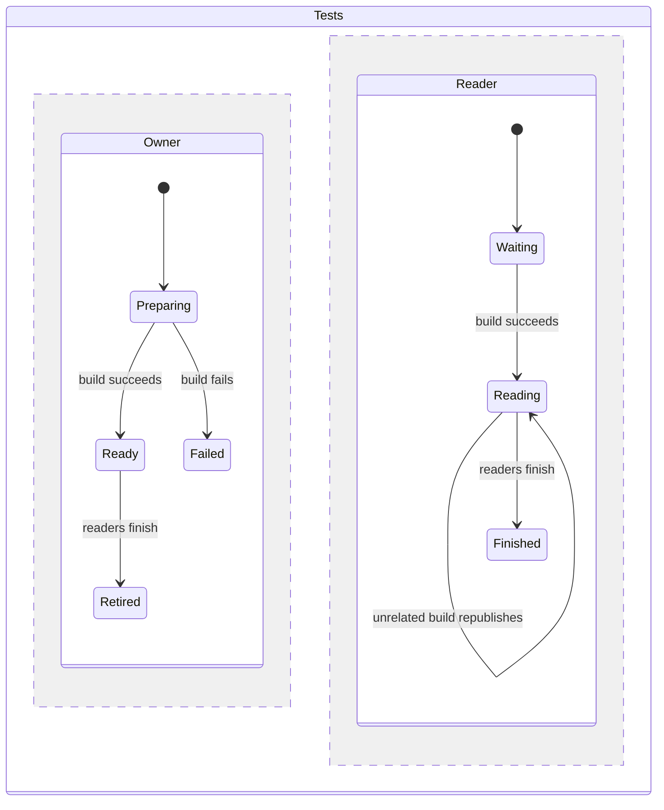

# Decoder build ownership design

The repeated failures share the premise that Cargo's build lock makes its public executable safe for readers after a build returns. J592's real Linux syscall trace disproves it. Three tally rows concern the same shared debug executable, across build-fixtures and task-candidates; these are occurrences, not evidence of three earlier attempted fixes.

1. Atomic publisher. Build in private staging, copy to a same-directory temporary file, rename over a consumer path. Enforce with concurrent readers observing only complete old/new versions. POSIX rename preserves destination visibility during replacement. Requires every writer to use the publisher; Cargo does not, so consumers must still move away from Cargo's path.
2. Reader-inclusive file lock. Hold a common advisory lock across build and every execution. Enforce with a blocked competing builder until the reader releases. All raw Cargo users must cooperate; serializes unrelated suites and is easy to bypass.
3. Per-suite target directories. Give each suite its own temporary Cargo target. Enforce distinct target paths under concurrent builds. Removes the sharing but recompiles dependencies for every suite.
4. Build once in a private target, share the finished artifact read-only with children. Enforce that children execute the prepared artifact without rebuilding and unrelated Cargo builds cannot remove it. Standalone suites own their own temporary target. Chosen. No shared mutable publication path, no lock protocol, no retries.

Sources: Cargo Book https://doc.rust-lang.org/cargo/reference/build-cache.html documents --target-dir/CARGO_TARGET_DIR and final executable locations. POSIX rename https://pubs.opengroup.org/onlinepubs/9799919799/functions/rename.html defines atomic destination replacement (Open Group fetch refused HTTP 403 this session; the directly read Linux manual https://man7.org/linux/man-pages/man2/rename.2.html corroborates atomic replacement). Cargo lock covers compilation, not a later consumer's process lifetime, as demonstrated in J592.

Data shape: one Path returned by test_binary(), backed either by a parent's completed private build or a process-owned TemporaryDirectory. Gates owns preparation lifetime; suite processes own standalone lifetimes. No persistent cache, eviction, stale reads, queues, database, external API, circuit breaker, or idempotent record writes. One bounded cargo subprocess (180 seconds) per owner; failure refuses execution. Today and 10x suites share one prepared build per gates invocation. Independent gates jobs own distinct directories. CPU/build time and disk are first capacity limits, not consistency. Cleanup follows the temporary directory owner on success and failure.

Statechart (build owner and reader are independent):

Test plan: deterministic competing publisher pauses in the proven unlink/link window while the original build-fixture suite reads. On main the public path disappears. On the fix the reader uses another owned path. Tests also cover preparation failure, parent artifact reuse, and standalone cleanup. Retain actual golden decoder suites as end-to-end proof; the synthetic publisher models syscall scheduling, not Cargo internals.

Build slices: failing regression commit, private-build helper plus all debug consumers, local gates and push. Production proof is hosted gates shards green on main after coordinator merges, then the next merges. Worker cannot claim that proof before merge.

Additional primary sources: Linux flock https://man7.org/linux/man-pages/man2/flock.2.html documents advisory exclusion, including independent opens in one process. GitHub Actions https://docs.github.com/en/actions/tutorials/store-and-share-data documents producing artifacts once and sharing them with dependent jobs. Here the same ownership pattern stays local to one gates process.

Prototypes executed in /tmp/J602-alternatives.py: atomic rename preserved 100 complete executable reads; a reader-inclusive lock refused a competing writer until release; a private executable remained readable after deleting the shared path. No prototype introduced a shipped dependency.

Model check: the chart compiler emitted an intentionally permissive skeleton. Added the real preparation-success and all-readers-finished guards from ops/ci-gates.py before checking. TLC checked TypeOK and the three never rules with zero errors (4 distinct states). Failure and retirement are intentional terminal states; deadlock checking was disabled. The model omits Cargo internals, operating-system termination, and fixture semantics. The real Cargo trace and golden-output test cover the publication mechanism independently.

Actual Linux evidence: Cargo 1.90.0 and 1.99.1 on native arm64, with strace delaying the real unlink return by two seconds. The shared reader raised FileNotFoundError; the private reader matched folder-04c2 golden in that same window; both build subprocesses completed successfully. The portable regression controls the equivalent publication schedule with events; it does not pretend to emulate Cargo compilation.
