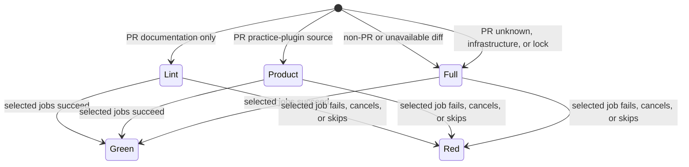

# CI path selection

`ops/ci.sh` delegates to the Python controller. `ops/ci_scope.py` owns path selection for both that controller and GitHub job scheduling. Only pull requests select automatically. Local callers opt in with `--changed-from <base>`; normal local checks remain full.

The selector compares the merge base of the event's immutable base and head SHAs with the head. Renames expose both old and new paths. Empty diffs, missing Git objects, malformed events, and unknown paths require every class. Merge groups, pushes, scheduled runs, and manual workflows require every class.

## Class map

All rows include unknown paths and changes under `ops/`, `.github/`, `contracts/`, `migrations/`, or any package lock or dependency manifest. Those changes invalidate CI itself or its inputs and select the full suite. All MCP changes run full migration proofs because those proofs execute MCP consumers and registry contracts.

| Class | Other paths that affect the class |
| --- | --- |
| lint | Every path. Whitespace and the existing secret qualification run for guidance. |
| pushfloor | Every product path. Diff admission, path shape, migration claims, and projection consistency. |
| unit | Every product path except an isolated Rust vendor change, which conservatively still runs full. |
| types | Python, MCP, and practice-plugin code and their configuration. Unknown inputs run full. |
| gates | Every product path. Repository-wide invariants and selftests can consume any source. |
| secret | Every path. Documentation-only lint retains the same secret runner. |
| dependency | Dependency declarations, locks, and unknown paths. Practice-plugin source alone cannot change installed dependencies. |
| migration | MCP, Python consumers, database inputs, and unknown paths. Isolated practice-plugin source does not affect PostgreSQL proofs. |
| binding | Worker configuration, MCP source, artifact pins, and product paths. |
| artifact | Registry, native rules, release artifact pins, and product paths. |
| hxprobe | `vendor/hxprobe/**`, Rust manifests and locks, and unknown paths. |

Documentation patterns are explicit. `docs/**`, `.agents/skills/**`, `tools/pstack/*.md`, `AGENTS.md`, `CLAUDE.md`, `README.md`, `CONTRIBUTING.md`, and `CHANGELOG.md` select only lint. A Markdown prompt under `mcp-server/src/` remains product. Infrastructure overrides documentation, so `ops/README.md` still runs full.

`practice-plugin/**` without lock changes selects lint, pushfloor, unit, types, gates, secret, binding, and artifact. Everything outside that proven independent package and the documentation patterns runs full. This deliberately favors extra checks over an unproven dependency graph.

## GitHub scheduling and verdict

GitHub's native `needs` and job conditions schedule existing lanes from the selector's class list. Documentation schedules one lint job. The controller applies the same selection to explicit `--only` groups. Full PRs use the existing complete class matrix and migration fixtures. Merge groups keep those full lanes. The main canary retains its existing exact-tree evidence reuse and trigger policy; its class controller never applies PR selection.

The required `ops/ci.sh --strict` aggregate always reports. It requires successful selection and every selected job to succeed. Only jobs excluded by that selection may be skipped. A failed or cancelled selector or selected job cannot produce a green aggregate. Draft PRs retain their existing deferred failure.

## System design

Two candidates were compared. [GitHub documents](https://docs.github.com/en/actions/reference/workflows-and-actions/workflow-syntax#onpull_requestpull_request_targetpaths) that path-filtered workflows can leave required checks pending. Workflow-level path filters are smaller but can leave a required check pending and cannot share selection with local checks. Native job conditions plus one Python selector preserve the aggregate and the canonical CLI. No new scheduler, dependency-graph service, or third-party action is required.

Selection is stateless. Its decision flow and tests are:

`test_changed_path_selection` covers each selection transition, including real merge-base discovery and credential refusal. `HostedVerdict.test_pr_selection_requires_every_selected_job` covers success, failure, cancellation, and skip for every selected job in all three paths. `HostedVerdict.test_pr_selector_failure_and_unexpected_skip_cannot_pass` covers failed selection and inconsistent scheduler results.

The selector stores no state. Its data is a set of classes plus a reason and the changed path list. It runs two bounded Git commands over one diff. At current load and ten times the changed paths, work grows linearly in path count; checkout history transfer is the first limiting cost. GitHub retains responsibility for queues, concurrency, execution, and cancellation. There is no cache, database access, network call, retry, write, or idempotency key inside the selector. Failed diff discovery selects full checks. Failed scheduling fails the aggregate.

## Measurement

The sample is the latest 50 merged PRs returned by one GraphQL query, ordered by update time. The query reads changed paths and the latest CI check suite available among the first five suites on each PR head. The committed CSV records each PR, paths, run URL, terminal aggregate result, elapsed CI check time, and summed job minutes. It does not include runner queue time before the first check starts. Four suites expose no check runs and are excluded from timing. The sample contains 35 successful and 11 failed aggregate checks. Failed runs stay in the sample and are identified. This is an observational baseline, not a controlled speed comparison.

All 50 diffs contain infrastructure or unknown inputs and therefore retain full selection. The 46 timed runs average 9.54 minutes, with median 9.40 and range 0.20 to 38.20 minutes. This sample provides no measured historical docs-only cohort and predicts no savings for those mixed diffs.

The separate guidance-only control is PR 3028. Its CI checks ran from 08:35:28 to 08:44:38 CST, or 9.17 minutes. Its existing secret job succeeded in 2.62 minutes. Reusing that job's dependency installation and secret qualification, plus a 0.50-minute allowance for selection, whitespace, and aggregate overhead, projects 3.12 minutes for the new docs lane. That is a projection, not a measured hosted after result. The original control failed fast/gates proof admission, so its 9.17 minutes must not be described as a successful baseline. Local admission of its unchanged body and `tools/pstack/routing.md` now succeeds.

Local selftests execute a real committed documentation diff through the shell controller, assert lint-only timing, and prove that a credential refusal fails that lane. Aggregate tests exercise documentation, product, and full selection with every required job failing, cancelled, and skipped in turn. The pinned PR 3028 guidance diff also passed the real local lint lane in one 36-second run, including the full secret qualification. This local smoke test ran during other local checks and excludes hosted installation and scheduling. It is not a cloud speed comparison. The full infrastructure PR must pass hosted checks before review handoff.

## MCP shard estimates

Discovery owns the suite set. `suite-inventory.json` is a minimum count, so adding a suite does not require changing that file. Receipt verification requires every discovered suite exactly once, one receipt per planned shard, and nonempty shards.

`ops/config/ci-unit-durations.json` is an advisory timing snapshot. Feature PRs do not add timing entries. A suite absent from the snapshot gets a 60,000 ms serial estimate, independent of old or retired entries. Removed suites are ignored. This is a planning allowance, not a measured duration or an execution timeout. Existing measured suites retain their estimates, including serial classification and cold snapshot setup. The planner adds shards up to the existing 16-shard cap to keep each predicted workload at or below 480,000 ms, with the unchanged 600,000 ms execution watchdog. Genuine estimated workload overflow still refuses admission; stale membership alone does not.

For the 461-suite comparison, both an advisory snapshot (A) and a prototype with one JSON file per measured suite (B) produced seven shards with maximum estimated time 458,598 ms. Adding one unmeasured suite produced seven shards at 466,579 ms in both. These are planner estimates executed against the same snapshot, not measured hosted runtimes. B required 461 timing files plus setup metadata and a different loader. A deletes the mandatory-entry check and keeps the existing loader and refresh interface. A is the chosen design. Subtract Before You Add and the Laziness Protocol favor removing admission coupling over migrating timing state.

Timing refresh is maintenance, separate from feature delivery. After a successful full main run, retain its complete `suite-timing` log lines and use `python3 ops/ci_unit_shards.py timings <logs...> --source-run <run-id> --output <candidate.json>` to generate a candidate snapshot. The command refuses missing, duplicate, or unexpected timings. Review the candidate against the existing file before a maintenance PR; that file also contains gate budgets and measurement annotations. This change adds no automatic writer, credential, or scheduled job. Old snapshots remain usable without requiring feature PR repairs.

`ci-floor-verdict` distinguishes failed local push-floor classes (`pushfloor`, `secret`) from failures relocated to hosted CI (every other class). `relocated` does not mean a passing test or a missing timing entry. The command still returns its failure verdict. The suite discovery floor is a separate minimum-inventory check.
