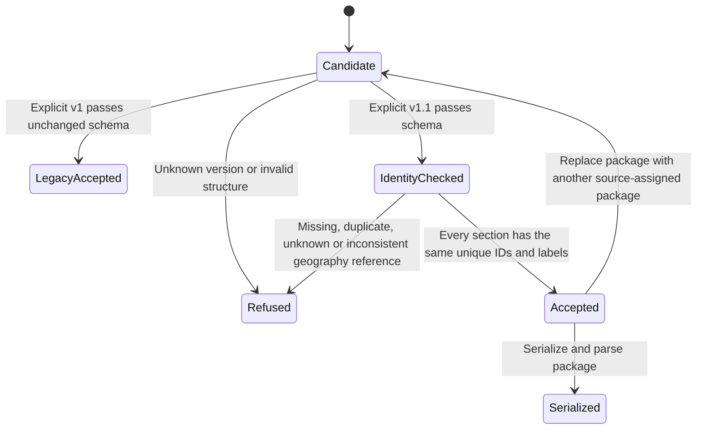

# Core demographic geography identity

## System design

This is a medium, single-session contract build. The producer owns source-assigned geography IDs. The package validator owns structural and cross-section checks. The app owns selection by ID in a separately dispatched consumer change. No AI output changes.

Today the package validator checks the v1 JSON Schema in full or research mode. The pending composer overlays reviewed record groups and calls that validator twice. Demographics are research-owned and pass through unchanged. There is no publisher in this checkout. Composer integration waits for PR #2998 at `0af86bbeeebefeff4479d10b18b0e828b2f88aee`.

Two designs were considered. A new geography registry would normalize names but require consumers to replace every row shape. Adding source-assigned IDs and explicit display labels to the four existing row collections keeps the consumer interface small. The latter is the chosen design. Growth rows define the geography set. Age, median-income and income-band rows reference exactly that set once each, in any order.

The new wire version is `carr.market-study.v1.1`. Its schema reuses unchanged v1 definitions by reference. The v1 schema and fixture stay unchanged. The validator selects by explicit version and never upgrades a package or generates an ID. IDs are opaque, source-assigned strings of at most 128 ASCII identifier characters. Names and positions never determine identity. The same source geography retains its ID across package replacement. A changed geography gets a new ID. Cross-publication identity history remains a producer obligation, not something a stateless validator can infer.

Every core row requires `geography_id` and `geography_label`. Labels must agree for the same ID across sections and distinguish different IDs. `name` remains the source name, so two geographies can both be named Springfield while their labels identify the state or radius. The fixture is a synthetic overlay on the unchanged example-health package and is the exact input for consumer contract tests. Optional micro-zones retain their separate existing IDs and radius semantics.

Validation uses local immutable schema validators and per-call maps and sets. Work and memory are linear in row count, including at 10x load. There is no cross-request state, cache invalidation or eviction. Synchronous validation refuses invalid or unknown versions before composition. There is no database access or N+1 query, async producer, queue, network call, retry, breaker, alert or rate-limited external fan-out in this change. There is no write or send requiring an idempotency key. Repeated validation is deterministic and leaves inputs unchanged. JSON serialization preserves strings exactly. Package replacement starts a fresh per-call identity set, so no previous package leaks into the next validation.

## State transitions and test obligations

Tests cover every edge through `validateMarketStudyPackage`, including same names, independent row order, full and partial mode, package replacement and serialization. The pre-change validator must refuse the v1.1 fixture. Production publication and the app loader remain unproven until the coordinator runs the separately authorized proof against exact releases and a publication revision.

## Throughput checkpoint

- Blocking first steps are old-schema refusal and checking the current holder file sets.
- Independent workstreams are not applicable. The schema and validator implement one contract.
- Shared mutable state is not applicable. All request identity maps are local to validation.
- The smallest safe decomposition is one worker for schema, validation and synthetic tests. Composer integration follows its holder.

## Migration policy

Existing v1 publications retain their version and bytes. Consumers must treat v1 as legacy and must not infer IDs from its labels or positions. A source owner must supply verified identities before explicitly republishing as v1.1. No private package is migrated by this change. Deploy the version-aware loader before publishing v1.1 to clients. Unknown versions are refused.

## Design and debt pass

Codebase-design keeps structure and identity validation behind the existing `validateMarketStudyPackage` interface. The versioned schema references unchanged definitions instead of copying the full contract.

Zero-tech-debt retains v1 because persisted publications are real consumers. It adds no automatic migration, name matching, positional fallback, or identity cache.
