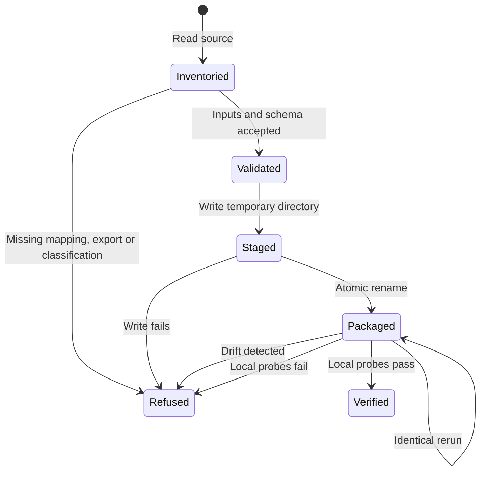

# Private portal migration rehearsal

The offline converter accepts a source directory, a private `migration.json`
descriptor and a property mapping. Output belongs under ignored `out/`.
It neither publishes nor registers portals. Never commit private inputs.

The descriptor has `study` in the existing `carr.market-study.v1` shape,
`pages` as view IDs, `files` as `{path, classification}` entries, and
`selections` as exported rows. Classification is `content` or `financial`.
Every source file must be classified. Financial files are recorded by path
and hash but never copied. Review financial prose while preparing `study`.
File classification cannot identify financial meaning inside arbitrary prose.

The mapping binds each renderer property slug to a canonical CARR UUID.
Keep read-only lookup receipts beside it. UUID syntax alone does not prove
that a record resolves. A binding sidecar retains renderer slugs without
changing the existing market-study schema.

```sh
python3 tools/client_portal_migration.py inventory /private/source out/manifest.json
python3 tools/client_portal_migration.py convert /private/source /private/mapping.json out/package
python3 tools/client_portal_migration.py verify out/package
```

Inventory reads regular files, JSON assignments and HTML view IDs without
executing JavaScript. Saved selections held in D1 are absent from static
bundles. Supply an authorized export including version and retired IDs.
An explicit empty export is valid. Missing exports are unknown.

## System design

One Python module owns inventory, conversion and local parity. The existing
market-study validator owns schema validation. A private descriptor makes
handwritten interpretation explicit. Automatic HTML-to-schema guessing was
rejected because it could omit content or preserve financial prose unnoticed.

One synchronous process handles at most 2,000 files and 256 MiB. Larger input
refuses. There is no fan-out, database, queue, network call or shared cache.
At ten times the limit, input refuses before conversion. The local schema
subprocess has a 30-second deadline and fails closed on its first error.
No external-call circuit breaker, eviction, retry or N+1 policy applies.

The converter validates all inputs before writing, stages a private sibling
directory, then renames it once. Deterministic bytes and hashes identify each
write. Identical reruns return the existing result. Drift refuses. Existing
packages survive failures unchanged. A process crash may leave an unreferenced
temporary sibling, which never looks like a complete package.

## Rehearsal states



Local probes compare saved rows, pages, exclusions, bindings and asset hashes.
The package also carries an unchanged copy of the canonical portal parity
probe set for the existing harness. Stage 1 checks package field coverage;
stage 2 requires the rendered staging site. The synthetic acceptance test
runs only rows V-S14 and V-S28 against the converted fixture, not a full-site
parity claim.
They do not prove browser behavior, URL/password continuity, live selection
freshness or rollback. Those remain S4 staging and cutover checks.
