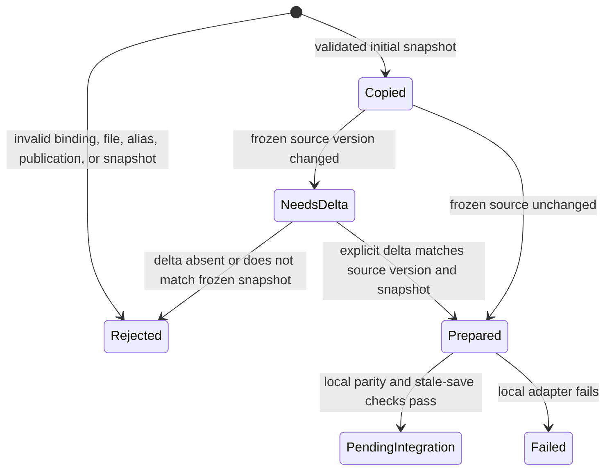

# Synthetic portal migration rehearsal

This preparation exercises local fixtures only. S21 staging acceptance and production proof remain pending.
The plan and schema originate at `865fefee26fcbbe50a04c7515c5f3d3bc8913cd1`.
The later flexible-page ruling controls page composition. This tool imposes no page order or template requirements.

## System design

The Python module owns a bounded synthetic manifest and validates portal bindings, file aliases, publication revisions,
and Tour List copy/freeze/delta snapshots. The JavaScript adapter owns disposable loopback HTTP fixtures and invokes
`runParity` and `sourceFidelity` from the existing parity implementation. It owns no production transport or UI.
Caller usage is `python3 tools/portal-migration-rehearsal.py client-portal/fixtures/migration-rehearsal.json`.
The command emits one JSON receipt on stdout. Redirect it into a private evidence directory for a staging handoff.

Two designs were considered. Extending the production parity runner with migration state would mix copy validation
with comparison. A separate Python validator plus a narrow local adapter keeps migration rules out of the parity engine.
The second design is selected. No production module changes.

Capacity is four portals now. A 1 MiB input limit and 32 files per portal bound work and memory.
Ten times the file load remains bounded by that limit. More portals require a new rehearsal contract rather than silent truncation.
Load spread and scaling are n/a because this is one offline process. No cache, invalidation, eviction, database access,
Postgres N+1, queue, async producer, or send exists. Snapshots require exact consistency. Missing data refuses preparation.
Local servers start sequentially, use ephemeral ports, run comparisons sequentially, and close in finally blocks.
The Node subprocess has a 60-second timeout. It has no retry. A local adapter error fails the receipt and alerts on stderr.
External-call breakers and API rate limits are n/a because the adapter cannot accept external URLs.
Source file checks retain the parity engine's 150 ms pacing. Each fixture has bounded request bodies and server timeouts.
Writes are synthetic compare-and-swap requests with an expected version, so stale replay returns 409.
The receipt is deterministic JSON with a manifest SHA-256 identity. No file, registration, routing, import, or password is changed.

## Statechart and test obligations

`Prepared` means the synthetic copy is consistent. It never authorizes cutover.
Tests cover rejection categories, changed and unchanged snapshots, stale saves, adapter failure, and pending integration.
The chart models an offline validator. It makes no claim about deployed session or publication behavior.

## Throughput checkpoint

- Blocking first steps are contract inspection and manifest rejection tests.
- Independent workstreams are n/a because a single worker owns the coupled manifest and adapter.
- Shared mutable state is confined to one disposable HTTP fixture per comparison.
- The smallest safe decomposition is one validator and one adapter that imports the existing parity runner.

## Rehearse staging with the existing plan

All steps are required in a separately authorized staging job. Real inputs and receipts stay outside Git.

1. Resolve four distinct deals and confirm each existing slug and password in the partner desk session.
2. Register each portal with its existing slug and proven current password.
3. Publish the reference packages and hash-check both legacy bundles, including recovery aliases.
4. Export Tour Lists with versions, retired entries, per-property notes, and legacy notes.
5. Run full Stage 2 for both reference sites and HTTP probes for every legacy slug and file.
6. Freeze old-host saves and record each changed version as an explicit delta before cutover readiness.
7. Rehearse route rollback on staging and bind the staging reports to the migration receipt.

The source is [the migration plan](standard-site-design.md#migration-that-keeps-every-address-and-password-working-ac1).
No step above runs automatically. Missing S9 transport or S10-S17 UI reports pending integration.
After eventual cutover, a separate read-only verifier opens every old address with an authorized session,
reads one file and Tour List, and matches the publication and retained version to the release and migration receipt.
Until that proof passes, the product remains landed-unproven.
