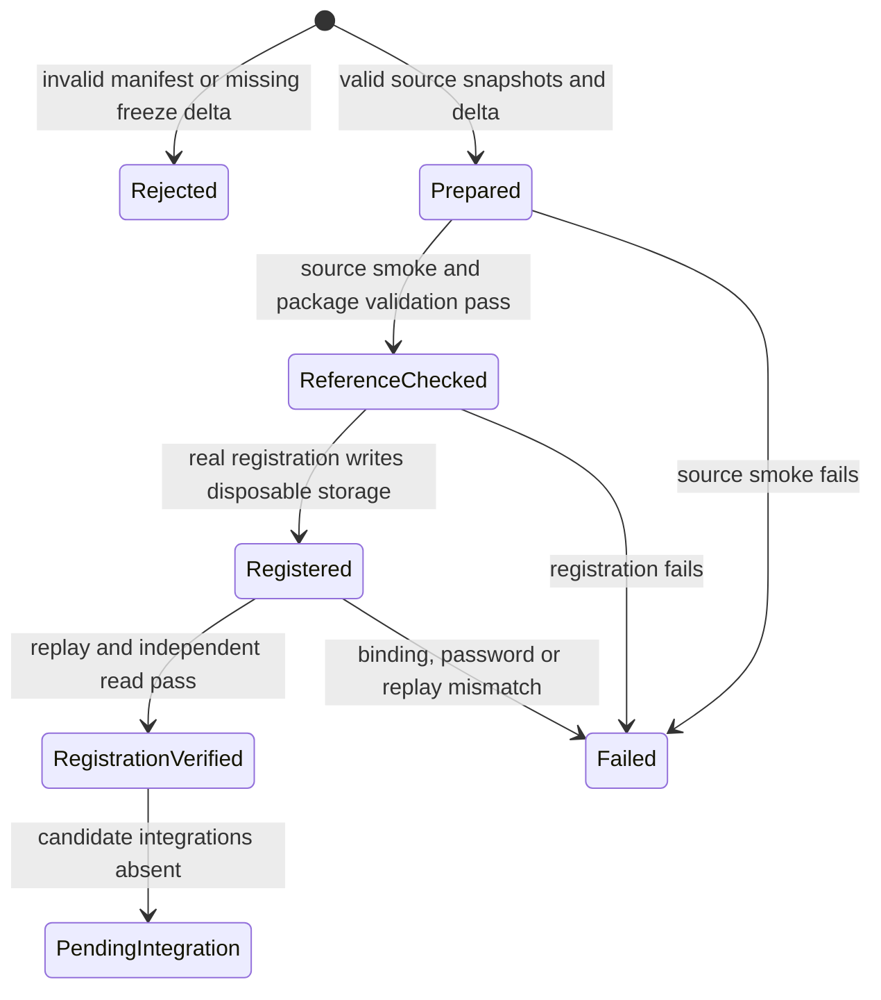

# Synthetic portal migration rehearsal

This rehearsal checks a synthetic reference and real portal registration in disposable PostgreSQL.
It reports publication, bundle and alias import, Tour List import, Tour List persistence, client-view publication, and HTTP parity as pending.
S21 staging acceptance and production proof remain pending. `cutover_ready` is always false.
The plan and schema originate at `865fefee26fcbbe50a04c7515c5f3d3bc8913cd1`.
The later flexible-page ruling controls page composition. This tool imposes no page order or template requirements.

## Run and read the receipt

Run `python3 tools/portal-migration-rehearsal.py client-portal/fixtures/migration-rehearsal.json`.
The command requires the repository's Node dependencies and local PostgreSQL binaries.
The command emits one JSON receipt on stdout. Exit 3 means pending integration, 1 means a failed check,
and 2 means rejected input. A pending result is not a successful migration.
The Python receipt preserves the candidate's named failure message.

`local.reference` describes synthetic source smoke checks only. It retains file and alias fidelity,
Tour List source versions, retired entries and notes, and canonical Stage 1 package validation.
`local.steps.portal-registration` describes the real registration handler and SQL execution.
Every other named step includes a pending reason and its known dependency. Reference smoke cannot satisfy a candidate step.
The rehearsal does not implement synthetic candidate saves or fabricate an imported selection from a deep copy.

## System design

The data shape is a prepared source manifest plus named migration step results.
`prepare` owns the bounded manifest and validates bindings, file hashes, aliases, publication revisions,
and copy/freeze/delta snapshots. `freeze` remains a source expectation, never a candidate result.
`runMigrationFixtures` owns the synthetic reference HTTP server and invokes the existing parity functions.
`registerCandidate` owns the disposable database and calls `clientPortalTools` through its existing dependency seam.
The registration handler and canonical SQL migrations are real. No production implementation is edited.
The envelope, event sink, and UUID subject resolver are synthetic infrastructure.
No deployed authorization, envelope audit, production registration, or full migration claim follows from this test.

Two designs were compared. Keeping a candidate HTTP fixture with optional handlers would leave fake fallback behavior.
Removing that candidate and testing real steps directly prevents a fixture response from counting as migration evidence.
The second design is selected. The existing parity engine remains available for the future real HTTP candidate.

Capacity is four portals with a 1 MiB manifest and 32 files per portal. Ten times the file load stays bounded by those limits.
More portals require a new rehearsal contract. One disposable database serves sequential registrations.
Each registration is replayed once, then read through a separate connection to prove committed binding and password compatibility.
The read also verifies client and deal isolation. Database work is bounded per portal with no variable-length nested query loop.
Synthetic source writes carry revisions. Registration writes carry UUID idempotency keys and verify the SQL's existing-result replay.
No parallel fan-out, cache, invalidation, eviction, queue, or external API call exists.
Scaling and load spread are n/a for this bounded offline command. The database helper owns isolation and crash cleanup.
The subprocess deadline is 180 seconds, including resource-lease acquisition, with no retry on failure.
Reads require exact consistency. A missing row, wrong binding, changed password, or changed URL fails by name.
Local servers use ephemeral loopback ports and bounded bodies and close in finally blocks.
The source fidelity reader keeps the parity engine's pacing. External circuit breakers are n/a because there are no external calls.
Missing integrations refuse readiness. A local failure produces a failed receipt rather than a pending or passing candidate step.

## Statechart and test obligations

Python tests cover rejected input, changed and unchanged snapshots, explicit deltas, reference failure,
named candidate failure, pending exit status, and refusal of the former fixture-only PASS result.
Node tests exercise healthy real registration and mutate the installed real SQL's slug write and password write.
Both mutations must fail the rehearsal with `portal-registration` in the reason.
No selection-import or compare-and-swap mutation test is claimed while those real steps are pending.
The chart is an executable-test guide, not a formal verification claim.

## Pending dependencies

The inspected main contains registration but no market-study publication, legacy bundle and alias importer,
version-preserving Tour List importer, or portal Tour List persistence implementation.
No supplying branch for those steps was verified during this fix. They remain named gaps rather than fixture implementations.
The held branch `wr227-s9-j1` at `cc16e75fdc219e7c471536a72c56a9657fd19e0d` supplies portal HTTP sessions and projection.
It does not supply package, alias, or Tour List migration. It is a prerequisite for HTTP parity, not its full implementation.
The held branch `wr586-s4-j1` at `541e47ffce83bbd6cb591545417be0dd91a3ea0c` supplies explicit client-view publication.
That milestone and deliverable projection is separate from market-study publication and selection persistence.
Neither held branch is imported into this rehearsal or counted as exercised code.

## Throughput checkpoint

- Contract inspection and regression tests precede implementation.
- One worker owns the coupled validator and adapter. No delegated work runs.
- Reference state lives in one disposable HTTP server per source check. Candidate state lives in disposable PostgreSQL.
- The host-wide PostgreSQL fixture lease can delay execution. A deadline failure stays visible as a failed check.

## Rehearse staging with the existing plan

All steps are required in a separately assigned staging job. Real inputs and receipts stay outside Git.

1. Resolve distinct deals and confirm each existing slug and password in the partner desk session.
2. Register each portal with its existing slug and proven current password.
3. Publish reference packages and hash-check legacy bundles, including recovery aliases.
4. Export Tour Lists with versions, retired entries, property notes, and legacy notes.
5. Run full Stage 2 for reference sites and HTTP probes for every legacy slug and file.
6. Freeze old-host saves and record changed versions as explicit deltas before cutover readiness.
7. Rehearse route rollback and bind the staging reports to the migration receipt.
8. Verify the receipt names every real step and leaves no migration check pending.

The source is [the migration plan](standard-site-design.md#migration-that-keeps-every-address-and-password-working-ac1).
After cutover, a separate read-only verifier opens every old address with an authorized session,
reads one file and Tour List, and matches publication and retained version to the release and migration receipt.
Until that proof passes, the product remains landed-unproven.
