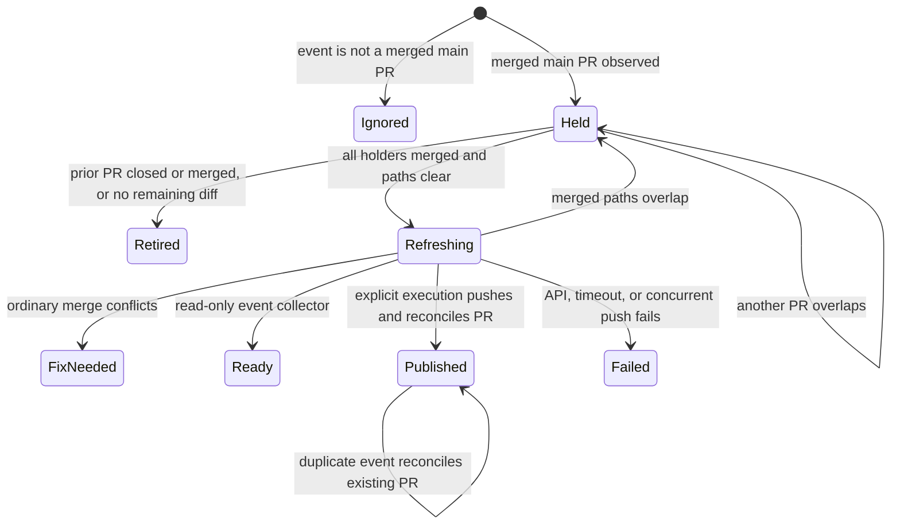

# Held branch release

The trusted main manifest `.github/held-branches.json` records branches, their build Card, and every holder PR. Entries never execute commands or contain credentials. An empty manifest deliberately enrolls no historical branches. The coordinator must enroll audited branches separately. The PDF admission branch belongs to WR823.S15.J5 and is not enrolled here.

The initial slice collects read-only candidates on GitHub. The trusted coordinator must wire artifact consumption to `--execute`; that integration is not implemented here. Live Actions settings returned `can_approve_pull_request_reviews=false`, so the built-in token cannot create PRs in this repository. No credentials are added to work around it.

## System design

`ops/held-branch-release.py` owns admission and reconciliation. GitHub owns merged events, serialization, Git refs, PR identity, CI, and review. Git owns merge computation and non-forced push rejection. No custom scheduler or queue is introduced. The interface is one event plus a trusted manifest and a JSON receipt. Compare an event-only candidate collector with direct reconciliation. Direct reconciliation avoids a second consumer and crash-sensitive job ledger.

The workflow checks out only trusted main code. Held code is never executed. Temporary Git worktrees disable hooks. Each reconciliation checks all holders live, then checks changed paths against every open PR, merges main locally, and checks paths again. Default mode emits a ready candidate. Explicit `--execute` pushes without force and reconciles the PR. Existing PRs keep their body and title. The workflow emits candidates; only the trusted coordinator invokes explicit execution. A closed PR is never reopened automatically. A merged or empty branch is already released. A conflict becomes a deterministic `fix_job` in the uploaded receipt. It never resolves conflict hunks or launches an unregistered agent.

Capacity is capped at 100 branches, 20 holders per branch, 100 open PRs, and 3000 changed paths per PR. The GitHub CLI paginates file reads; a full PR-list page refuses rather than hiding additional PRs. At 10x load the cap refuses and requires partitioning. Reads cache holder status within a run; caches expire with the process. Open PRs refresh before each branch and after each merge. No database or N+1 storage access applies. PR file reads are bounded N+1 GitHub requests. External calls have a 45-second deadline. Any external failure stops the run without retries or further writes; native workflow failure is the alert. Worktree cleanup runs on every exit.

A single workflow concurrency group serializes admission. Pending events may coalesce, so each run reconciles the whole manifest rather than only the event's holder. An ordinary push detects concurrent branch movement. A last-moment unrelated PR open cannot be atomically excluded with GitHub's PR API; this remains a documented race requiring coordinator reconciliation. No custom distributed lock would make GitHub PR creation transactional.

Idempotency derives from live branch ancestry and PR lookup. After a lost push response, retry fetches the updated branch. After a lost create response, retry discovers the existing PR. Fix-job identity binds Card, branch head, and main head. The receipt is a routing artifact for the existing coordinator, not a claim that a fix agent was launched.

The workflow uses only the built-in GitHub token. GitHub may disallow Actions PR creation by repository setting. Its resulting PR workflow runs require native approval. This change does not configure an App, transfer credentials, approve workflows, or arm merges. See [GitHub token behavior](https://docs.github.com/en/actions/concepts/security/github_token).

## Throughput checkpoint

- Blocking first steps. Read the platform audit, S14 branch, and every open PR's file list before editing.
- Independent workstreams. One builder owns this coupled script, workflow, and acceptance tests. No fan-out.
- Shared mutable state. GitHub serializes this workflow; ordinary push rejects concurrent branch updates. Open-PR admission refreshes between branches.
- Smallest safe decomposition. A single reconciler hides holder and overlap policy behind one entry point, with Git and GitHub as existing adapters.

## Statechart

## Production proof

After merge, enroll a synthetic held branch with two synthetic holder PRs. Observe the installed workflow ignoring a closed-unmerged holder, retaining the branch after only one merge, and creating exactly one PR after both merge. Replay the event and verify the same PR number. Observe a synthetic conflict producing a fix_job receipt without any branch update. Observe overlap retention and ordinary merge ancestry. Verify new source CI and independent review before the coordinator arms that PR. These effects require coordinator authority and are not claimed by the builder's synthetic local tests.
