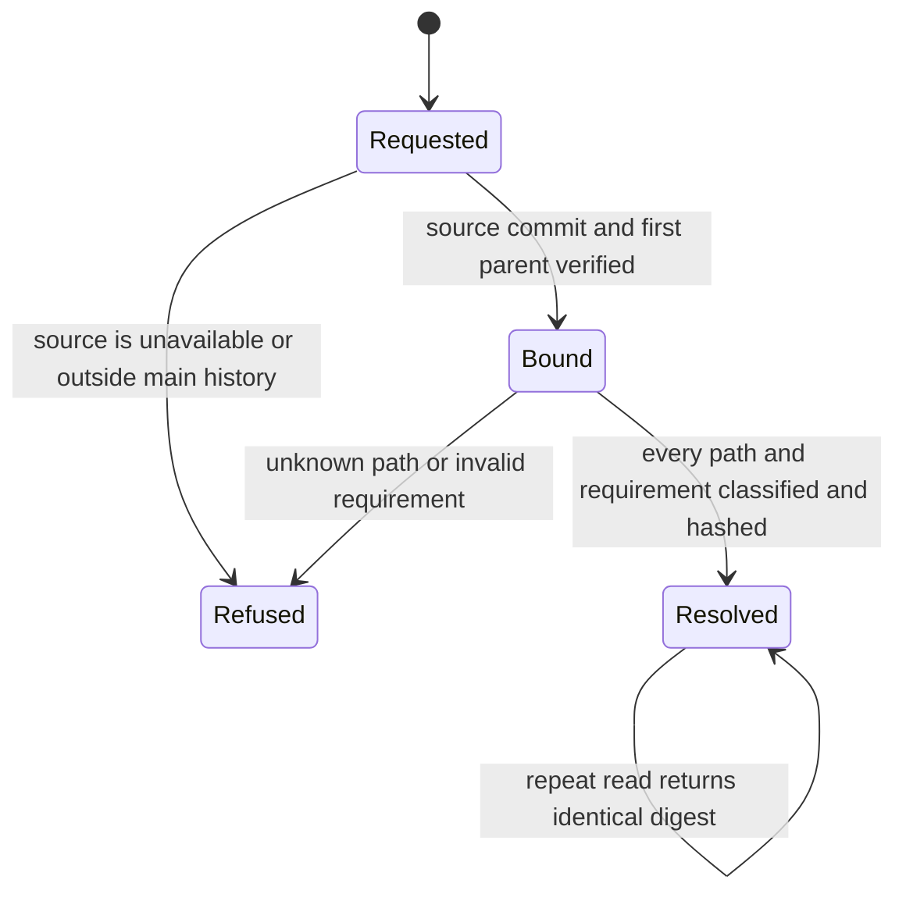

# Immutable delivery plan resolution

Resolution is a read, with no release or proof-state transition. A resolved plan
is never evidence of execution. Tests in `ops/delivery-plan-selftest.py` cover
each edge, renames, deleted requirements, mixed lanes, and dirty working files.

## System design

A single classifier in `ops/delivery_plan.py` reads admission policy and the
versioned lane inventory. Admission calls it for product paths and required
targets. The resolver reads only immutable Git objects, binds first-parent main
history, and returns a sanitized canonical JSON plan. No SQL or mutable record
store is added. Persisted observation acceptance remains a later slice.

Two designs were considered. A second resolver-specific path table would drift
from admission. The chosen classifier shares the existing admission policy and
adds only lane inventory, with explicit control and documentation dispositions.
The organizing data shape is a commit-bound plan containing sorted lane sets,
source references, requirement content hashes, and registered observer bindings.

At current and tenfold commit rates, resolution is independent per commit and
uses no shared mutable state. Git object reads scale with requirement count,
not assertion count. Bounds are 10,000 changed paths, 100 requirements, 16 source
files per observer, 1 MiB per file and response, and a 60-second total deadline. The deadline
or input bounds fail closed. No cache is needed; immutable Git objects are the
storage cache. No stale fallback, queue, write, send, network call, retry, or
external circuit breaker applies. Failures return nonzero without a plan.
Idempotency follows from canonical JSON hashing, independent of working files.

Throughput checkpoint. Blocking steps are source grounding, inventory and tests.
Independent workstreams are n/a because one worker owns this coupled classifier.
Shared mutable state is n/a because resolution only reads Git objects. One PR
is the smallest safe decomposition because admission must use the same code.

## Read contract

`python3 ops/delivery-plan.py --main-sha FULL_SHA` resolves one local
`origin/main` first-parent commit. It does not fetch, execute observers, inspect
PR bodies, accept receipts, or write records. Refresh the local remote ref
before a production read. The main ref is the trusted input from the source
admission caller; this CLI does not independently authenticate GitHub.

Each runtime-changing commit must add or change its requirement JSON under
`proofs/requirements/`. An unchanged requirement referenced only in a PR body
is refused because mutable admission text cannot be final proof authority.
Deleted requirements are refused. This slice does not migrate old commits to
that landed-file protocol, store accepted plans in CARR, or deploy a remote
reader. The versioned projection is ready for that subsequent integration.
No delivery verbs appeared in the live registry of 410 verbs during this build.
OIDC exchange remains unproven and no reader secret is provisioned.

`app` in a CARR plan requires downstream compatibility evidence. It grants no
app deployment authority. `control` requires source conformance. `docs` requires
committed-content verification. Neither disposition attests runtime execution.
The inventory conservatively classifies local tools, templates, skills, and
installed Markdown as Studio sources. Only the admission policy's explicit
non-product allowlist exempts paths. Test and CI-only paths use the control lane.

The statechart conversion wrote a TLA skeleton under
`scratchpad/wr823-s6-j1`, then exited 2 because TLC is unavailable. The chart
is checked by behavioral tests, not a formally verified model.
