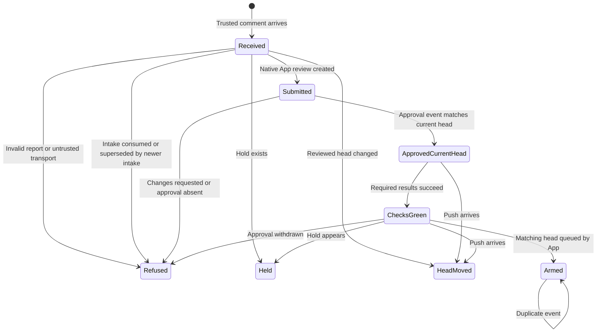

# Verdict delivery

The review worker writes its verdict file and then runs `python3 ops/verdict-delivery.py publish --number N --body-file /absolute/review.md` using the configured transport account. The command stores a durable PR comment. It does not post a native review. A successful comment is the admission receipt. A transport timeout can create duplicate comments; the consumer deduplicates identical App reviews by SHA, decision and report text. The configured transport attests independent review provenance. The free-text Reviewer header alone is not authentication.

Only a newly created comment from CARR_VERDICT_TRANSPORT_LOGIN is input. Editing a comment never revises a submitted review. Publish a new verdict for a revision. App reviews use the existing review-submit module with an Actions-owned installation token. This preserves key-file behavior for its existing callers. The Actions token never reads a local key and the token action owns revocation.

Status and CI/Review gate completion events re-evaluate the live PR. The collector executes default-branch code and never checks out PR bytes. It reuses review-gate's approval predicate and reads required checks from the live ruleset. It refuses missing or truncated evidence. Only success counts as green, including both a check and status when both match. Provider-bound statuses resolve the producing bot's App ID. A green result cannot override a failure from the same required context.

merge-hold refuses the PR. PR 2988 has a separate source-controlled hold. This hold remains until Joe's explicit decision is implemented in source. The final live read catches holds added during evaluation. GitHub offers no atomic compare-and-set on labels or reviews alongside merge arming. A hold applied after the final read requires disabling an existing auto-merge request; this workflow does not claim atomic label fencing. GitHub's required review status and matching-head option remain the final head-race checks.

## Identity setup

Read-only inspection of the DoctorCRE organization installations found App 5567205, doctorcre-carr-review, with metadata read and pull_requests write. The repository's secret-name inventory contains no App private key. The job therefore emits a refused receipt until configured.

The operator provisions CARR_REVIEW_APP_PRIVATE_KEY in repository Actions secrets, sets CARR_VERDICT_TRANSPORT_LOGIN to the trusted publisher, and grants the App Contents read/write. The installed grant must be approved before setting CARR_VERDICT_ARM_ENABLED=true. Submission needs only the App's existing pull_requests write and metadata read. Read evidence uses GitHub's separate read-only Actions token with contents, pull requests, checks and statuses read. No bypass role or settings-write permission is requested. See GitHub's [merge permission](https://docs.github.com/en/rest/pulls/pulls) and [branch rule permissions](https://docs.github.com/en/rest/repos/rules) references.

This PR does not configure a worker completion hook. The coordinator must add the publish command to the independent review job template once this interface is available. Existing /tmp files and chat reports are not automatically watched. That integration is necessary before claiming the whole coordinator-free path is operational.

## System design

GitHub owns durable verdict comments, review state, required checks and native merge state. The Python decision accepts a read adapter and write adapter. These adapters are the test seam. The frozen Verdict contains decision, reviewed SHA, reviewer and report text. A receipt records repository, PR, head, state and reason. No parallel worker or local mutable queue is introduced.

The workflow serializes events for each PR or check SHA. Different event keys may overlap during arming, which is native and idempotent. Every comment submission for a PR uses the same PR-number concurrency group. Repeated or ambiguously published comments deduplicate by reviewed head, decision and report body. Arming events may overlap by SHA and PR number, but both re-read approval and checks.

Each event handles at most 20 PRs and makes at most 100 gh calls before refusing further work. Each collection contains fewer than 100 results; larger collections fail closed. Required check count is bounded to 100. Each external call has a 30-second process timeout, and review-submit's HTTP calls have 20-second timeouts. Workflow timeout is five minutes. There are no automatic retries. The first external error opens the breaker for that run. Failed runs and artifacts are the diagnostic receipt; no separate send occurs. At ten times event load, API quota and redundant read work are the first constraints. There is no cache, eviction policy, database access, or per-check network lookup except App ID resolution once per distinct producer.

A comment ID is the intake key. Admission scans every prior App review at the current head, including dismissed and superseded reviews. A consumed intake is refused regardless of its decision or report text. An older comment is also refused once a newer intake has won. A genuinely new approval after changes may submit. Identical verdict bodies at a head deduplicate even if publication returned an ambiguous response. An existing native auto-merge request or native queue entry avoids another arm. Missing facts refuse rather than serving stale success. Recovery starts a fresh event after diagnosis. No automatic retry loop is installed.

## Statechart

The executable tests in ops/verdict-delivery-selftest.py cover these transitions. The source-only statechart is not a formal model-checking result.

## Production observation

The registered github-verdict-delivery.v1 runner reads two successful Verdict delivery run artifacts and current PR metadata. It requires one armed receipt whose current native queue enqueuer or auto_merge.enabled_by is the review App, and one held receipt for PR 2988. Both must match the current PR head. Run it while the approved PR is still waiting in the merge queue. Once it merges, the current auto-merge actor is unavailable and this observer refuses. It does not infer the actor from merged_by or from a historical coordinator message.

The runner is registered against the CARR worker delivery target because the schema has no separate source-automation target. It proves GitHub delivery behavior, not a Worker runtime deployment. Existing Worker release proofs remain separate. No production execution is claimed by admission.

The app repository needs its own event consumer and token permissions. This job intentionally refuses another repository. The app follow-up should reuse the decision implementation through a pinned reusable workflow after supporting its squash command and live required checks. No app edits occur here.
