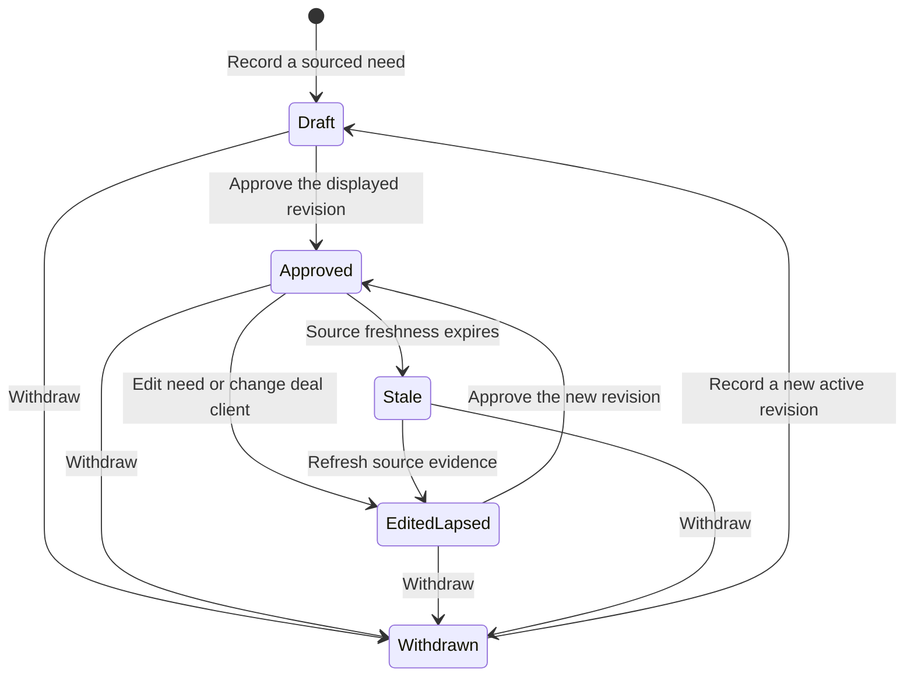

# Deal-owned client needs

The producer owns explicit needs under an existing deal. Existing deal checklist items, vendor assignments, history, and scoring remain unchanged. A selected vendor receives matches only from exact recorded applicability, never vertical or geography.

## System design

Two alternatives were considered. Reusing checklist text would require interpreting prose as approval and would couple generic checklist completion to introductions. A deal-owned need row makes need revision, explicit vendor applicability, restrictions, and approval independently inspectable. The latter is the chosen interface.

`record-deal-client-need-v1` creates, edits, or withdraws a need. `approve-deal-client-need-v1` binds approval to its exact revision and client identity. `read-deal-client-needs-v1` supplies reviewable revisions from the deal. `read-vendor-client-needs-v1` returns a bounded page of eligible matches with source and approval evidence. All are authenticated partner-authority verbs. Writes use the existing transactional idempotency envelope and audit writer.

Postgres stores needs. A trigger advances revisions and clears approval on content edits, even outside the verb. Reads join the current deal, client, vendor and live parties in one query. No cache, queue, external network call, retry, fan-out, or circuit breaker is needed. Failure refuses the read. Limits cap pages at 50 and offsets at 10000. Composite indexes cover vendor and deal scans. At current and tenfold load the same indexed access applies; deep offsets break first. Pagination is live, not a snapshot. Consumers must refresh after mutation.

Freshness uses source observation and explicit expiry. Stale, future-dated, restricted, withdrawn, draft and edited-lapsed needs never match. Approval is checked against both need revision and current deal client. No stale fallback is served. Partner authorization is derived from server identity; caller-supplied approval identity is absent.

## Lifecycle

Only Approved with allowed restrictions and live identities matches. Withdrawal invalidates approval. Refreshing evidence requires a new approval. Restrictions changing invalidate approval. The database clock decides freshness.

## Consumer contract

The version is `client-needs.v1`. The registered MCP verbs are the authenticated versioned transport. Responses carry exact UUIDs, revision, source reference/revision, observation/expiry, restriction, and approval actor/time/revision. Vendor reads distinguish `ready`, `missing_approval`, and `empty`. Transport and permission errors remain errors, never empty matches. Recorded fixtures are generated by the registered handlers on a disposable database and validated against the response schema.

## PRODUCTION PROOF

After a containing release, read an existing deal need and its vendor page through the registered verbs. Compare need/client/deal/vendor UUIDs, source revision, approval revision, applicability, and freshness exactly. An approved, current, unrestricted need must appear. A lapsed or withdrawn need must not appear. No recorded qualifying need leaves positive proof unobserved. This build does not call or mutate production.
