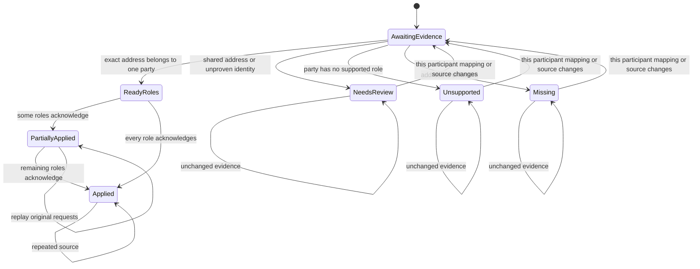

# Typed email participant resolution

Card: WR634.S1.J132

## Statechart written before implementation

Never silently choose one of several roles. Never acknowledge an unknown participant. Never clear pending work on an empty contact read. Never replace an existing request payload or key. This chart is a design artifact, not a model-checked proof. Tests exercise its transitions through Matcher.resolve and Run.emails.

## System design

The chosen interface is candidate 2 from J131. Matcher.resolve(address) returns ParticipantResolution(disposition, party_id, targets). RoleTarget owns canonical identity independently of optional display_ref. ParticipantResolution.single_target explicitly restricts scalar consumers. Candidate 1, raw rows with grouping at every caller, repeats eligibility policy and is rejected. Matcher owns exact identity grouping; Run owns persisted per-participant evidence and existing request acknowledgements; the contact reader owns authoritative role identity. No prompts or matching policy change.

Build starts at origin/main and explicitly merges dependency J134 head 4ec95b850fc88ac13f033f78efe1f7be3f5903e4. J134 is delivered behind #2977. This branch stays behind J134 with no PR until J134 merges. Existing effect keys, frozen payloads and completed refs remain authoritative.

Contacts load in one batched read. An address index and per-address revision serve constant-time lookups. Capacity is linear in rows plus participant-role fan-out at current and 10x load. The contact read and local snapshot size break first; no N+1 SQL or new remote calls are introduced. Run-local indices expire at run end. Persisted outcomes invalidate only on the participant's normalized mapping evidence or its source evidence revision. Unrelated mapping edits do not repeat resolution. Failed writes keep their existing bounded retry state; independent acknowledgements survive partial failure. Empty readers refuse before processing. Existing transport timeout, retry budget, run lock and intake source limits remain the circuit breaker and rate bound. No new queue, cache service, alert, or asynchronous consumer exists. Each write uses the existing deterministic request key and J134 binding for newly typed role effects. Historical requests replay their original payload.

## Production proof

After deployment and ordinary installed intake, use J134 reconciliation on the frozen expected role-effect cohort. Count fully applied and partial source identities and unresolved participants by reason and role. Repeat on the next ordinary run and prove zero new activity for acknowledged effects. Include natural multi-role and null-ref examples privately if available; otherwise keep positive proof pending. No intake launch or production write is authorized by this build.

## Verification and retention details

Per-participant records store separate mapping_revision and source_revision values. Mapping revisions exclude names and display-only snapshot values; source revisions include the participant and captured source evidence. Persisted mail_participants retains completed outcomes and original effect-key associations after mail_unresolved settles. This is request metadata, never a second message-body spool. Outcome metadata uses the existing source retention horizon, retaining unresolved, hydration, signature and flag holders. J134 permanent application evidence remains server-owned beyond local retention. The existing mail_done horizon controls source admission. Settled mail is not reopened by a later contact mapping, preserving the existing settled-machine-mail rule. Reconsideration applies to pending participants of unresolved sources. J134 source_version `1` denotes the initial captured occurrence generation; source evidence changes reconsider participant eligibility, not correction or reapplication of acknowledged touches.

Historical completed display refs remain completed. Existing request payloads and keys win over new canonical-ref keys, including legacy ownerless keys. New role effects bind J134 source lineage. Existing requests retain their original payload even when they predate that binding. Historical effects without lineage cannot be retroactively certified by this build.

Throughput checkpoint. Dependency merge and statechart precede code. Producer and consumer edits stay serialized in this worktree because one typed contract couples them. Tests may run independently in disposable fixtures. One builder owns this capability; delegation is forbidden. The selected typed result gathers role policy once instead of repeating it at each caller.

Design and debt pass. Codebase-design concentrates eligibility and canonical target grouping behind Matcher.resolve, with one explicit scalar selection method. Zero-tech-debt removes the old parallel by_email and unsupported indices and repeated per-participant classify calls. Existing scalar wrappers remain because calendar, flags and unresolved-review callers use them. No generic identity registry or retry framework is introduced.
