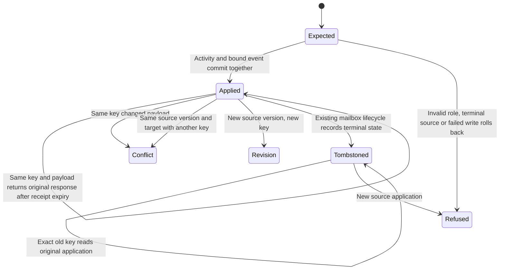

# System design

The existing log-activity event owns the permanent application manifest and response. No second queue or ledger. The source binding is an opaque source ID, source version, original request key, canonical client/lead/vendor target, canonical role and occurrence. Clients supply email_touch.source_id/source_version/role; the server proves target identity through resolveSubject. Role is client, prospect (lead), or vendor. Explicit occurrence is mandatory.

Two designs considered: a separate application table with receipt retention versus an indexed projection of existing immutable events. Choose the event projection to keep application and activity ownership together. Source revisions receive separate bindings; a given source version and target has one effect. Mailbox identity still deduplicates revisions when present. An old exact key returns its original response, even after tombstone; a new application against a tombstoned identity refuses.

A bounded reconciliation request supplies at most 500 unique expected effects and occurrence [start,end), with an optional recorded [start,end) filter. One set query reads permanent events; no per-party timelines, cache, queue, external API or N+1. Counts partition into applied, missing, dangling, tombstoned, out_of_window and refused (explicit caller-reported refusal with no application). Refused is reported evidence, never an application event. Flags are separate from the partition. The reader reports complete only for its submitted cohort, never an unbounded mailbox census. Today and 10x use the same capped request, split by the consumer. Index lookup capacity first limits large cohorts. Canonical consistency is transactional; refuse changed payloads, never serve stale application proof. External circuit breakers, rate limits and queues n/a because no external calls or fan-out are added.

Tests derive from each transition, including activity/event rollback, canonical UUID resolution, per-target fan-out, source version binding and bounded counts with missing/dangling/terminal/window evidence. Model checking is not claimed.

## Contract and verification

`log-activity.email_touch` accepts `source_id`, `source_version` and `role`. The response adds `email_application` with those fields, the original UUID key, canonical target type and UUID, normalized occurrence and activity UUID. Source IDs are scoped to the authenticated actor and organization. Source versions are opaque immutable revisions. Client, lead and vendor targets require the canonical roles client, prospect and vendor respectively. Explicit occurrence is required. Reusing a source version and target under a different key refuses with `email_touch_already_applied`; callers must retain their original keys. The permanent manifest uses a fixed hash version independent of later registry metadata.

`reconcile-email-touches` accepts 1 to 500 unique expected effects. Each effect has the response binding fields except activity_id, plus an optional `refused` boolean. It executes using the existing authenticated read-only writer route. Totals and groups by canonical target type and source version contain counts only. The primary dispositions partition the submitted cohort: applied, missing, refused, dangling, tombstoned, out_of_window and conflicting. Applied requires an exact binding, an extant matching email activity, a live canonical target and live source lifecycle. Refused means a caller-reported refusal with no permanent application. It does not attest a server refusal. Conflicting means the key has different bound evidence or the activity was changed. Window classification takes precedence. Recorded bounds are optional but must be supplied together. Complete means the submitted cohort was fully evaluated, never that the caller supplied every mailbox effect. Consumers must freeze their expected cohort before applying it. Unit 2 owns that expectation journal and legacy unknown evidence.

The PostgreSQL tests cover every chart edge, canonical roles, two competing connections, retention expiry and receipt deletion, immutable proof, transaction rollback, source revisions, mailbox tombstones, missing and dangling evidence, target tombstones, and half-open occurrence and recorded windows. A source revision without mailbox identity creates a separately bound activity. A revision with mailbox identity returns its existing activity only when occurrence and canonical target agree. New keys against terminal mail refuse. Exact old keys return original evidence even when mail has become terminal. No correction or intake recovery is implemented here.

Tests use synthetic PostgreSQL and real registered tool entry points. The statechart is a design artifact, not a model-checked guarantee. Production proof requires a natural intake cohort after deployment and unit 2 adoption; local tests establish no production application count.
