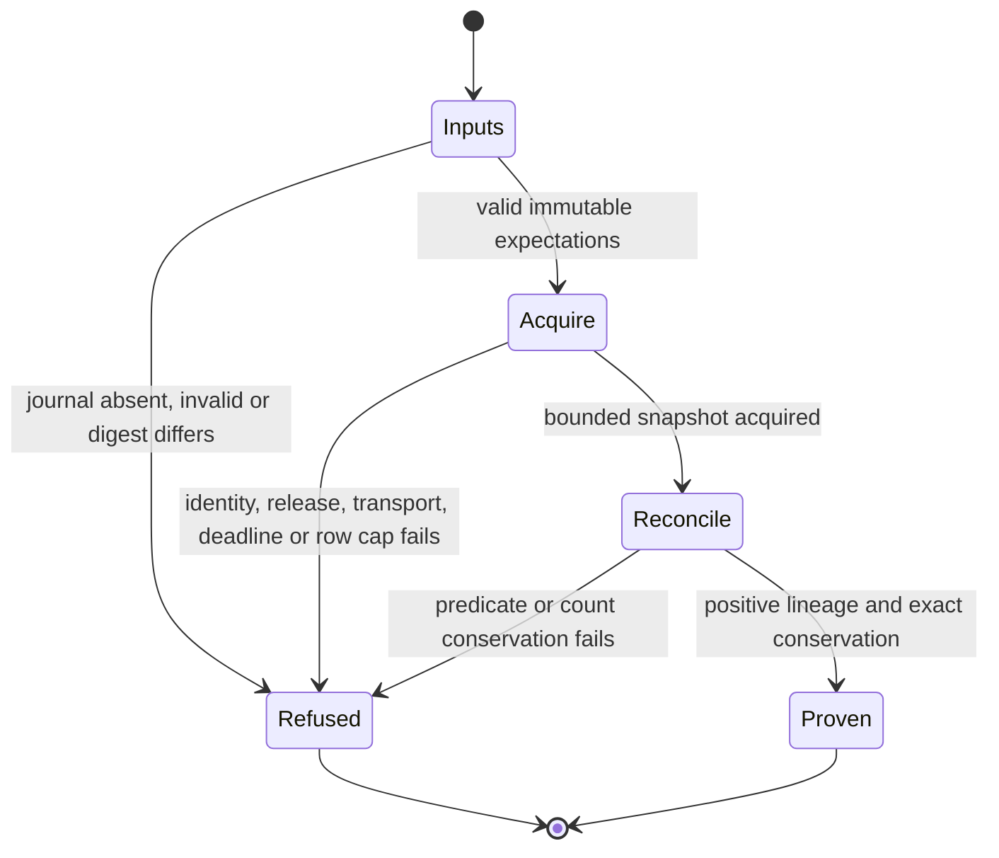

# Email-touch cohort proof

## System design

The operator supplies a local Unit 2 journal, its SHA256, and the immutable
reference `sha256:<same digest>`. The journal owns the expected actor, tenant,
source/version/key/role/target/occurrence bindings, exact application count,
occurrence window, optional paired recorded window, and deployed release SHA.
The established local-machine principal must match the journal's principal.
The database authenticates the connection supplied by `tools/db-tap.py run`.
Actor ID and slug are resolved together against canonical `actor`. This is a
local authenticated database observation, not an OAuth impersonation of that actor.

The Python command owns input validation, a single repeatable-read READ ONLY
snapshot, bounded acquisition, reconciliation, and a counts-only verdict. It
independently checks permanent event bindings and activity lineage instead of
requiring the unmerged email-touch reader module. It never sends or writes.
The four existing registered runners keep their own contracts.

Two designs were considered. Calling the JavaScript reconciliation reader
would reuse its submitted-expectation semantics but would miss extra touches
and unbound activities, and main does not yet contain that reader. Reading the
canonical tables in one snapshot also supports those inverse predicates.
The second design is selected. A future reader change requires checking this
independent proof against the versioned lineage contract.

Scope is intentionally stronger and narrower than a mailbox census. It covers
all email activities created by the declared actor on the declared canonical
targets in the half-open occurrence window, plus all that actor's application
events for those targets in that window and every expected key even outside
the window. Unit 2 must choose targets/windows containing only the intended
natural application cohort. Unrelated sources on those targets fail as extras.
It does not claim global orphan detection outside that population. Deleted or
merged targets fail as tombstoned, separately from missing and dangling.

The journal is at most 1 MiB with 1..500 unique effects. Each evidence query
returns at most 1001 rows and refuses above 1000 combined evidence rows. Three set-based queries avoid
N+1 reads. The outer command has a 60-second process alarm. Connection timeout
is 5 seconds and statement timeout is 10 seconds. The release GET has a
5-second deadline and a 64 KiB body cap. Any failure opens the circuit on its
first occurrence, returns a fixed reason and makes no retry or fallback.
At current load and 10x, memory and output remain capped; a broad cohort hits
the row cap or statement timeout first. Split cohorts at immutable window
boundaries. No fan-out, queue, caching, stale reads or write idempotency key
applies. Repeated observations are side-effect free; the journal is immutable
while database state can change between observations.

Throughput checkpoint. Blocking work is journal validation and evidence schema
inspection. Workstreams are serialized because this is one tightly coupled
command and acceptance suite. Mutable state belongs to one disposable fixture
or one read-only transaction. One worker owns the smallest safe decomposition.



The CLI acceptance suite covers every edge. It exercises real disposable
PostgreSQL and the same entry point as production. No model checking is claimed.

## Invocation and Unit 2 contract

`python3 ops/email-touch-cohort-selftest.py` runs the disposable fixture command
in CI through existing selftest discovery, including positive and inverse cases.
No CI or gate script registration is needed.

Production uses `python3 tools/db-tap.py run ops/email-touch-cohort-proof.py`
followed by `--journal`, `--journal-ref`, and `--journal-sha256` with Unit 2's
actual immutable artifact values. No production invocation was run during build.
The runner requires DATABASE_URL and adds its own READ ONLY transaction even
when the transport has already set a read-only default.

Unit 2 must publish an acquired, frozen journal with schema
`email-touch-expectations.v1`, `principal_slug`, `actor_id`, `actor_slug`,
`tenant` equal to `carr-internal`, `release_sha` as a full deployed SHA,
`start`, `end`, optional `recorded_start` and `recorded_end`, `expected_count`,
and `expected`. Each expected entry has exactly `source_id`, `source_version`,
`original_key`, `role`, `target_type`, `target_id`, and `occurred_at`.
Roles map client/client, lead/prospect and vendor/vendor. IDs and original keys
are UUIDs; occurrences are normalized UTC milliseconds. Every expectation is
an application; caller-reported refusals are not successful lineage evidence.
Unit 2 must provide the original journal bytes, content digest, immutable
reference, acquisition provenance, and the chosen natural-intake population.
This runner does not fabricate that artifact or infer it from observed touches.
Missing journal fails with `missing_journal` before database access.

Only the fixed schema, verdict, reason and integer counts leave the command.
Exceptions and raw SQL diagnostics are suppressed. Fixture mode accepts only a
local Unix socket in a disposable `email-proof-*` directory and uses explicit
synthetic principal/release inputs. Its verdict is labeled `fixture`, never
production. It cannot use an ambient production DATABASE_URL.

## Canonical acquisition schema

The fixture loads the exact `CREATE TABLE` definitions for actor, party,
activity, event, client, lead, vendor and deal, plus the exact `v_ref_index`
view, from the migration baseline's `db/schema.sql`. It then executes the
activity column and constraint statements from `1020_email_deal_matching.sql`.
No fixture table, view or column is invented. The snapshot subset omits
separate indexes, triggers, grants and foreign keys. This proves SQL column
compatibility and reconciliation, not migration replay or production permissions.

`test_acquisition_columns_exist_in_canonical_schema` executes all acquisition
queries in a real read-only transaction and reconciles a positive cohort.
PostgreSQL resolves every named column, including both activity aliases and
the resolver view's underlying relations. A nonexistent column raises its
original database error instead of being hidden behind the CLI refusal.
The positive CLI and all inverse cases use that same canonical schema.

The runner reads these columns. Migration 0001 is preserved in the committed
baseline and in Git history before migration compaction commit
`8952141cbec936ac57b86285612ef9d1987f101c`.

| Relation | Columns read | Defining migration |
| --- | --- | --- |
| actor | id, slug | 0001_init.sql, baseline `db/schema.sql` |
| event | idempotency_key, new_value, recorded_at, verb, actor_id | 0001_init.sql, baseline `db/schema.sql` |
| event | organization_tenant_id | 0095_sponsor_runtime_audit.sql |
| activity, aliases a and s | id, kind, occurred_at, actor_id, client_id, lead_id, vendor_id | 0001_init.sql, baseline `db/schema.sql` |
| activity, aliases a and s | email_context | 1020_email_deal_matching.sql |
| v_ref_index | subject_type, subject_id, merged | 0016_ref_index_resolver_view.sql; current merge predicates in 0069_enrichment_write_gap.sql |
| v_ref_index | party_id | 0027_review_fixes_graph_views.sql; retained in 0069_enrichment_write_gap.sql |
| party | id, deleted_at | 0001_init.sql, baseline `db/schema.sql` |

Activity attribution is `actor_id`. `created_by` belongs to other records and
is not an activity column. The former handwritten fixture concealed this error.

## Natural production declaration for email application

The email-application change must keep its release assertion and add a semantic
assertion using `email-touch-cohort-reconcile.v1`. The complete proposed
replacement for `proofs/requirements/wr634-email-touch-application.json` is:

```json
{
  "schema": "carr-production-proof-plan.v1",
  "requirement_id": "WR634-S1-email-touch-application",
  "targets": ["worker"],
  "assertions": [
    {
      "id": "release-identity-and-registry",
      "predicate": "Verify the deployed merged full SHA and verb registry with the registered release smoke runner.",
      "runner": "worker-release-smoke.v1",
      "expected_result": "PASS for the deployed merged full SHA and verb registry.",
      "input_class": "deployed Worker read-only identity and registry",
      "deadline_seconds": 60
    },
    {
      "id": "natural-email-touch-cohort",
      "predicate": "Run python3 tools/db-tap.py run ops/email-touch-cohort-proof.py with --journal bound to Unit 2's frozen natural-intake journal bytes, --journal-ref bound to sha256: plus their digest, and --journal-sha256 bound to that digest. The journal must bind the current deployed merged release SHA, authenticated local principal, canonical actor, tenant, occurrence window and exact expected source/version/key/role/target/occurrence cohort. Accept only mode=production, verdict=proven, reason=matched, expected=applied greater than zero, and zero missing, dangling, conflicting, tombstoned, out_of_window, extra and orphan counts. No fixture result proves natural production lineage.",
      "runner": "email-touch-cohort-reconcile.v1",
      "expected_result": "Exit 0 with production proven matched and exact positive count conservation; otherwise remain landed-unproven.",
      "input_class": "Unit 2 immutable natural-intake expectation journal with original bytes, SHA256, content-addressed reference and acquisition provenance; counts-only read-only evidence",
      "deadline_seconds": 60
    }
  ],
  "safety": {
    "read_only": true,
    "no_sends": true,
    "max_requests": 10,
    "max_records": 1000,
    "max_runtime_seconds": 120,
    "max_artifact_bytes": 4096
  }
}
```

This declaration admits the right predicate but is not a bound runnable proof
until Unit 2 supplies the actual artifact path, immutable reference and digest.
Unit 2's natural-intake capture worker owns that journal. It must freeze the
intended successful applications independently of the observed database result,
including principal, actor, release and cohort provenance. The runner only
consumes it. It cannot reconstruct the expectation from the evidence it judges.

The deployed `list-verbs` query with `filter=journal` returned zero verbs during
this fix. A repository search for `email-touch-expectations.v1` and expectation
journals found this consumer, its synthetic tests and this documentation, with
no natural-journal producer. This is a bounded search result, not proof that
no external producer exists. Journal production and natural production
observation remain Unit 2 work; this fix performs neither.
