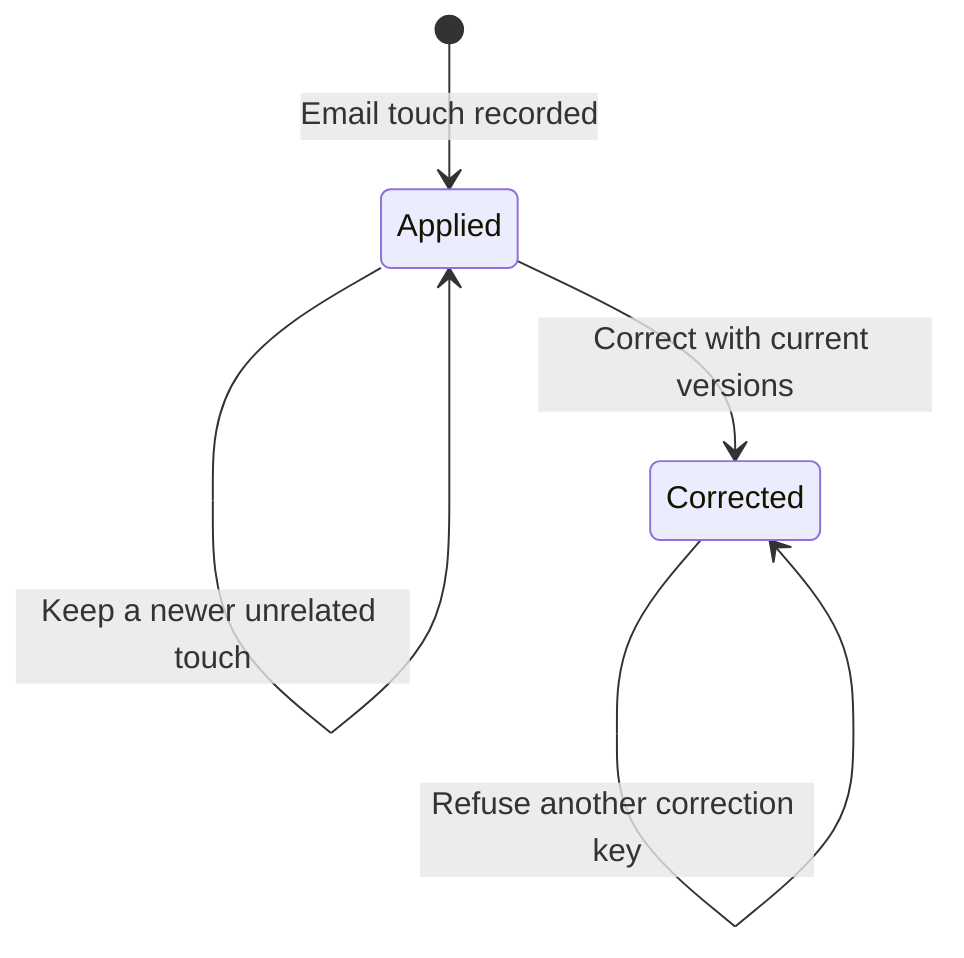

# Guarded email contact correction

Card: WR634.S1.J135

The caller names an original application key, its immutable source version, the target's current base_version, the activity's activity_base_version and the source activity's source_base_version. The source is email_context.source_activity_id when present, otherwise the activity itself. CARR owns the immutable application, compensation event and derived dates.

Never remove the original activity or application event. Never subtract an unrelated touch. Never correct after a source revision, terminal source or stale target/activity/source read. Concurrent correction has one winner. Exact-key retries return its durable response after ordinary receipt retention. This chart is not model checked. Tests exercise the registered handler on synthetic PostgreSQL.

Two interfaces considered. Overload undo-call-change with email identifiers, rejected because that interface owns call changes. A dedicated correct-email-touch command beside existing email application lineage, chosen to enforce exact application and source guards in one transaction. The compensation marker excludes the original activity from contact dates while preserving its kind, occurrence and history.

System design. Lock shared actor/source/target identity, existing mailbox identity if present, target row, then source/activity rows in UUID order. Same-source revisions share the identity lock. Later unrelated contacts remain independent and included in the aggregate. Indexed application lookup plus one source conflict lookup and one date aggregate per correction, no per-party loop or N+1. At the previously reported 82 retained touches and hypothetical 820, one correction remains one transaction. Event scans and same-source contention limit capacity first. No measured throughput claim. No external calls, fan-out, queue, cache, eviction, external circuit breaker or async worker. Failure rolls back marker and compensation together. Every write uses a UUID key. Stale input refuses. Existing transaction timeouts bound database failure.

Throughput checkpoint. Chart, failing PostgreSQL tests, compensation and reader exclusions, touched suites, gates and push floor. J134 at 4ec95b850fc88ac13f033f78efe1f7be3f5903e4 was merged into this branch from origin/main under the explicit dependency exception. J132 may overlap tools.js and the generated registry. PR publication waits behind J134 and live holders.

The correction marker is activity.touch_correction_key. v_last_touch excludes marked activities for clients, leads, vendors and inherited deal dates. Vendor relationship last_contacted_at and last_contact_note use the same exclusion. History retains marked activities. Reconciliation adds a mutually exclusive corrected count to its existing submitted-cohort partition. It never reports a compensated application as still applied.

Correction also refuses an activity whose target changed or gained another target attachment, even with fresh versions. Excluding a shared activity could otherwise subtract another party's later work. Exact replay of the original application retains the compensation marker and never restores the contact date.

Model the Domain shaped the immutable compensation and the single corrected disposition. The codebase-design pass keeps transaction guards behind one registered command. The zero-tech-debt pass reuses the existing activity and event ownership rather than introducing another ledger or undo framework. Delegated design and review steps are omitted under the explicit no-subagents instruction. No rebase is used.

Bound log-activity defers its source-row lifecycle guard until after the source-target and mailbox locks. Correction uses the same ordering. A synthetic concurrent linked-source application exposed the previous lock inversion. A deterministic regression holds the source-target lock, waits for the revision to reach it, then corrects before releasing it. The revision must finish after that correction without a database deadlock.

Correction tests live in the existing email-touch application PostgreSQL suite. A separate unknown-duration suite exceeded the conservative shard watchdog budget. Combining tests at the existing lineage seam preserves coverage without changing timing estimates or weakening the watchdog.
