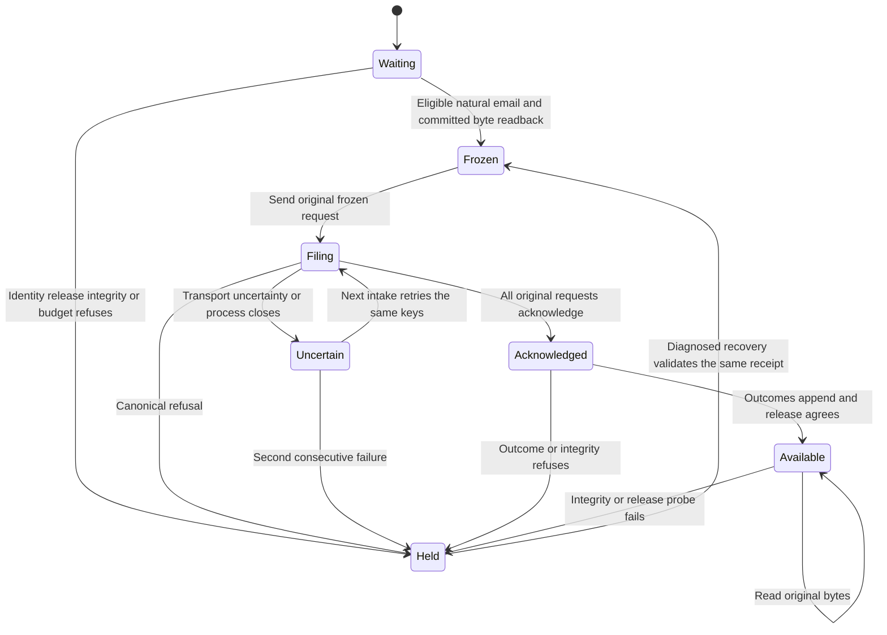

System design before code

Data shape: immutable journal bytes/provenance keyed by tenant and digest, unique capture UUID; separate observation UUIDs. A private Cohort state machine owns selection, durable capture, application and recovery.

Architecture: intake produces frozen proposals; narrow authenticated SQL custody stores exact bytes; outcomes never establish expected membership; read-only export feeds the independent runner. Compared local files against Postgres custody directly under no-subagents order. Postgres avoids single-host byte loss and is the approved design.
Capacity: one cohort per mailbox/runtime, 1..500 effects, 1 MiB journal, one capture and one outcome batch per run. At 10x inputs fixed caps defer work; no performance claim. No scheduler or fan-out.
Load: existing mailbox lock; capture-key advisory transaction lock serializes competing captures. No target cache or automatic journal eviction. Unresolved private requests survive pruning.
Availability: capture and committed byte readback precede application. Storage failure defers selected writes. Acknowledgements can lag. Recovery runs before store/watermark early exits. Release mismatch refuses stale proof.
Storage: set-based canonical ref lookup; one insert/read by capture key; batch outcome insert, no N+1. Unique capture and primary digest indexes.
Consistency: refuse identity, release, input, digest or cardinality disagreement. Immutable bytes are never rebuilt from JSONB. Canonical application evidence remains the consumer's responsibility.
Async: existing run retries only. Every capture and outcome uses stable UUIDs. Apply uses existing activity UUIDs. Two consecutive transport failures persist a breaker; no third attempt without diagnosed recovery. Each run stops at first transport error; no busy retry.
External calls: bounded existing CARR transport and one release read with 5s timeout; one attempt per operation per run. Failure holds the cohort and existing failed-run receipt supplies alerting. No new outbound messages.
Export: repeatable-read READ ONLY snapshot, 120s deadline, fixed output size, private directory/files, symlinks refused. Runner invoked once as an argument vector, nonzero remains nonzero.
Throughput checkpoint
- Blocking first steps: source contracts, named statechart, failing tests.
- Independent workstreams: n/a, one code-coupled vertical path and no subagents.
- Shared mutable state: mailbox lock locally, transaction lock for capture uniqueness; immutable rows thereafter.
- Smallest safe decomposition: one worker owns coherent store/producer/export contract; independent review belongs to coordinator.

## Statechart and transition evidence



`ops/email-touch-journal-selftest.py` exercises the transitions through `Cohort`, including an actual `Run.write` call using durable private payloads. It also executes a refusing consumer process and private-file export checks. `mcp-server/test/email-touch-journal-postgres.test.mjs` installs the real migration in disposable PostgreSQL and exercises custody, replay, conflicts, append-only observations and denied role mutations. Tests use synthetic messages only. The inherited planning model could not run TLC; no model-check pass is claimed.

## Recovery and custody

`pending_email_capture` persists the chosen message and planned requests before any release probe. It remains separate from `requests`. `email_cohort` retains the receipt, every intended application, original keys, pending observation UUIDs, and failure count. `Run.write` only receives the final frozen payload. Capture, application and outcome transport failures preserve their original identities. Recovery precedes unchanged-store and watermark exits. A second consecutive failure holds the cohort. `Cohort.resume_after_diagnosis(reason)` validates the original receipt before clearing that hold. This is an internal recovery interface for a diagnosed repair, not an automatic retry.

Successful cohorts remain in Postgres. A new installed producer SHA archives the completed private cohort and permits selection of a new unattempted natural email. Outstanding cohorts do not rotate on release changes. Existing private-state pruning preserves the selected requests. Hydration remains outside touch expectations.

The journal is one deterministic UTF-8 JSON byte sequence, stored as `bytea`, with a checked SHA256. A custody trigger binds raw identity and scope to provenance. Runtime roles can invoke only the narrow capture and outcome functions. They cannot insert, update, delete or truncate rows. Owners can alter schema and backups; hashes are tamper evidence when compared with an independently retained receipt. Existing Postgres backups own recovery.

## Production proof

After dependency delivery, install through the existing Outlook runtime installer and wait for ordinary intake. Do not create mail or replay old mail to force a result. Zero eligible natural messages is waiting, not a passing proof.

Capture-only observation uses the sanctioned read-only database route.

```sh
python3 tools/db-tap.py run ops/email-touch-journal-proof.py --first-natural-for-installed-runtime --capture-only --output-dir /tmp/wr634-unit2-natural-proof
```

The adapter selects the first capture for the installed producer, established principal and mailbox scope. It never filters on success. It checks immutable byte identity, capture-before-application and absence of runtime mutation privileges. It exports a private journal and acquisition manifest. Standard macOS `/tmp` and `/var` aliases are normalized before symlink checks. Other symlinks refuse.

WR634.S3.J1 performs the lineage proof against deployed email lineage after PR #2996 and PR #3001 land.

```sh
python3 tools/db-tap.py run ops/email-touch-journal-proof.py --first-natural-for-installed-runtime --reconcile --output-dir /tmp/wr634-unit2-natural-proof
```

The adapter invokes the actual cohort runner once with the exported path, reference and hash. A nonzero consumer exit stays a refusal. The consumer must report production mode, matched, expected=applied>0 and zero missing, dangling, conflicting, tombstoned, out_of_window, extra and orphan effects. Current-release agreement is required; historical proof across release changes is unsupported.

## Design and debt pass

Codebase design places selection and durable retry semantics behind `Cohort`, canonical custody behind two SQL functions, and read-only proof behind the export adapter. Local-file-only custody was rejected because it ties recovery to one host. A generic artifact service was rejected because this bounded journal has one producer and one consumer.

Zero tech debt keeps the existing intake, lock, request keys, transport and installer. There is no second scheduler, generic byte-store API or success-derived expectation path. The added records represent new independent intent; they do not replace an existing authoritative expectation store.
