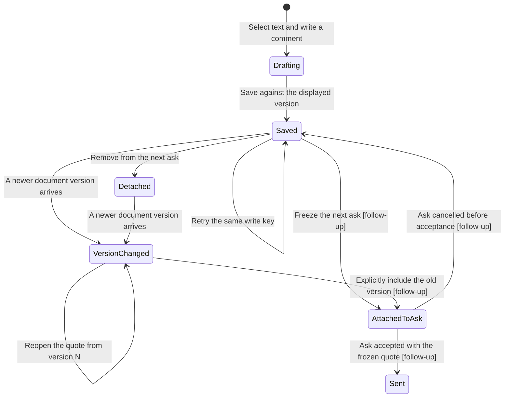

# Deal line quotes

This first delivery unit stores and reads exact-version line quotes. Ask attachment,
sending, text extraction integration, and the selection UI are separate follow-ups.
AC-QUOTE is not complete until those follow-ups run together.

## Existing flow

Attachments own the document UUID, deal UUID and byte hash. They do not contain a
text layer. The app currently lists documents and fact citations, but has no lease
text selection viewer. The queued-asks outbox freezes a conversation and body;
`doc-request.v1` deliberately accepts no deal or quote fields. PR 2942 owns that
contract and the conversation module. This unit must not silently overload it.

## Data shape and interface choice

A text snapshot owns immutable extracted text, attachment UUID, byte hash, text
hash, and a monotonically numbered version. A quote owns a snapshot UUID, zero-based
Unicode code-point range with an exclusive end, exact selected text, comment,
partner identity and write key. A detached quote retains its original selection.

Considered storing caller-supplied excerpts against a byte hash alone. Rejected
because the server could not verify the range or distinguish forged excerpts.
Chosen interface registers a text snapshot through an authority-only door and
creates quotes only by slicing that snapshot. The future extractor must verify
source bytes before registering the text. This unit does not claim byte extraction.

## Statechart

The storage state is saved or detached. VersionChanged is a read projection,
independent of that state. AttachedToAsk and Sent are not implemented here.
Never change a quote's snapshot or range. Never replay a write without rechecking
current access. Never accept a changed request under an existing key.

## System design

- Architecture. PostgreSQL owns immutable snapshots and quote receipts. The
  existing deal-files tool registry exposes registration, saving, detaching, and
  a bounded list. The existing business.read_deal decision installer and its
  revision-bound SQL guard own deal access. No second access policy.
- Capacity and scaling. Text is capped at 200,000 code points and a quote at 4,000.
  Each deal list returns at most 100 quotes with a continuation cursor. Writes serialize on one attachment or
  one actor/key. At 10x, the existing all-deal authorization installer is the first
  scaling constraint. No new loop or external fan-out is introduced.
- Storage. Indexed attachment/hash and deal/quote lookups. The list joins snapshots
  and current attachments in one query. No per-quote fetch or N+1.
- Load spread. Independent deals and write keys proceed independently. Version
  numbering serializes on the attachment row.
- Cache. None. Reads recheck authorization and attachment state every time.
- Availability. Database calls are sequential in the existing transaction. A
  failure rolls back the write. No background retry or partial acceptance.
- Consistency. Immutable text and excerpts can be historical. Current access must
  pass. A changed attachment hash or newer snapshot yields `version_changed` and
  `from version N`; it never changes the old range or text.
- Async. n/a in this unit. The next unit freezes quotes into the queued ask.
- External calls and circuit breakers. n/a. No network provider, extraction call,
  or send is introduced. PostgreSQL failure propagates without a retry loop.
- Rate limits. Registration is bounded by text size. Saves and lists have fixed
  bounds. No polling or fan-out. Existing ingress limits apply.
- Idempotency. Every write requires a UUID key. Snapshot and quote receipts bind
  the full request and actor. Changed arguments refuse; concurrent retries return
  one original result. Detach uses a separate immutable receipt.

## Throughput checkpoint

- Blocking first steps. Resolve the text source and authorization before code.
- Independent workstreams. n/a. This worker owns one coupled store and tool diff.
- Shared mutable state. Serialize snapshot versions on their attachment and writes
  on actor/key. Do not share quote state with the queued-ask outbox.
- Smallest safe decomposition. Store first; queued-ask integration second; app
  viewer and selection third. Only the store is this delivery unit.

## Verification

Disposable PostgreSQL exercises tool-facing storage functions with synthetic
attachments and partners. It checks exact ranges including Unicode, immutable
replay, changed-key arguments, current deal access, version changes, detach replay,
size limits, and concurrent writes. New grants must not expose tables directly.
Hosted strict CI and a reviewer remain required before merge. UI, axe, and the
counterparty-facing ask are explicitly unverified in this first unit.

## Remaining delivery units

1. CARR ask attachment. Extend `doc-request.v1`, the submission definer,
   `mcp-server/src/doc-conversation.js`, its projections, and its PostgreSQL tests.
   Bind an ask to a deal, freeze selected saved quotes atomically, preserve retry
   receipts, and include the exact clause and comment in the ask body. Sending
   must consume only those frozen quotes, with cancellation and concurrent asks
   tested against the statechart. Do not change existing frozen outbox payloads.
2. Text source and app selection. Add a byte-verified PDF text-layer producer that
   calls `register-deal-quote-text`. Add a TypeScript document viewer under
   `doctorcre-app/src/ui/` and connect it to the existing deal document list and
   queued-ask composer. Count code points rather than DOM offsets. Verify phone
   selection, keyboard selection, comment retry, stale versions, and access errors
   at 390, 1024, and 1440 pixels in both themes with axe.

The storage tools are internal CARR verbs. No browser route or document-byte
extractor is shipped in this first unit. No app source changed.
