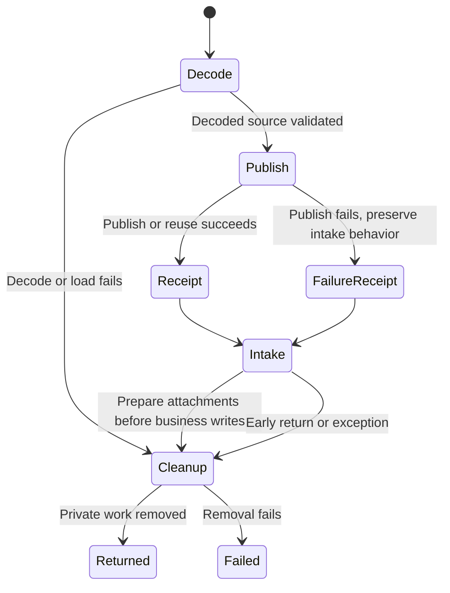

# Intake private history publication

WR634.S1.J84. Size: one verifiable PR, no app or runtime installation changes.

## System design

Architecture: intake owns snapshot/decode lifetime and its run receipt. The search
module owns account selection, validation, FTS storage, private publication and
lookup. Usage: `build_index(db, index, mailbox=account, account_id=id,
source_revision=digest, select_account=True)` followed by
`query_index(index, account_id=id, query=phrase, published_snapshot=True)`.
The index retains sender, recipients, subject, decoded body, dates and source
references. These are authorized local history for Joe and Dell, not an invented
knowledge fence. Nothing in publication or lookup leaves the Studio.

Two placements were considered before implementation. Inside the decode context, publication uses the same closed decoded copy
immediately after decode/load validation. A separate post-decode step would need another snapshot/decode or retained
copy, double IO, and risk indexing a different capture. Choose the existing decode
lifetime. Inspection found an early cleanup before business writes in attachment
preparation. Preserve that safety contract by publishing before yielding to intake,
rather than extending decrypted-file lifetime through business writes. Publication errors produce a count-only receipt and preserve intake's
outcome; decode errors publish nothing. Cleanup failure retains its existing
failure semantics. No queue or new scheduler.

Interface synthesis: a dedicated projection database plus unchanged publisher
would add a second temporary database and another schema owner. Instead the
publisher selects only rows positively bound to the configured account and with
no conflicting ownership. Strict explicit builds retain their existing refusal
contract. The decoded source itself is never retained.

Capacity: one account index, hard limit 512 MiB, one writer, nonblocking lock,
atomic replacement; a failed generation preserves the old index. The shipped
publisher supports complete replacement, not incremental mutation. Identical
source/revision/account skips replacement. Streaming rows avoids Python mailbox
materialization. Temporary generation also contains one decoded snapshot; peak
storage is source size plus old and new index (at most 1 GiB of indexes).
Today's production mailbox size/count is unavailable under this synthetic-only
job; no production size is fabricated. The receipt exposes actual index bytes
and rows. Synthetic measurement with ~2 KiB repeated body text: 10,000 rows use
47,132,672 index bytes; 100,000 rows (10x) use 463,306,752 bytes.
This is a fixture sizing example, not a measurement of today’s mailbox.
At the measured ~4.6 KiB/row, an estimated N current rows use ~4.6N KiB
and 10N use ~46N KiB; actual token/body distribution changes this ratio.
Disk space or full-rebuild latency breaks first at 10x; the cap refuses growth.

Load spread/scaling: sequential local build, one per successful decode, no fan-out.
Caching: latest complete index replaces previous generation; identical source is
reused; failed publication serves explicitly dated prior snapshot. No history of
generations is retained. Consistency: source-bound queries still refuse changed
sources; explicit published-snapshot queries report capture recency unverified,
unknown completeness and publication time. They never claim current mailbox parity.
Storage: one ordered scan and FTS rebuild, no remote N+1. Ownership predicates use
decoder message-key indexes. Async, external circuit breakers and API limits are
n/a: no external calls or queue added. Local failures trip after one attempt,
fallback is prior generation plus visible failure count. Write identity is source
SHA256 plus revision, mailbox and account; atomic replacement converges on replay.

A durable local publication-attempt flag forces one decode for pre-index intake
state. Subsequent unchanged-store runs retain the existing optimization. A failed
publication retries on the next natural decode (store change, hydration or review);
its visible failure receipt remains the evidence until then. No tight retry loop.

## Run statechart

Synthetic entry-point tests cover publish/lookup, decode refusal, publish failure,
replay and cleanup. Existing publisher tests cover atomicity and privacy. This is
an executable-test-backed behavior chart, not a formal model-checking claim.

Production proof (coordinator, after runtime refresh): after the next natural
intake on the refreshed Studio runtime, the index exists with n rows and one
read-only history lookup returns a hit; counts only. Until then live behavior is
unproven.

## Verification and debt pass

The safety fact is that publication failure cannot stop intake and the decoded
copy is still removed before business writes. Executed synthetic tests exercise
the real intake entry point and the real publisher, not a copied implementation.
The original cleanup-failure test still prevents business writes when deletion
fails. Source-bound lookup tests remain unchanged and pass.

The codebase-design pass keeps schema/account/private-file rules in the search
module and uses the existing decode lifetime as the integration seam. The
zero-tech-debt pass preserves early cleanup, avoids a second decoded database,
and reuses one query implementation for both explicit freshness contracts.
No scheduler, network client, record-layer verb or app surface is added.
