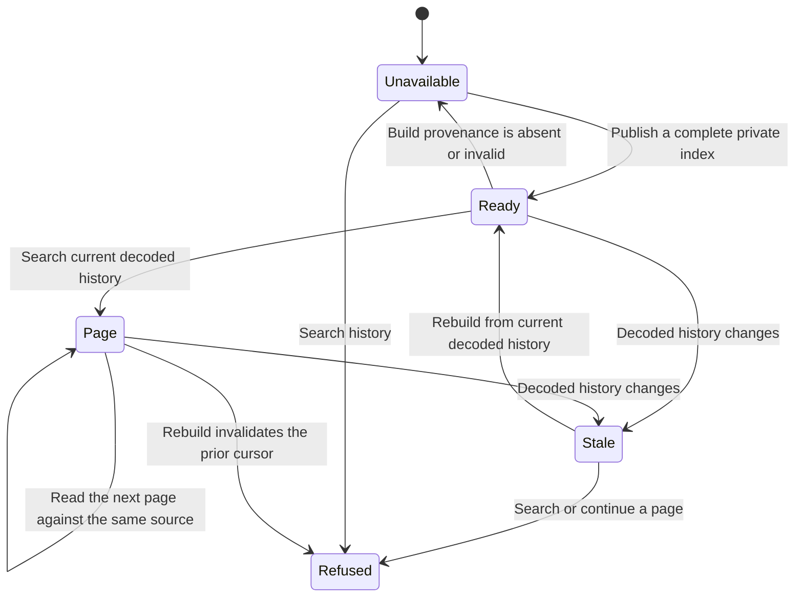

# Private local history lookup states

Freshness means byte identity with the explicitly supplied current decoded copy
and exact source revision. Age alone cannot attest whether a decoded copy changed.
A valid timezone-aware build timestamp is required and returned, but is not an
attestation of full mailbox coverage or capture recency. The caller must supply
the current closed decoded copy. No mailbox or network access establishes it.

Never return matches or an empty history result from Stale or Unavailable.

| Transition | Executable test in ops/email-local-search-selftest.py |
| --- | --- |
| Publish and search | test_history_lookup_returns_exact_account_results_without_network_calls |
| Continue pages; reject rebuilt cursor | test_query_pagination_unicode_quotes_duplicates_and_replacement |
| Source changes; refuse empty search and valid cursor; rebuild recovers | test_query_refuses_stale_source_and_recovers_after_rebuild |
| Source changes during lookup; refuse result | test_query_refuses_source_change_during_lookup |
| Missing provenance; refuse lookup | test_query_refuses_missing_freshness_provenance |
| Invalid provenance or revision; refuse lookup | test_query_refuses_invalid_freshness_provenance_and_revision |
| Missing index; refuse lookup | test_query_refuses_missing_current_source_or_index |

This chart is a behavior specification backed by synthetic entry-point tests.
It is not a TLC model and makes no formal model-checking claim. It leaves
publication crash recovery to the existing publication tests and does not model
mailbox completeness, real mail capture, or adversarial modification of FTS data.
