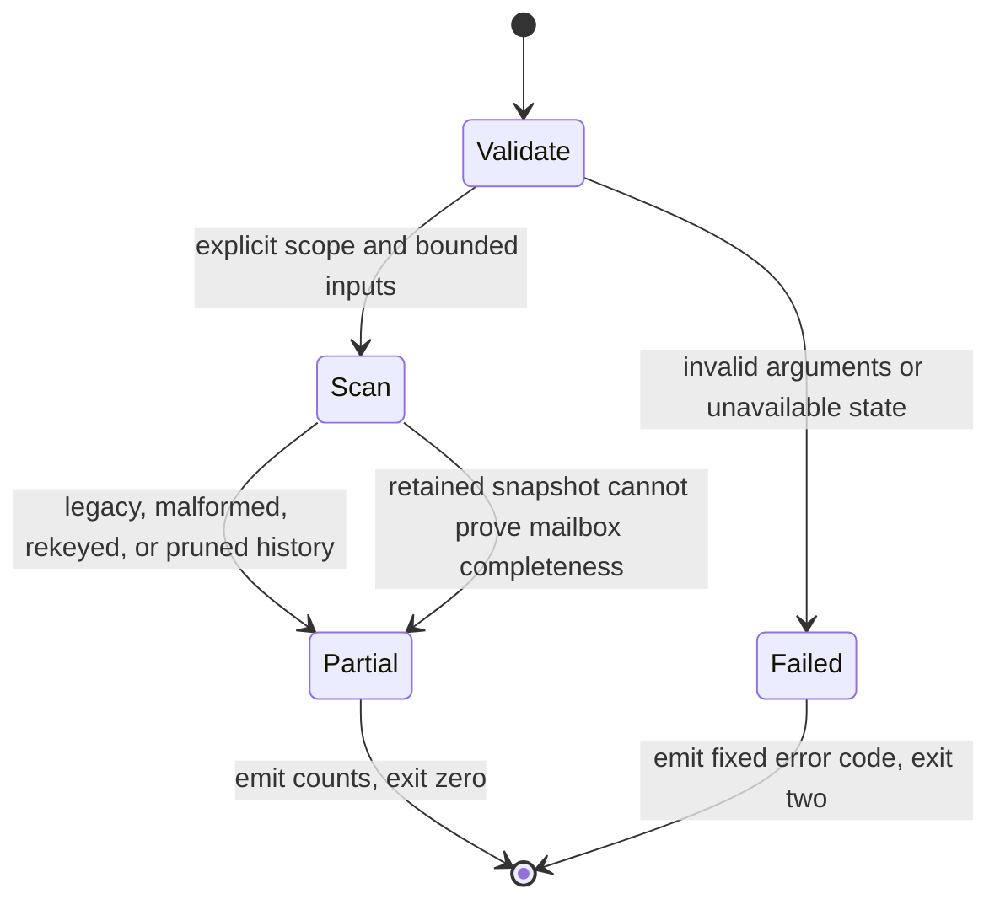

# Retained email application census

## System design

This read-only command accepts two explicit private directories. Receipt exports own
run observations. The intake `state.json` owns retained requests. The census owns
only aggregate output, never application state. Its read port and clock are injected.
The data shape is a receipt sequence and a request map keyed by idempotency UUID.

Two designs were considered. Replaying receipts into an application ledger would
invent identity and acknowledgement timing that the producer does not retain.
A bounded snapshot reducer preserves those limits and is the chosen design.
It reuses intake's counter split and retention constants rather than copying them.

Capacity is bounded at 1,000 receipt files, 64 MiB total input, 16 MiB per file,
100,000 receipt rows, and 100,000 retained requests. The historical 353-receipt diagnostic fits; ten times
that file count refuses at the cap. Memory for parsed state breaks first. Reads are
sequential and local. There is no fan-out, cache, eviction, queue, async owner,
network call, retry, external timeout, rate limiter, or circuit breaker to configure.
Each loop has a file, row, byte, or request cap. Scaling means selecting a narrower
receipt window, not adding parallel reads. There is one state read and one pass
over receipts and requests, with no database access or N+1 queries.

The caller supplies a frozen copy. Input digests identify the exact bytes read.
Concurrent snapshot construction is outside the command. Unreadable state refuses;
malformed receipt rows remain counted as incomplete. Unrecognized counter names are discarded. No writes or sends occur, so
write idempotency is n/a. Request UUIDs deduplicate effects. No stale snapshot can
establish current inbox coverage. The injected clock rejects a future as-of.
Acknowledgement time is absent, so as-of describes snapshot observation, never a
historical reconstruction of acknowledgement state. Historical pruning always
makes a unique-message census incomplete. Rekeys remain incomplete too.

The throughput checkpoint has four decisions. Input contracts and overlap checks
come first. Independent workstreams are n/a for this single reducer. Shared mutable
state is n/a because the command only reads frozen inputs. One worker owns the four
scoped paths, which is the smallest safe decomposition.

## Observation statechart

Request populations are observed, never transitioned. An unacknowledged request is
pending or blocked. A refused disposition stays refused even when acknowledged is
true. An acknowledged effect counts once by retained request identity. Failed then
successful attempts do not become two effects. Tests exercise each chart edge and
population.

## Input and output reference

Invoke `python3 tools/email-application-census.py` with required flags
`--receipts-dir`, `--journal-dir`, `--account`, `--since`, `--until`, and `--as-of`.
All three times require offsets. Windows are half-open. `until <= as-of <= clock`.
The journal directory contains the existing intake `state.json`. Receipt files are
`.json` or `.jsonl` exports of existing ops run rows with `service`, `started_at`,
and `detail`. `service` is `outlook-intake`; `detail` is the receipt object or its
JSON string. Non-intake service rows are excluded. The caller must export only the
selected account's receipt stream because receipts carry no account identity.

`counts.run` sums recognized run counters across selected run dates. `counts.backlog`
is the latest selected structured receipt's recognized standing totals, never their
sum. `admitted` is a backlog observation of decoded message rows. `emails` is a run
observation, neither is a unique-message count. Legacy flat counters are counted as
legacy without guessing their split. Arbitrary input keys never become output keys.

`counts.retained` counts email log-activity requests by communication occurrence
date. Calendar requests are excluded. Known account mismatches are excluded;
legacy requests require the state's matching `mail_ids_account` hash. Refused,
blocked, pending, and acknowledged populations remain distinct. Acknowledged
contact effects are requests, not messages. Explicit email_identity item IDs give
retained source identities; missing identities remain counted separately. Rekeys
may change these source identities and cannot establish a unique-message census.

`completeness` always labels retained history partial. The state retention policy
prunes acknowledged history and does not retain acknowledgement timestamps.
`retention_window_crossed` additionally identifies windows before the ordinary
retention horizon. This report never states an application rate. Stdout and stderr
contain fixed labels, counts, timestamps, and digests only. They contain no input
paths, account, request identities, addresses, names, subjects, or content.

## Production proof procedure

The builder uses synthetic fixtures only. After merge, a separate authorized
read-only proof job supplies one frozen installed receipt export and state directory.
It runs this command with the installed account and explicit offset-bearing bounded
window and as-of. Record the command privately, the exact input digests, and the
window. Independently sample source journal entries and compare each retained
population, including refused and pending requests. Verify that repeated attempts
count once and backlog counters come only from the latest receipt. A legacy or
pruned window must remain partial. This establishes reporting behavior only.
Source-ready, landed-unproven, and live-proven are distinct states.
