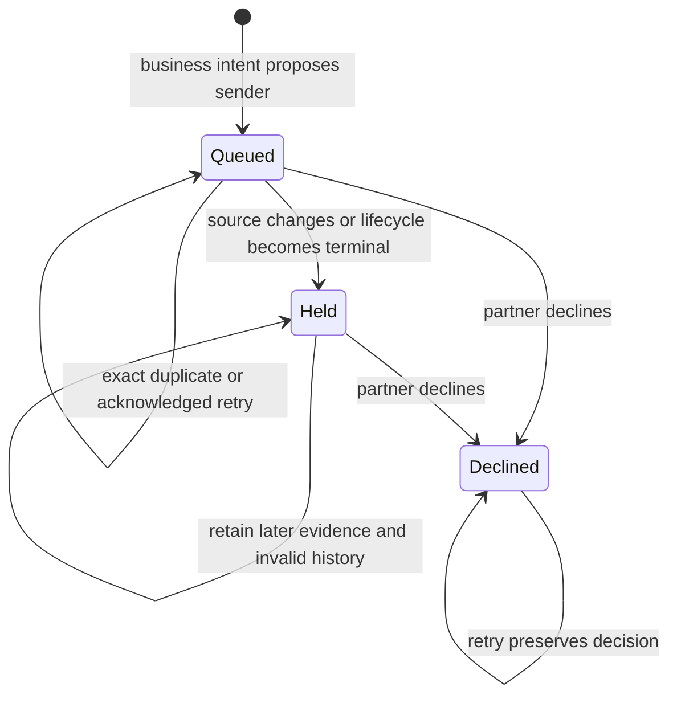

# Candidate signature evidence

The data shape is one mailbox/address candidate with immutable observations and an evidence version. Observations bind the source, raw evidence digest, extraction version and candidate version. They never verify identity.

## System design

Two shapes were considered. A growing source_row JSON array rewrites history on every append. An indexed child table keeps source revision history and candidate readback together. The child table is the chosen interface.

Candidate row locks serialize append, decline and confirmation. Installed email identity advisory locks serialize lifecycle observations. Invalid sources hold pending promotion through a database guard. Readback returns candidate and evidence versions. No cache authorizes promotion.

Historical J129 stock is 15 pending candidates and 1161 decoded rows. The 10x scenario is 150 candidates and 11610 rows, not measured traffic. Decoder scanning and local JSON rewriting are the first limits. Intake batches 50 observations per request with 20 requests per run. Two consecutive failures stop the stage. Existing journal backoff and the 120 second transport timeout apply. Readback uses candidate and UUID pagination, capped at 100. No per-observation network reads are needed.

Ordinary intake produces deterministic observations. CARR consumes them inside its existing transaction envelope. There is no new provider, model call, queue or software-factory dependency. Failed writes remain in the existing journal. T3 owns worktree cleanup. Disposable fixture supervisors own database cleanup.

The throughput checkpoint has grounded contracts and overlap before implementation. One worker owns the coupled intake and database change. Shared evidence serializes on candidate locks. Fan-out is inapplicable because the brief forbids subagents.

## Statechart



A crash before commit leaves no observation. A crash after commit before acknowledgement replays the request. Fresh evidence cannot erase invalid history or verify itself. Verification and reviewed resolution belong to subsequent units.

## Readback contract

`observe-email-candidate-signatures` accepts at most 50 observations for an existing mailbox-scoped address. Its envelope key is an immutable UUID derived from the frozen batch. It returns `email-candidate-signatures.v1`, `pool_id`, `candidate_version`, `evidence_version`, insertion and duplicate counts. Declined candidates return their terminal status without appending.

`read-email-candidate-signatures` takes `pool_id`, optional `after` UUID and `limit` up to 100. Candidate metadata and its observation page use one database snapshot. The next two units must bind verification and resolution to both version tokens and re-read after any conflict. `source_invalid` remains held until an explicit reviewed resolution in a later unit. Observation `candidate_version` is the version when that observation entered the set, not the current set version.

`record-email-lifecycle` now accepts a retained candidate source even when it has no canonical activity. It uses the same mailbox identity, methods, lifecycle version and observation replay rules as captured activities. The lifecycle receipt and candidate audit event retain invalid history. Absence from a decoder scan is not a deletion observation.

## Production proof

After merge, deployment and Studio installation, run this read-only counts command following ordinary intake.

```sh
./run.sh call read-email-candidate-signature-counts '{"since":"2026-11-01T00:00:00Z","until":"2026-12-01T00:00:00Z"}'
```

The result contains observation and candidate counts, invalidated observations, duplicate observations and an observations-per-candidate histogram. It returns no names, addresses, subjects, bodies or candidate IDs. The source occurrence window is half-open. The histogram must include a candidate with at least two observations and `duplicate_observations` must be zero. Compare readbacks around an ordinary repeated intake run and its `candidate_signature_duplicates_suppressed` receipt count. An invalidation requires a naturally observed lifecycle event or source revision. Without it, that positive transition remains unproven. Do not rerun intake or mutate business records for proof.
