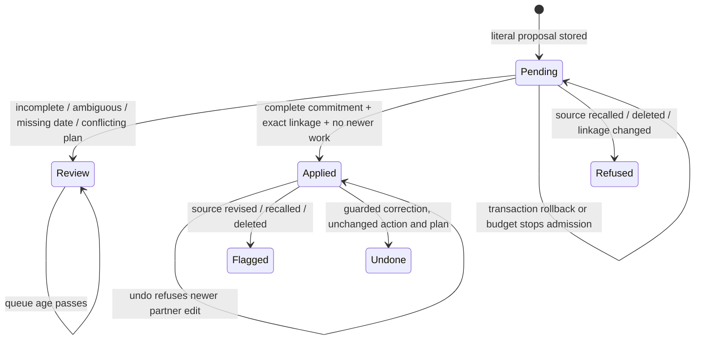

# Email commitment application

M settled. One worker owns the adapter, registered contract and tests. Blocking reads and consumer merge precede edits; no fanout. Shared writes serialize on source, proposal and canonical subject locks. No nested agents per brief.

## Existing flow and chosen interface

Router extracts proposals, record-email-proposal validates literal captured evidence, preview-email-next-step binds source/target/version, canonical set-next-step or set-next-action writes the task. J133 owns durable extraction generations and leases. This slice consumes that contract. No mailbox effects.

Two shapes considered: new executor queue/table/verbs versus existing proposal modes and pending proposal queue. Choose the latter. Evidence evaluation, application and receipt live together in email-step-application.js. Existing proposal owns review/application/undo evidence in correction_provenance.email_application; canonical writers own tasks and events. Shared automaticEvidenceHold remains the first evidence gate. Call and email plan undo use the same restoration helper with explicit source verb.

## Capacity and consistency

Supplied load is eight pending proposals, zero confirmed; not a new production census. At 10x, pending read pages cap at 25; index-backed activity/proposal joins. First limit remains 25 sources/20 minutes per router pass. Each application has bounded constant queries (no contact roster N+1), no external fanout. PostgreSQL transaction and source/subject locks refuse stale linkage, lifecycle, hash or edits. No stale cache; no new cache, invalidation or eviction needed. Persisted held proposals survive age. Apply and receipt commit together; rollback leaves pending. Retry after commit reads the permanent receipt, including after envelope expiry. Undo is a separate normal correction with version checks, never undo-call-change with an email ID.

External calls reuse installed CARR transport timeouts/retries, model subprocess 180s, two consecutive failures break the pass, 25-source admission and shared 20-minute budget. No new external provider. Database failures roll back, transport failures leave durable pending work. No additional queue or resources; T3 owns worktree cleanup. Existing receipts expose counts, no personal data.

## Statechart written before code



Tests will exercise every transition plus two-source partial success and pass budget. No model prompt or schema change planned; deterministic application policy receives its own cases. No live model quality improvement claimed.

## Delivered contract and conservative holds

`record-email-proposal` stores an immutable captured-source digest and optional filing generation with the existing proposal. Undated proposals retain null rather than inventing a due date. `mode=apply_next_step` takes a proposal_id and an idempotency_key. It returns email_application.state applied or review, a reason for holds, and duplicate_suppressed on permanent receipt replay. The source and proposal lock, canonical write, receipt and event are one transaction. No separate proposal-ID-to-call-ID conversion exists.

Automatic eligibility is deliberately narrow: an outgoing authenticated partner's own literal “I will”, “I shall” or “I commit to” commitment, confidence at least .95, complete full body, literal ISO due date and task words grounded in the quote. The quote must begin the captured text and cannot be forwarded attribution. Incoming attribution, relative or absent dates, paraphrases, questions, suspected instructions anywhere in the body and legacy unknown completeness stay review proposals. No prompt, model, schema or matching policy changed. This is a deterministic application-policy change, not a measured model-quality improvement.

Deal work also requires the current exact J133 filing digest and confirmed or inherited authority. Contact work uses the existing activity-linked canonical contact view. Existing ordinary actions, board plan or date cause a review hold; checklist siblings remain unchanged. Newer canonical plan/action events after the source occurrence also hold. Closed, merged or unresolved targets cannot apply.

`email-router-queue purpose=next_steps` returns a bounded page of pending unevaluated proposals of every age. The existing router consumes it before extraction, at most 25 applications per pass, sharing the pass deadline and stopping after two consecutive failures. Proposals extracted later in that pass become eligible on the next ordinary pass. Review holds do not automatically re-enter execution; partners use the existing preview/confirm route. Incomplete extraction is a durable pending hold excluded from the queue until a source change creates a fresh J133 generation; it does not suppress body-repair recovery. Existing expiry retains evaluated next-step holds and undated proposals.

`mode=undo_next_step` takes proposal_id, idempotency_key and, for a deal, its fresh base_version. It requires a verified human partner. Call and email plan corrections use the same restoration implementation; action corrections drop only the created untouched action and restore the prior deal date. Action and deal versions refuse later partner changes. Existing terminal-source database and envelope guards also refuse undo against recalled/deleted mail; correction must then use the canonical domain surface. No lifecycle gate was bypassed. Undone receipts suppress automatic reapplication.

`list-email-proposals` exposes application state, source_changed, source_terminal and current undo_eligible. Applied/held receipts remain visible after a lifecycle change. Guarded correction does not promise eligibility forever. No application is declared live-proven by this source change.

## Counts-only production readback

After merge/deploy, a separately authorized read-only proof binds the installed full runtime SHA and one ordinary natural intake receipt. Do not launch intake, manufacture business work or execute an undo. Read installed receipt counters next_step_applied, next_step_review, next_step_refused, next_step_duplicate, next_step_failed, application_applied (extractions), application_held and incomplete_held. The existing `studio-run-receipt.v1` observer uses service email-router and count next_step_applied with minimum 1. Zero eligible is pending positive proof.

Run the following prepared read-only SQL with $1 = the natural run's observed UTC start, $2 = its observed UTC end, $3 = the authenticated mailbox owner slug. The cohort uses proposal creation time, includes old source occurrences, rejects future source occurrence, and does not count bulk source loads as application. Repeat with the same private cohort window after the next ordinary intake. Return counts only. Keep source/proposal IDs private. Partition missing and dangling separately; inactive targets are excluded from the active population but counted explicitly. A second ordinary pass must not increase applied action or application-event counts for the frozen cohort.

```sql
with cohort as (
  select p.*,a.occurred_at,a.deal_id as current_deal,
    public.email_filing_source_hash(a) as current_hash,
    coalesce(a.email_context#>>'{lifecycle,state}','live') as lifecycle,
    d.id as linked_deal,d.phase,cl.id as linked_client,
    (cl.merged_into is not null or cp.merged_into is not null or cp.deleted_at is not null) as inactive,
    p.correction_provenance->'email_application' as receipt
  from email_proposal p join activity a on a.id=p.activity_id
  left join actor owner on owner.id=a.actor_id
  left join deal d on d.id=p.deal_id
  left join client cl on cl.id=coalesce(d.client_id,a.client_id)
  left join party cp on cp.id=cl.party_id
  where p.kind='next_step' and p.created_at >= $1 and p.created_at < $2
    and a.occurred_at <= $2 and coalesce(a.email_source->>'mailbox_owner',owner.slug)=$3
), evidence as (
  select c.*,n.id as action_id,
    (select count(*) from event e where e.verb='record-email-proposal' and e.field='email_application'
      and e.new_value->>'proposal_id'=c.id::text and e.new_value->>'state'='applied') as applied_events
  from cohort c left join next_action n on n.id=(c.receipt->>'action_id')::uuid
)
select count(*) as extracted_proposals,
  count(*) filter(where receipt is null) as pending_evaluation,
  count(*) filter(where receipt->>'state'='applied') as applied,
  count(*) filter(where receipt->>'state'='review') as review_held,
  count(*) filter(where receipt->>'state'='undone') as undone,
  count(*) filter(where receipt is not null and receipt->>'source_hash'<>current_hash) as source_changed,
  count(*) filter(where lifecycle<>'live') as terminal,
  count(*) filter(where deal_id is null) as non_deal,
  count(*) filter(where deal_id is not null and linked_deal is null) as dangling_deal,
  count(*) filter(where inactive or phase='closed') as inactive_target,
  count(*) filter(where receipt->>'state'='applied' and action_id is null) as dangling_action,
  count(*) filter(where receipt->>'state'='applied' and applied_events<>1) as invalid_effect_count,
  count(*) filter(where receipt->>'state'='applied' and not coalesce(inactive,false) and phase is distinct from 'closed') as active_applied
from evidence;
```

Read `v_email_step_undo` eligibility counts joined by the same frozen cohort. In private read-only pre/post snapshots of the target's `next_action` rows, exclude each receipt's action_id and compare every remaining `(id,status,version)` tuple. Return sibling_count and changed_sibling_count only. Require changed_sibling_count=0, dangling_action=0 and invalid_effect_count=0. Test the inverse by counting all excluded inactive/dangling subjects independently; do not quietly drop them from totals. At least one naturally eligible commitment must update the correct canonical plan/task with a source-linked event and live domain readback. Deployment identity and synthetic tests alone do not satisfy this proof.
