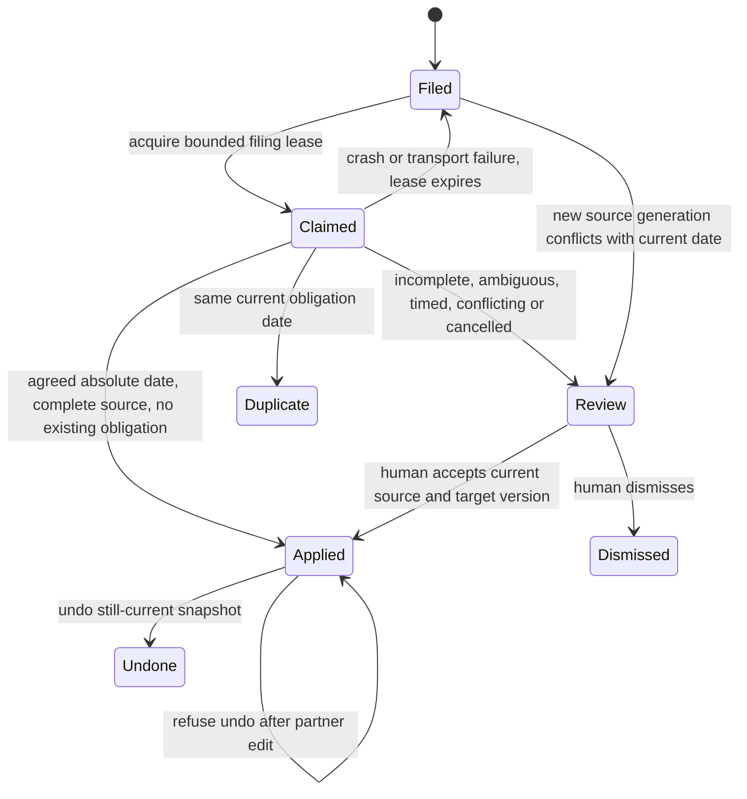

Card: WR634.S1.J138

Settled M slice. Interface A extends the general model proposal with asserted date/confidence fields. Interface B extracts bounded obligation quotes deterministically and rederives dates and holds inside the server adapter. Choose B. No model assertion can waive the evidence bar and no model output or prompt changes.

Owned data is one email critical-date effect per filing generation and recognized obligation kind. Existing activity/filer own source identity, completeness and lease. critical_date owns date-only Chicago business dates, status, version and deal reader. New effect rows own before/after snapshots, review reasons and source/event lineage. Task dates stay separate.

Current measured intake is 17 seven-day router rows in J129, not a unique ingestion rate; durable pending load is unmeasured. Existing budget is 25 sources per run, 20 minutes, three lease attempts, five-minute leases and breaker after two transport failures. Ten times that observed queue is 170 rows and drains over bounded runs. First limit is the existing model budget, unchanged. This adapter adds no external/model call. Carr wrapper timeouts/rate bounds apply. PostgreSQL statement/lock timeouts reuse request settings. Per-source at most four obligation kinds; fixed bounded queries, indexed generation and deal/kind lookup. No N+1 unbounded collection. No cache, invalidation or eviction needed. No scheduler, new queue or factory dependency. Existing filing worker produces, server consumes atomically. Row locks serialize source then deal and obligation. Source hash and lease bind attempts. Unique effect key deduplicates retries, including partial success. Transactions roll back effect/date/event together. No resources survive request teardown.

Statechart fixed before implementation, rendered here with the same transitions:



Stale leases refuse writes. Cancellation stays in review; human resolution drops
the identified existing obligation. An undone row remains dropped instead of being
deleted, and a correction undo restores the previous date and status.

Verification fixed before build: deterministic extraction failing-before test; registered-tool disposable PostgreSQL tests assert actual critical_date and event rows, source staleness, mailbox isolation, crash/retry, date-only DST dates, conflict, cancellation, review correction and guarded undo. Existing router, filing and critical-date closure tests protect baseline. New extraction fixtures are deterministic evaluations, not model quality claims. No production writes. Proof remains landed-unproven until coordinator runs ordinary-intake readback after deploy.

## Contract and review

`record-email-proposal` mode `critical_date` accepts activity_id, deal, generation,
claim_id, obligation_kind and evidence_quote, with an idempotency_key. It derives
all application evidence from the locked captured source. There are four recognized
kinds, loi_expiry, lease_commencement, lease_expiration and contingency_deadline.
The extractor intentionally has no model call. It emits at most four quotes from
12,000 characters. Unsupported/relative wording is retained for review. Automatic
date-only application accepts the exact agreed absolute statement grammar. Timed
statements are reviewed, including explicit zones, because the existing domain
stores a date rather than a contractual instant. No legal deadline is computed.
Any attachment metadata, contradictory date, uncertainty, suspected instruction,
unknown/partial/preview body or existing conflicting obligation prevents automation.
No existing obligation is automatically replaced, cancelled or reopened.

`email-router-queue` purpose `critical_dates` returns mailbox-owned effects with
reason, quote, source hash, generation and target snapshots. It pages by effect UUID
using limit (maximum 200) and after. These records are the review reader contract;
this slice changes no app surface. The general email_proposal table is unchanged.

Mode `critical_date_review` requires a verified human partner actor, effect_id,
decision (apply/cancel/dismiss) and reason. Apply requires due_on; correction and
cancellation require the existing critical_date_id and current base_version.
It refuses changed source text, linkage or lifecycle, or an intervening target edit.
Mode `critical_date_undo` requires effect_id. It restores the before snapshot only
when every saved after field including version still matches. Undo of a new date
marks it dropped and preserves its evidence. Undo remains available when source
text is revised; it checks the applied value rather than trusting revised text.
All effects and date changes are transactional with their deal event. Source
references are `activity:<uuid>` plus filing generation/effect. The existing
`get-deal-room` critical_dates reader exposes the actual domain rows.

The normal filing consumer records critical dates before the existing model call.
A later model failure leaves that effect committed and safely deduplicated on retry.
The extraction and server grammar are intentionally conservative. Wider wording,
more obligation kinds or timed-instant storage requires another measured change.

## Production proof for the coordinator

Status remains landed-unproven. Do not rerun intake or manufacture a live date.
Run this read-only query through an authorized counts-only database reader after
the merged worker release deploys. The fourteen-day window is on email occurrence,
not migration time or effect insertion. Exclude merged/deleted parties and closed
or invoiced deals. Freeze the actual observed window boundaries in the proof report.

```sql
with eligible as (
  select e.* from email_critical_date_effect e
  join activity a on a.id=e.activity_id
  join deal d on d.id=e.deal_id
  join client cl on cl.id=d.client_id join party p on p.id=cl.party_id
  where a.kind in ('email_in','email_out')
    and a.occurred_at >= now()-interval '14 days' and a.occurred_at < now()
    and cl.merged_into is null and p.merged_into is null and p.deleted_at is null
    and d.phase <> 'closed' and d.invoiced_on is null
)
select count(*) as date_proposals,
  count(distinct activity_id) as source_emails,
  count(*) filter(where status='applied' and reason is null) as automatic_effects,
  count(*) filter(where status='review') as held_effects,
  count(*) filter(where status='applied' and reason is not null) as reviewed_effects,
  count(*) filter(where reason='existing_obligation_conflict') as conflicts,
  count(*) filter(where status='duplicate') as duplicate_suppressions,
  count(*) filter(where status='applied' and exists (
    select 1 from v_deal_room_critical_date cd where cd.id=eligible.critical_date_id
      and cd.deal_id=eligible.deal_id
  ) and exists (
    select 1 from event ev where ev.verb='record-email-proposal'
      and ev.subject_id=eligible.deal_id
      and ev.new_value->>'effect_id'=eligible.id::text
      and ev.new_value->>'activity_id'=eligible.activity_id::text
  )) as reader_and_event_correlations
from eligible;
```

Expected positive proof has automatic_effects >= 1 and at least that many correlated
reader/event rows. Also privately bind one applied critical date to its exact
source event and date via the ordinary deal-room reader. Counts alone cannot prove
correct date selection. Count effects by generation/kind and assert no group > 1.
Observe the next ordinary intake cycle and assert it produces zero additional
critical_date IDs for already-applied source/generation/kind pairs. A new correction
or source revision is a different population and must be reported separately.
If no eligible live statement exists, report zero and held reasons. Do not call the
unit live-proven from release identity or synthetic tests alone.

## Design and debt pass

Codebase-design concentrates evidence, transactional application, correction and
undo in one adapter behind existing record/queue verbs. The filing lock now accepts
a write-lock choice to avoid unsafe lock upgrades. No second state engine or model
schema was added.

Zero-tech-debt uses the canonical critical_date table and reader and stores only
effect lineage and snapshots separately. It adds no scheduler, compatibility alias,
production dependency on software-factory, duplicate task-date path or cache.

The intake now records attachment_count without filenames or content. A missing
count is unknown and cannot clear the automatic bar. Legacy complete bodies stay
held until ordinary capture supplies this evidence. Existing LOI spelling variants
resolve to the same obligation; corrections keep the existing row ID and kind.
