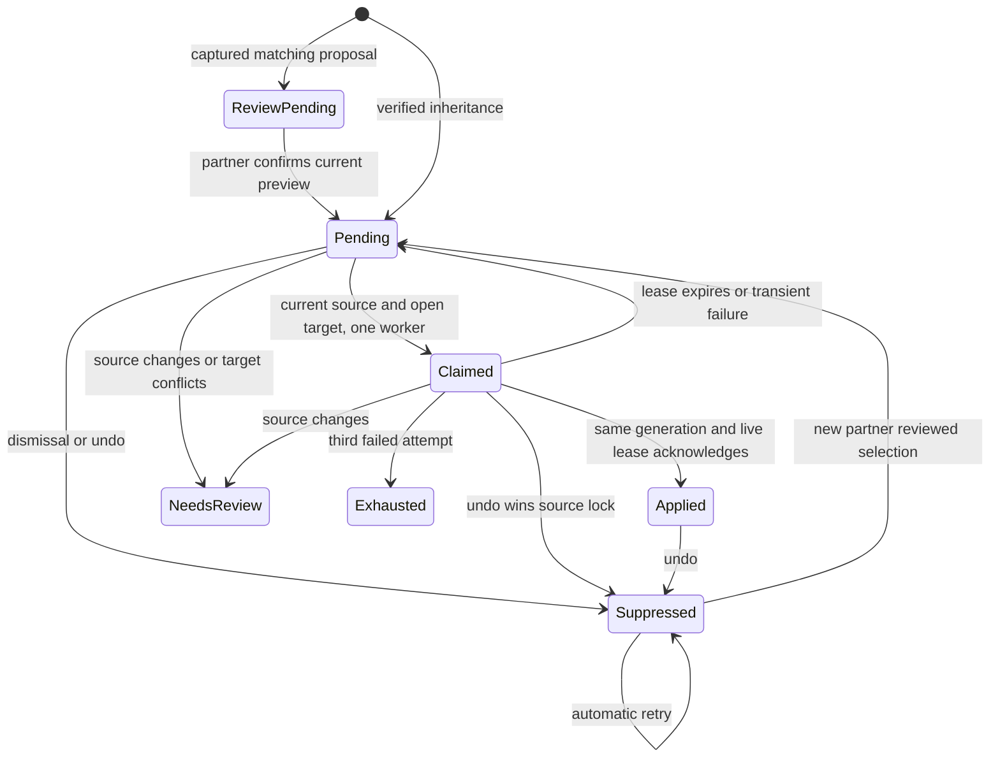

# Durable filing application

Size M. One durable generation row owns source digest, selected deal, authority receipt,
claim lease, attempts and terminal disposition. Proposal rows remain review evidence.



Never acknowledge another generation or a superseded claim. Never automatically
resurrect suppression. Never let either age horizon or local routed state hide work.
Tests follow each transition, plus atomic rollback, ownership and bounded paging.

Two interfaces considered: a new queue verb family or purposes/modes on the existing
router/proposal verbs. Choose existing verbs to retain authentication, envelope,
transport and consumer ownership. Postgres owns generations; existing classify and
proposal validation own extraction. No second spool and no new model authority.

At the supplied 17 queued / 8 reviewed sources, and 170 / 80 at 10x, an indexed
pending page of 25 bounds reads and model calls. One locked router pass, three
attempts, five minute leases, twenty minute pass. First limit remains matching's
255 candidates, unchanged. No contact N+1 in durable queue. No cache; strict current
source/deal validation at queue, claim, proposal write and completion. Terminal rows
retain evidence under existing activity retention. Generation writes use unique
selection/source identity; external writes use existing idempotent envelopes.

Sequential external work stops after two consecutive transport/model failures;
existing failure receipt reports it, pending work survives. Existing model_call
subprocess timeout is 180 seconds. CARR transport uses installed timeout/retry.
No new external service, alert, scheduler or fanout. Database failure rolls back
filing plus enqueue; extraction failure preserves filing. T3 owns cleanup.

## Pending production proof

Run these counts only through a separately authorized read-only connection after
merge, deployment and an ordinary installed intake run. They do not launch intake.
This is a generation census across all source ages, not an activity trend.
Retain a private source/deal/generation binding for one naturally eligible email.
Check its current open deal and confirmed or continuity receipt privately. Compare
that generation on a later ordinary run. Zero eligible leaves positive proof pending.
The Studio receipt must report application_applied greater than zero from the exact
installed runtime. Synthetic fixtures and release identity alone do not prove this.

```sql
select g.authority,g.status,g.reason,count(*) as generations,
 count(*) filter(where g.source_hash=public.email_filing_source_hash(a)
   and a.deal_id=g.deal_id and d.phase<>'closed' and d.invoiced_on is null
   and cl.merged_into is null and p.merged_into is null and p.deleted_at is null
   and coalesce(a.email_context#>>'{lifecycle,state}','live')='live') as current_open,
 count(*) filter(where a.recorded_at<now()-interval '7 days') as late_sources
from email_filing_application g join activity a on a.id=g.activity_id
left join deal d on d.id=g.deal_id
left join client cl on cl.id=d.client_id left join party p on p.id=cl.party_id
group by g.authority,g.status,g.reason order by 1,2,3;

select count(*) as duplicate_proposal_groups from (
 select activity_id,deal_id,kind from email_proposal
 group by activity_id,deal_id,kind having count(*)>1
) duplicates;

select count(*) filter(where a.deal_id is null) as missing_filing,
 count(*) filter(where a.deal_id is not null and d.id is null) as dangling_filing,
 count(*) filter(where d.id is not null and (d.phase='closed' or d.invoiced_on is not null)) as closed_target
from email_filing_application g join activity a on a.id=g.activity_id
left join deal d on d.id=a.deal_id where g.authority<>'review';
```

Read suppressed generations and real unresolved reasons in the first census when
present. Preserve them across the later run. Do not manufacture business state to
obtain positive proof. No live census was performed by the builder.

## Verification mapping

The PostgreSQL application test drives late review into extraction, two concurrent
claims, acknowledgement, version-only changes, source replacement, expired-lease
recovery, stale acknowledgement, retry exhaustion, ownership, closed targets,
transaction rollback, lifecycle removal and bounded pages. Existing filing tests
exercise real inheritance and guarded undo under carr_writer. The router tests
exercise generation binding, two-failure circuit opening and the pass deadline.
The existing nine fixed-score matching cases remain the policy comparison; no
prompt, matcher policy or model output schema was changed.

The decisive safety fact is that a producer and its generation commit together,
and every downstream write locks the source before checking the current digest,
selected deal and exact claim. Independent worker claims contend on that same
source lock. This document is a statechart and executable test map, not a formally
checked TLA+ model. Review must use the tested head and the recorded suite results.
