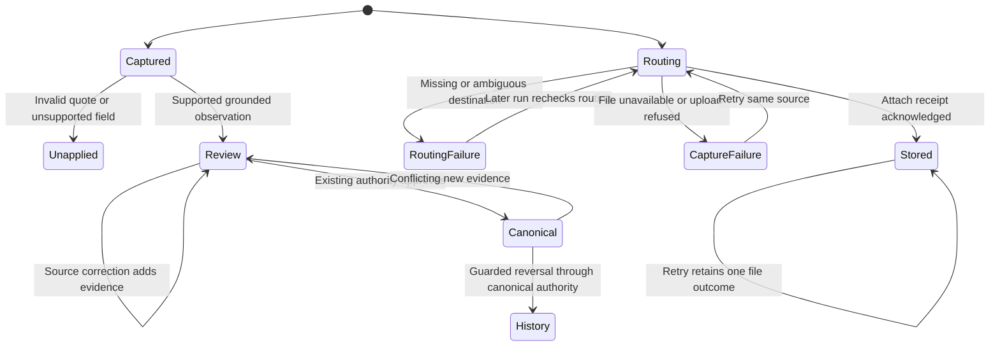

# Email facts builder design

Card: WR634.S1.J139

The existing fact store owns observations, normalized units, review and canonical history. The Python email adapter owns the immutable captured source version and the conversion of already extracted scalar candidates. The intake owns per-attachment routing outcomes in its existing locked state. No new fact table, queue or orchestration service is introduced.

Two interfaces were considered. A general email fact writer would accept arbitrary field/value pairs and independently decide promotion. The selected adapter accepts the existing extraction output with its cited source and produces existing fact observations and explicit dispositions. It leaves promotion entirely to the current fact authority kernel. The adapter cannot assert verified lineage. Current source at c7b3ed7e8 requires two server-verified independent observations for automatic promotion, with the feature setting enabled. The existing extractor marks observations human_review and lineage unverified. Email body plus its attachment cannot manufacture independent evidence.

The J129 observation contained 1,161 admitted mail rows and repeated routing attempts, not distinct files. At ten times that stock, parsing is bounded to 500,000 characters per source and 100 observations per write. Per-source outcomes replace prior attempts by stable source ID, so retries do not inflate the distinct count. The first limit is the existing single intake run and model/extractor throughput. No live throughput benchmark is claimed.

The adapter is pure, with no external call, queue, cache, fan-out or resource lifetime. Extraction and fact storage retain installed timeout, budget, authorization and transaction limits. Cache invalidation is n/a for immutable adapter results. Intake state persists under its existing lock and atomic replace; outcome rows expire with the existing 30-day attachment retention. No content, filename or address is added to receipts. Source keys already live privately in intake state.

Storage is the existing batch write and review query, not one query per field. A crash before recording has no effect; after recording the same stable batch key replays. A changed source produces another batch without replacing evidence or human canonical facts. Disagreeing candidates remain distinct observations in one field review. Quote mismatch and unsupported fields are explicitly unapplied. Incomplete capture never implies absent facts.



Canonical application and reversal belong to the kernel and must not be added as unchecked client writes. This build's adapter tests cover evidence transitions; current kernel tests cover canonical authority. A separate production proof must count unique source versions, never sum retry counters. No synthetic or local result is production proof.

Throughput checkpoint. Blocking steps are contract inspection and overlap checks. Independent workstreams are n/a because this is one worker and delegation is forbidden. Shared state uses the intake's existing run lock. The smallest safe decomposition is the evidence adapter and routing receipts first, then server-bound email application/guarded reversal once filing generations are delivered, then the coordinator's installed proof. This distinction is required because the currently installed fact kernel does not consider a grounded single email authoritative.

## Build boundary and remaining acceptance

This branch is a partial builder result. The body adapter is an importable evidence converter, exercised against the existing store in a database test. It is not connected to ordinary intake. No body fact application, attachment extraction scheduling, cross-source conclusion projection or guarded email fact reversal is claimed. Attachment capture statuses are operational receipts, not canonical fact receipts.

The remaining work is a server-bound email fact job that checks the current filed source generation before recording and retains every rejected or unsupported candidate. It must connect the ordinary consumer to that job and the existing attachment extractor. It must then add guarded canonical reversal without fabricating a second fact store. Existing canonical rows require a value, including version one, so reversal of an initial automatic fact needs a real retraction contract and compatible readers. Appending a prior-looking value without a retraction marker is not an undo. This must be tested as part of the canonical contract, not hidden in the Python adapter.

Design and debt pass. Codebase-design keeps validation and evidence construction in one adapter using the existing scalar validator. Zero-tech-debt reuses existing observations, intake state, locks and atomic writes. The unfinished ordinary-intake connection remains explicit rather than a second queue or speculative generic fact writer.

Skills used: poteto-mode, how, architect, blast-radius, tdd, statechart, principle-model-the-domain, codebase-design, zero-tech-debt, unslop, deslop.

The Model the Domain principle selected an immutable EmailFactSource and one field-to-disposition mapping. Delegation and parallel design agents were skipped because this builder brief prohibits subagents. The two interface shapes were compared directly.

## Read-only production proof query

After the ordinary consumer is connected, deployed and has received natural intake, use this counts-only query through the authorized read-only proof lane. The prefix binds the adapter version and original source identity. Do not rerun intake to create evidence.

```sql
with retained_email_evidence as (
  select id, organization_tenant_id, entity_ref, fact_key, document_ref, content_hash
  from ops.fact_observation
  where organization_tenant_id='carr-internal'
    and extractor_version like 'email-facts.v1+%'
    and document_ref like 'email:%'
), email_evidence as (
  select e.* from retained_email_evidence e
  join public.deal d on d.id::text=e.entity_ref
  join public.client cl on cl.id=d.client_id and cl.merged_into is null
  join public.party p on p.id=cl.party_id and p.merged_into is null and p.deleted_at is null
), fields as (
  select distinct organization_tenant_id,entity_ref,fact_key from email_evidence
)
select
  (select count(*) from retained_email_evidence e
    where not exists(select 1 from public.deal d where d.id::text=e.entity_ref)) as dangling_deal_observations,
  (select count(*) from retained_email_evidence e
    where exists(select 1 from public.deal d where d.id::text=e.entity_ref)
      and not exists(select 1 from email_evidence live where live.id=e.id)) as retired_party_observations,
  (select count(*) from email_evidence) as body_observations,
  (select count(distinct (document_ref,content_hash)) from email_evidence) as body_source_versions,
  (select count(distinct c.id) from ops.canonical_fact c
    join email_evidence e on e.id=any(c.observation_ids)
    where c.organization_tenant_id=e.organization_tenant_id) as canonical_history_entries,
  (select count(*) from fields f
    where (ops.fact_review_field(f.organization_tenant_id,f.entity_ref,f.fact_key)->>'pending')::boolean)
    as pending_field_reviews;
```

A positive canonical count is necessary but insufficient. The verifier must read at least one canonical field through list-fact-review and bind its source UUID privately. An unchanged next ordinary run must add no observation rows for the same batch. Attachment routing gauges are the attachments_distinct_* keys in the ordinary intake receipt, backed by attachment_outcomes in private state. Those gauges must not be summed over runs. This partial build cannot yet supply durable unsupported-field totals or attachment extraction/application counts, so the requested whole-unit production proof remains pending until the consumer and server job are implemented.

The query covers all retained adapter evidence, not a dated intake window or a current-party census. Live counts exclude merged client and party tombstones and deleted parties. Dangling deal references and retired-party evidence are separate counts. The inverse partition is retained evidence equals live plus dangling plus retired evidence. The verifier must bind a natural-run occurrence window privately before attributing causality to that run.
