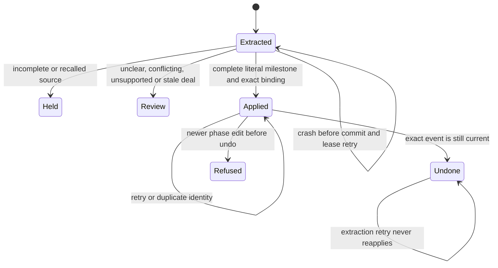

# Email phase application

Card: WR634.S1.J137

CARR owns source, proposal and phase state. The existing router owns extraction and its durable filing lease. Two interfaces were considered: a separate apply verb, or application inside record-email-proposal. Choose the latter so evidence, deduplication and application commit atomically. The receipt is stored in email_proposal.correction_provenance.email_phase, with source hash, identity, literal quote, from/to phase and exact domain event. Undo uses existing revert-deal-field and refuses newer phase events. There is no second phase table.

J129 observed 17 queued activities and 80 open deals. At ten times that stock, the existing 25-email page drains across runs. Model latency is the first limit, bounded by the installed 180-second timeout, three claim attempts, five-minute leases and two-failure transport breaker. No new external calls or queues are introduced. Each candidate uses constant database reads without fan-out. No cache is appropriate for evidence or phase state. All source and version checks refuse stale state. A crash before commit rolls back both effect and receipt; after commit the receipt prevents reapplication. Platform cleanup owns scratch resources. One worker owns the atomic source/deal workflow; there are no disjoint workstreams. Existing transaction deadlines bound database calls.



The extraction prompt and output stay unchanged. The deterministic adapter requires complete capture metadata, exact open-deal binding, extraction-time version, high confidence and affirmative milestone wording. Unknown, partial or conflicting bodies are held. Ambiguous evidence retains one review proposal. Supported transitions remain the existing adjacent phase rules. Production remains unproven pending the coordinator's installed intake observation, event readback, duplicate-free second run and read-only undo eligibility.

Design and debt pass. codebase-design concentrates phase policy behind applyEmailPhase, with the existing proposal transaction as its interface. zero-tech-debt reuses the filing queue, phase transition registry, evidence hold, domain writer and field revert; it introduces no parallel table, extraction model or queue. The additional code supplies the missing automatic evidence checks and source receipts. The identity lookup scans phase proposals; at larger historical volumes an expression index may be needed. This is a storage limit, not a measured latency claim.

The counts-only production readback below covers only this adapter's stored receipts. Run it before and after an ordinary installed intake run, then after the following ordinary run. Require positive applied evidence, zero missing domain events, zero duplicate applied source keys and no second application for an unchanged source. The installed run receipt separately counts phase_refused attempts, which cannot be counted as persisted successful proposals. Inspect one private eligible generation's source-linked event through the ordinary authenticated reader. Do not mutate production to test undo.

```sql
with receipts as (
  select p.deal_id,p.activity_id,p.correction_provenance->'email_phase' as r,
    p.resolution_reason from email_proposal p
  where p.kind='phase_move' and p.correction_provenance ? 'email_phase'
), applied as (
  select * from receipts where r->>'status' in ('applied','undone')
    and resolution_reason='automatic_email_milestone'
)
select
  (select count(*) from receipts where r->>'status'='applied') as applied_receipts,
  (select count(*) from receipts where r->>'status'='review') as reviewed,
  (select count(*) from receipts where r->>'status'='held') as held,
  (select count(*) from receipts where r->>'status'='undone') as undone,
  (select count(*) from applied x where not exists (
    select 1 from event e where e.id=(x.r->>'event_id')::uuid
      and e.subject_id=x.deal_id and e.field='phase')) as missing_domain_events,
  (select count(*)-count(distinct r->>'source_key') from applied) as duplicate_applied_sources,
  (select count(*) from applied x join activity a on a.id=x.activity_id
    where x.r->>'status'='applied'
      and public.email_filing_source_hash(a)=x.r->>'source_hash'
      and coalesce(a.email_context#>>'{lifecycle,state}','live')='live'
      and x.r->>'event_id'=(select e.id::text from event e
        where e.subject_id=x.deal_id and e.field='phase'
        order by e.recorded_at desc,e.id desc limit 1)) as undo_eligible;
```

Undo calls record-email-proposal with mode=phase_undo, the original proposal_id, a freshly read phase_base_version and a fresh idempotency_key. It checks source revision and lifecycle before the existing latest-field revert. Re-extraction after undo cannot advance that source again. Generic revert-deal-field retains its existing behavior for callers outside this adapter.
