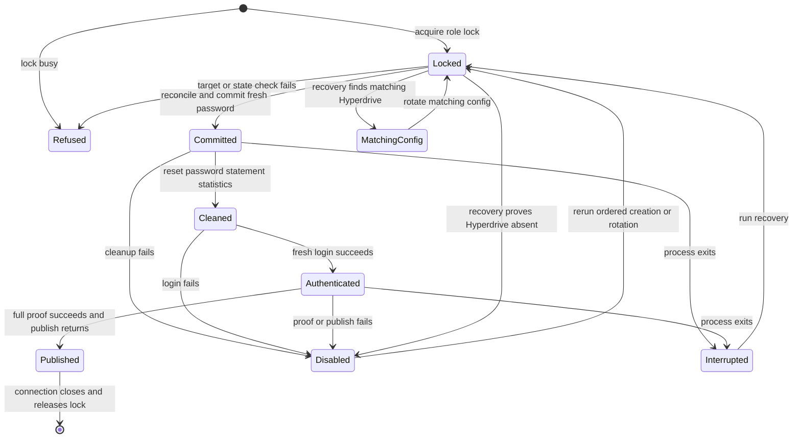

# Reconcile the engine production writer

Run only in a production-authorized task. This PR's implementation and tests do not authorize a production run.
The reviewed entrypoint is `tools/engine-db-role.py --environment production --writer`.
It pins the direct production endpoint, owner, database and Cloudflare account, checks owner logging settings, and proves the writer before publication.
Every safety condition raises `Refusal`; Python optimization cannot remove these checks.

For initial creation, the authorized operator runs this command from the reviewed checkout.

```sh
CARR_BREAK_GLASS=1 python3 tools/db-tap.py --reason "Reconcile engine production writer through reviewed ordered publication" run tools/engine-db-role.py --environment production --writer
```

Success prints only `created` and `password_changed` booleans. The password stays in process memory and the Hyperdrive origin.
An existing LOGIN role blocks creation. A matching existing Hyperdrive requires `--rotate`.
Reader rotation uses the existing `--hyperdrive-account` and `--hyperdrive-config` arguments and preserves the GET response's caching and connection limit.

## Recover an interrupted publication

Run the recovery command before retrying an interrupted or ambiguous creation.

```sh
CARR_BREAK_GLASS=1 python3 tools/db-tap.py --reason "Recover interrupted engine writer publication" run tools/engine-db-role.py --environment production --writer --recover
```

Recovery takes the same session advisory lock as publication and inspects the complete Hyperdrive list.
An unavailable, paginated or mismatching response refuses before SQL mutation.
If no matching Hyperdrive exists, recovery commits `ALTER ROLE ... NOLOGIN PASSWORD NULL` for an existing writer and clears its password statements from `pg_stat_statements`.
An old password remains unusable even if LOGIN is later restored.
Recovery returns `hyperdrive_exists=false` and `invalidated=true` for this orphan case. Rerun the initial creation command to reuse the disabled role with a fresh password through the normal ordered path.
If the matching Hyperdrive exists, recovery returns `hyperdrive_exists=true` and leaves the role intact.
Rotate that configuration through the reviewed command.

```sh
CARR_BREAK_GLASS=1 python3 tools/db-tap.py --reason "Rotate recovered engine writer Hyperdrive credential" run tools/engine-db-role.py --environment production --writer --rotate
```

A failed login, proof or publication disables the credential. A failed invalidation or statistics cleanup requires another recovery before retry.
A process kill after password commit can leave a usable password until recovery. PostgreSQL releases the session lock when that process's connection closes.

## Publication statechart



`test_publication_order_failure_cleanup_and_redaction` covers commit, login, publish, compensation and commit failure.
`test_busy_rotation_refuses_before_reconciliation` covers lock contention; the PostgreSQL publication callback also checks contention after commit.
`test_recovery_invalidates_existing_role_without_hyperdrive` and `test_recovery_preserves_matching_hyperdrive_and_lock` cover recovery outcomes.
`test_writer_procedure_reuses_only_disabled_orphan_through_ordered_path` covers restart and live-role refusal.
`test_guarded_plaintext_password_create_rotate_and_failure` proves invalidation, non-revival and recovery on PostgreSQL.
The PostgreSQL test kills a publishing child process and recovers its persisted role state.

RESIDUAL RISK: Neon reveal_password retains SQL-set passwords while valid. pg_stat_statements stores plaintext utility text until the post-commit reset; a crash or reset failure extends that interval. Provider logs, PANIC/error diagnostics, later logging changes and live-query inspection remain outside this tool's guarantee. NOLOGIN PASSWORD NULL invalidation prevents reuse, but no tool can erase previously captured copies. Existing authenticated sessions survive password invalidation. Production statistics configuration has not been read by this task.
