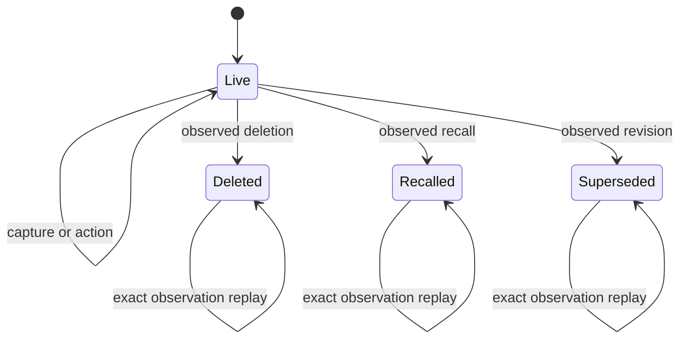

# Mail lifecycle

WR442.S4.J5. Stable identity is mailbox owner, account and item ID. Legacy mail
is live at lifecycle version zero. One terminal observation covers all captures
of the same identity. Actions lock activity rows; capture and lifecycle lock the
stable identity first. Exact observation replay returns the original result.
Stale versions and changed observations on terminal mail refuse.

Terminal mail allows historical reads and exact replay only. Movement preserves
live identity. Restoration needs a separate explicit contract, never recapture.
Detection is PR two. Prior actions receive permanent notes rather than blind
reversals that could overwrite subsequent human decisions.

Design A adds a lifecycle table with grants and joins at every reader. Design B
stores metadata in existing email_context and audit events. Choose B for a
smaller interface and no parallel identity store. A trigger guards proposal and
summary writes. Tests derive from each terminal transition, replay, stale and
terminal refusals, actor/account scope, action notes and downstream suppression.

Account scope comes from the immutable captured identity, so a later change to
the partner's current email address does not invalidate earlier captures. A
narrow audit view exposes only mail-action IDs, verbs and source activity IDs
for earlier-action notes. The mutation needs no raw event-table access.

Throughput checkpoint: resolve overlap and acceptance before modeling and red
tests. One worker owns this coupled contract, with no subagents permitted.
Identity and ordered activity locks serialize shared state. The smallest safe
decomposition is record contract first and Outlook detection second.
