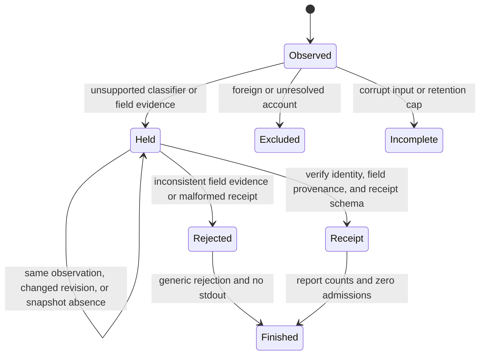

# Evidence-held Outlook task candidates

## System design

Size is medium. This job implements the decoder evidence stage of WR442.S9.J5 only.
Rust owns classifier observations and `outlook-task-candidate/v1` serialization.
Python validates the SQLite projection and returns a count-only intake receipt.
CARR admission, review, bindings, and all canonical writes belong to later jobs.

The data shape is a candidate with tagged fields, explicit source context, provenance,
and a SHA-256 digest. Unknown, absent, conflict, and known are distinct variants.
The account-scoped accumulator uses account, local key, kind, and layout.
Unverified task identity never becomes verified from an IPM.Task classifier.

Two interfaces were considered. Extending ordinary mail db export would require an
implicit generation and build. The chosen `task-candidates --immutable-copy` command
requires enrollment generation, account, Outlook build, and decoder revision explicitly.
It creates a separate evidence database. It never changes ordinary mail export.

Capacity is unmeasured in production. The command scans twice, retains at most 10,000
selected-account candidate identities, and marks overflow incomplete. A caller can
resume with the last local key. A 100,000-object synthetic test exercises this cap.
The count-only census includes all observed classifiers, unknown tag/class pairs,
unresolved accounts, rejected objects, foreign accounts, and block failures.
Unknown membership is counted but never materialized. Duplicate observations reduce
into one candidate per account, key, kind, and layout. Conflicting revisions stay held.
Raw source bytes and private titles never enter stdout or error messages.
The receipt has a closed set of numeric fields in Rust and Python. Intake rejects
unknown or missing counters before any stdout output.

Load spread and async are n/a. One local synchronous scan has no fan-out or queue.
Caching and eviction are n/a. There is no persistent authority cache. Each evidence
database is newly created and callers must keep their supplied enrollment generation.
Storage uses one SQLite transaction and prepared inserts. There is no Postgres or N+1
lookup in this stage. Memory at 10x input is bounded by the candidate cap plus one
verified block, the block-offset list, and the mapped input. Decompression remains the existing reader's limit.

Availability follows scan, classify, project, validate, hold. Bad blocks and unknown
formats mark coverage incomplete. No failure fabricates supported fields or absence.
Consistency is conservative. Equal-revision disagreements are conflicts. Unknown
ordering never picks a winner by scan order. Snapshot absence cannot mutate anything.
External-call circuit breakers and rate limits are n/a. This path has no network calls.
Local loops have a 10,000-candidate retention cap and a two scans of the supplied copy.
Write idempotency uses deterministic digests and a unique projection key. Replaying
input creates the same candidate digest. Output refuses an existing database.

## Statechart

No transition to Review or Open exists in this job. The intake interface takes no
writer dependency. Tests cover unknown layout, truncation, descriptor overflow,
foreign-account key collision, ties, revision order, replay, absence, cap/resume,
and corruption. These tests exercise the command and intake interface.
Transition coverage maps to executable tests in `ops/outlook-task-candidates-selftest.py`.

| Transition | Test |
| --- | --- |
| Initial to Observed | `test_nonmail_classifier_is_visible_but_never_verified` |
| Observed to Held | `test_unproven_due_semantics_preserve_exact_raw_slots` |
| Observed to Excluded | `test_foreign_account_collision_cannot_poison_selected_candidate` |
| Observed to Incomplete | `test_corrupt_block_and_live_store_name_fail_closed`, `test_cap_and_resume_on_large_synthetic_corpus` |
| Held to Held | `test_revision_order_and_conflict_are_scan_independent`, `test_replay_absence_and_readonly_intake_have_no_writer` |
| Held to Receipt | `test_replay_absence_and_readonly_intake_have_no_writer`, `test_interpreted_fields_require_exact_observation_records` |
| Held to Rejected | `test_intake_rejects_interpretation_without_observed_provenance`, `test_receipt_rejects_hostile_names_and_missing_counters` |
| Rejected to Finished | `test_receipt_rejects_hostile_names_and_missing_counters` |
| Receipt to Finished | `test_cli_intake_emits_only_counts_and_refuses_bad_context` |

Formal checking and rendered statechart are not claimed.

## Throughput checkpoint

- Blocking first steps. Read the design, reproduce its red probe, then write tests.
- Independent workstreams. Rust projection and Python intake share one versioned wire shape.
- Shared mutable state. One worker owns this tree and one SQLite transaction owns output.
- Smallest safe decomposition. One worker implements and tests both ends. No subagents are allowed.

## Decoder boundary

The first scan retains only selected-account candidate evidence. The second scan
confirms that a known mail-detail object has a matching IPM.Note classifier.
Standalone-task fields remain unknown even when a generic classifier is readable.
Calendar objects are counted as unresolved coverage, never converted to reminders.
The cursor is stored as decimal text in `task_context.resume_after_key`. It never
appears in the count-only receipt. A page boundary never splits one local key's layouts.
Deferred counts describe observations outside the retained page, not unique tasks.

## Operation

The command syntax is `hxprobe task-candidates --immutable-copy COPY OUTPUT ACCOUNT GENERATION BUILD REVISION [AFTER_KEY]`.
`COPY` is an explicitly supplied immutable copy, never the live HxStore file.
`GENERATION` is the existing enrollment UUID, never a snapshot hash or generated per run.
`REVISION` is the decoder's exact 40-character Git revision.
The Python intake command is `python3 tools/outlook-task-evidence.py OUTPUT ACCOUNT GENERATION`.
It emits counts only and always reports zero admitted candidates.

Production proof remains a later read-only Studio job after deployment and installation.
It must emit a task census receipt and zero admitted candidates. This source job uses
synthetic stores only. Standalone task and calendar reminder format offsets remain unknown.

## Round 2 evidence corrections

Due meaning remains unverified, including the apparent no-date sentinel. The new
candidate interface never interprets either +294 or +302 as due. `unresolved_spans`
retains both raw u64 values as decimal strings, their offsets, lengths, encoding,
and the unresolved reason. Fractions are preserved. Newest verified mail revision
wins for raw observations. Equal-revision disagreements become raw-span conflicts
independently of due meaning. Retention stays bounded to two raw slots per candidate.
Historical mail date decoding remains unchanged.

Known or absent interpreted fields require verified mail identity and the exact
observed atlas provenance tuple for that field. A completed date also requires its
own observed tuple. Unknown fields cannot become interpreted merely by changing a
kind label or recomputing a digest. This validates the declared evidence relationships;
it does not authenticate an arbitrary database producer or authorize admission.

The repair keeps the existing read-only intake interface. A generic schema engine
was considered and rejected because the supported shape is one local evidence
format. Fixed receipt structures remove arbitrary string keys at the producer and
consumer. No cache, queue, external call, additional scan, or canonical write was
introduced. Capacity and failure behavior remain as described above.
