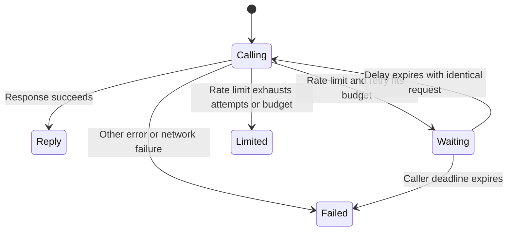

# Record client rate-limit recovery

The CLI and Python HTTP reader use the retry policy in
`lib/release_reader.py`. The data entering that policy is an HTTP status,
headers, response bytes, attempt count and elapsed monotonic seconds. Its
result is a delay in seconds, or no retry. Neither transport rebuilds the
request during retries.

## Cause and options

The supplied J280 incident reports a shared-IP edge limit. Locally, a stub
returning 429 followed by success demonstrated that the reader returned the
first error and the CLI exited before requesting the success response.

Three approaches were considered:

1. Retry whole CLI subprocesses in each caller. This misses direct CLI calls
   and duplicates retry budgets across wrappers.
2. Move Node's HTTP transport into Python. This centralizes transport but
   changes credential delivery, cancellation and existing fetch fixtures.
3. Share the Python retry policy and keep both transports. This preserves
   Node cancellation and response parsing. Node consults Python only for
   429 or HTML responses. This is the selected approach.

[RFC 9110 section 10.2.3](https://www.rfc-editor.org/rfc/rfc9110.html#name-retry-after)
defines Retry-After as delay seconds or an HTTP date.
[Cloudflare's Error 1015 documentation](https://developers.cloudflare.com/support/troubleshooting/http-status-codes/cloudflare-1xxx-errors/error-1015/)
identifies the response as rate limiting. The policy recognizes HTML Error
1015 responses without treating record JSON containing 1015 as a limit.

## Statechart

Never retry a non-rate-limit error. Never change the body or idempotency key.
Never retry before Retry-After expires. Never wait beyond the retry budget or
the CLI caller's deadline. The statechart tool generated a TLA+ skeleton but
could not check it because TLC was unavailable. Executable tests cover these
rules; this is not a formally verified model.

## Capacity and failure handling

Each call is serial, with at most six requests and a 90-second retry window.
Without Retry-After, delays start at five seconds, double and add up to one
second of jitter. A delay that cannot fit the remaining window ends retries
without shortening the server's requested wait. At ten times the traffic,
the shared edge limit remains the bottleneck; jitter spreads retries but
does not reserve capacity or guarantee recovery.

Responses close before the Python reader sleeps. Node uses an abortable
sleep under its existing whole-call deadline. Exhaustion returns the last
response through existing error handling and emits the limit and attempt
count. The unattended record caller classifies this as transient. Network
errors, unrelated 4xx responses and 5xx responses do not retry here. There
is no cache, queue, new database access, stale read, or extra write key.

## Transition tests

`ops/rate-limit-client-backoff-selftest.py` covers the chart as follows:

- Calling to Reply and Waiting to Calling use `test_reader_429_then_success`
  and `test_cli_429_then_success`.
- Calling to Failed uses `test_other_errors_never_retry` and
  `test_cli_other_4xx_never_retry`. Existing record deadline tests cover
  interrupted HTTP body reads.
- Calling to Waiting uses `test_reader_date_then_1015_then_success` and
  `test_retry_after_variants_and_bounds`.
- Calling to Limited uses `test_reader_exhaustion`,
  `test_cli_exhaustion_preserves_error` and the retry-budget cases.
- Waiting to Failed uses `test_cli_deadline_during_wait`.
- Identical write bytes use `test_cli_write_1015_reuses_exact_body`.

The enforcement check is the automatically discovered Python selftest,
plus the existing deadline and transport tests. The direct remote MCP
connector has a provider-owned transport; repository code cannot change its
retry behavior. Local unattended callers use `lib.record_call` and the CLI.
