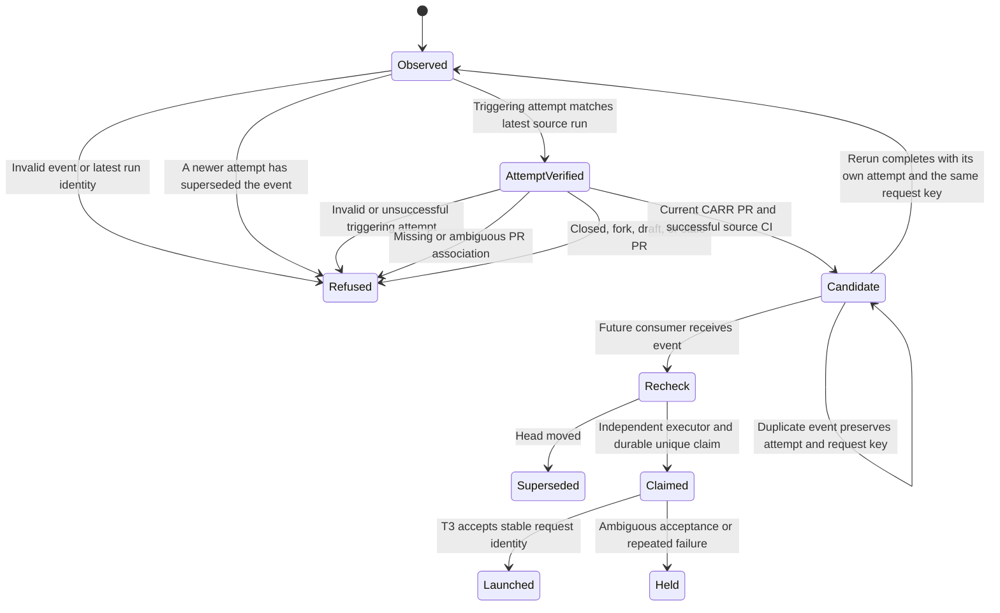

# Source CI review admission

This is the first verifiable piece of WR823.S13.J1. It collects a CARR-specific review candidate after source CI. It does not admit or launch a reviewer. Automatic review and production proof remain unimplemented.

## System design

The data shape is `carr-source-ci-review-candidate.v1`. A candidate names the repository, PR, full source head, review round, triggering source run and attempt, and a stable request key. The key excludes run and attempt so reruns converge. The collector owns no mutable job state and grants no review authority.

### Grounding

`ci.yml` has a source aggregate named `ops/ci.sh --strict`. GitHub required review by the CARR review App supplies approval independently of source CI. The coordinator calls CARR `dispatch-job` and T3 `delegate_task`. Generic job state and launcher code belong in software-factory. CARR retains Card authority. Current placement section `3bb51d3e-2661-4ea2-a585-053540545b5d@3`, delivery policy `52880de2-ab90-4673-b046-b74f900aa2de@7`, and delivery-one-graph section `343eb0e4-3809-48a2-a32b-438098238b3f@1` were read for this design.

### Design fork

| Option | Fit and tradeoff | Decision |
| --- | --- | --- |
| Trusted workflow_run adapter plus signed T3 Connect webhook schedule | Platform remote delivery without a new Studio listener, runner, or polling loop. Needs authenticated delivery and durable consumer deduplication. | Selected target. |
| GitHub App webhook to a new Studio listener | Native events and signatures, but needs an inbound endpoint or tunnel plus another listener lifecycle. | Reject. T3 exposes webhook schedules already. |
| Admission artifact plus periodically scanning Studio consumer | Durable source evidence, but normal operation polls GitHub. | Reject as final transport. Artifacts remain for audit and bounded replay. |
| Hosted Codex or GitHub-native reviewer | Avoids Studio delivery, but does not reuse T3 and does not establish the empirical independent reviewer-of-record. Model usage is separate from runner cost. | Reject for this brief. |

Two interface sketches were `collect(run_id, run_attempt) -> candidate; admit(candidate) -> launch_receipt` and one privileged `coordinate(run_id) -> launch_receipt` in GitHub. The first wins. It keeps Card and local executor authority off hosted runners and places durable job transitions in software-factory. The second exposes CARR admission and a T3 launch capability to Actions.

GitHub documents [free standard runners for public repositories](https://docs.github.com/en/actions/reference/runners/github-hosted-runners) and [workflow_run security risks](https://docs.github.com/en/actions/reference/security/secure-use). The adapter checks out the workflow's trusted default-branch revision, never PR code or artifacts. It queries public source metadata only. Repository permissions are read-only. No model, merge, review, or CARR token is supplied.

### Riskiest link and required split

The installed T3 tool schema exposes webhook schedules with signature validation, replay and coalesce keys, offline delivery age, and webhookUrl. Its documentation says the URL is absent when T3 Connect remote access is off. `delegate_task` exposes `clientRequestId`. These establish feasible interfaces, not durable delivery or exactly-once execution. No schedule or T3 job was created. Provisioning and subagents are forbidden to this worker.

The local transport probe demonstrates that deduplicating by delivery run admits two reruns of one head. Committed collector tests prove the head-based request key is stable instead. Windowed webhook deduplication alone is insufficient. Durable claim and launch recovery still require testing actual T3 clientRequestId behavior. This prevents a truthful claim of exactly one launched reviewer.

This needs separate PRs under repository placement. This PR delivers the CARR evidence producer. The next piece belongs in software-factory and must ship separately. Then CARR pins its exact reviewed revision in the transport adapter. No floating dependency or copied generic launcher is introduced here. Activation provisions the signed schedule and sender settings, then J3 performs a normal-PR production proof. The app adapter follows proven CARR operation.

### Consumer contract, unimplemented here

The consumer rereads run and current PR metadata through GitHub before launch. It resolves registered builder and reviewer Cards through CARR, requires distinct executor identities, and refuses unknown builder provenance. A PR author is not proof of builder executor identity. It atomically claims `(repository, PR, head, review round)` in a durable ledger, calls dispatch-job once per admitted round, and persists the Card before launch. T3 clientRequestId derives from the same key. A crash after launch acceptance reconciles that request with T3 before another launch. If reconciliation is unavailable, hold ambiguous requests instead of blindly retrying paid jobs.

Receipts bind source run and attempt, current head, builder Card and executor, reviewer Card and executor, T3 task and thread, and pinned launcher revision. Workers receive no review-submit, merge, or production credentials. Stale heads become superseded. Two failures with the same cause open a held diagnosis. Signature failure admits nothing. The stored schedule prompt needs its own minted coordinator Card. Webhook values are untrusted locators, never instructions.

### Capacity, availability, and consistency

The producer performs at most six GitHub reads, each with a 15-second timeout, without retries. One collector runs per CI completion. At ten times current load, machine admission capacity fails before this bounded collector. Consumer fan-out needs its own resource admission. No cache is used. Mutable PR metadata is reread. Unknown, ambiguous, truncated, stale, closed, draft, or fork input refuses. A candidate never proves that the PR remains current after collection.

GitHub or artifact failure fails the job. This piece has no database or N+1 query. Artifacts expire after seven days and are audit evidence, not the durable admission ledger. Future signed webhook delivery carries a source-run locator and stable key. Transport failures must be visible with bounded replay of specific missed events. No release transition changes.

## Statechart

The event supplies the run ID and attempt through environment variables. The collector checks the latest run for supersession, then reads the exact attempt endpoint and its jobs. A queued completion never adopts a newer attempt. Refusals preserve the triggering attempt too. A rerun has a different evidence attempt but the same head-based request key. The latest attempt can change after collection, so the future consumer still must recheck before admission.

`test_queued_completion_never_adopts_newer_attempt` covers completed and in-progress newer attempts after successful and cancelled events. `test_attempt_endpoint_identity_and_conclusion_are_verified` covers mismatched attempt, run, head and conclusion. Existing collection tests cover PR refusal, candidate and duplicate transitions. The YAML contract tests enforce trusted checkout, read-only permissions, ephemeral token use, pinned actions, no PR artifacts, and no event interpolation into executable shell. Unexpected jobs or steps fail closed.

Only transitions through Candidate are implemented here. Recheck onward are software-factory obligations. No formal invariant or production launch is claimed. Run `python3 ops/source-ci-review-selftest.py` for executable transition tests.

## Production proof

After the consumer and signed transport ship, a normal PR must cause exactly one independent review without a coordinator turn. Download its adapter artifact with `gh run download <adapter-run-id> --repo DoctorCRE/carr-system --name source-ci-review-candidate`, then use the consumer's read-only receipt command, still to be supplied. Compare repository, PR, source head, source run, reviewer Card, independent executor and T3 task. A candidate artifact alone fails this proof. This piece remains source-only and unproven.

## Safeguards that must survive

Workers hold no review or merge authority. Reviewer independence and CI as merge gate remain mandatory. No force-push, rebase, retarget, review submission, or merge operation exists here. Card admission and bounded retry remain consumer requirements. Source CI remains separate from GitHub required review by the CARR review App.

## Pull request approval

Approval is GitHub required review by the CARR review App
(`doctorcre-carr-review[bot]`), separate from required source CI. GitHub dismisses
stale approvals after pushes and requires approval of the latest push. The
coordinator submits the independent reviewer's verdict as a native App review
through `ops/review-submit.py` (also reached by `./run.sh review-pr` and
`bin/review-pr`). That helper remains supported. Do not import the retired
approval evaluator or invoke its deleted workflow from delivery automation.

The retired custom approval policy in generated rule `7bb0a3ed` is superseded by
Joe's removal instruction (`27810f4f`). Its size exemptions and Actions-variable
checks no longer apply. Card admission and PR-title skip-CI checks are not CI
requirements; do not recreate them. Historical rule snapshots remain provenance.
