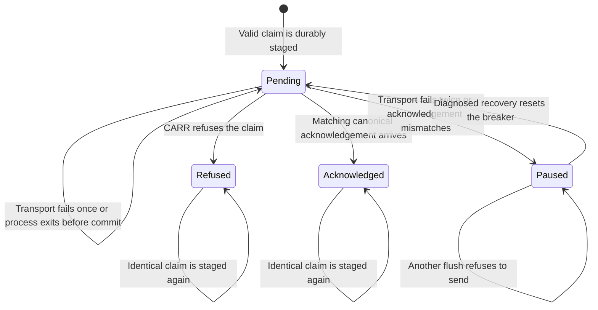

# Studio evidence outbox

Card: WR823.S7.J1

This is the first independently verifiable part of delivery slice 2. It stages immutable installation-to-execution claims for later authenticated CARR ingestion. It does not collect trusted installation facts, publish canonical evidence, or change the observer's holds. The remainder needs the execution owner's readback and a canonical authenticated ingestion contract.

## System design

The data shape is a frozen `Capture` binding a canonical execution UUID to one installation UUID, registered host, exact runtime, command, helper, plist and executable digests, and installation and execution intervals. These fields are claims until CARR verifies them. Semantic counts stay in canonical `ops.run` and are never accepted from this queue.

`Outbox.enqueue(capture)` durably stages claims in a private explicit SQLite path. `Outbox.flush(send)` sends at most 20 claims with a five-second timeout passed to the transport. The transport must enforce that timeout and authenticate CARR. Matching acknowledgements include the run UUID, content digest and canonical receipt UUID. An acknowledgement records transport delivery only. It cannot establish live-proven.

Alternative A extended the existing generic run spool. That spool owns recorder argv, not installation associations, and is held by open PR #2980. Alternative B uses an isolated SQLite outbox with immutable execution keys. B keeps queue recovery local and leaves the run recorder contract unchanged. No production adapter or command accepts caller JSON as evidence.

SQLite transactions serialize concurrent enqueue and flush operations. A flush holds a write transaction across its bounded batch to prevent concurrent flushers from racing. At normal load one producer and one flusher suffice. At ten times load the serialized transport is the first limit. Storage caps at 1,000 retained claims, including acknowledged and refused rows, then refuses visibly. There is no automatic eviction of audit history. No caching, fan-out, N+1 database reads or production Postgres writes occur in this part.

The queue persists before any network operation. Timeout or connection failure leaves the same immutable key pending. Two consecutive transport failures persistently open the breaker. A diagnosed recovery explicitly resets it. A lost acknowledgement replays the same key and digest. Deterministic ingestion refusals remain visible and do not block later rows. A mismatched acknowledgement opens the breaker immediately. Missing facts, runtime drift, target mismatch and malformed intervals refuse staging. No failure falls back to local success.

The callback is an internal transport seam, not authentication. Supplying an arbitrary callback or modifying the SQLite database does not confer canonical authority. The unchanged canonical observer continues to hold installation and run-target facts. No scheduler is connected in this part, and no new production credential is provisioned.

## Throughput checkpoint

- Blocking first steps. Read the design and deployed contracts, then write transition tests.
- Independent workstreams. Not applicable. One bounded module and its tests share one owner.
- Shared mutable state. Each outbox uses an explicit file, SQLite transactions and immutable run keys.
- Smallest safe decomposition. Deliver the queue first. Trusted readback and canonical ingestion follow in a separately testable part before production proof can pass.

## Statechart

Invalid claims and changed payloads for an existing execution UUID leave all states unchanged. Queue states never imply a proof verdict. Tests cover every transition, capacity, concurrent producers and crash-after-remote-acceptance replay. This chart is a test model, not a TLC-checked formal proof.

## Remaining production proof

After trusted collection and canonical ingestion are implemented and deployed, the coordinator must observe an actual authorized Studio install and a natural non-send Outlook run. The existing read-only observer must bind that canonical execution to the actual installation and registered command, reject the newest failed run, and require `run.mail_ids >= 1`. Until then its `held` response is expected and this slice remains unproven.
