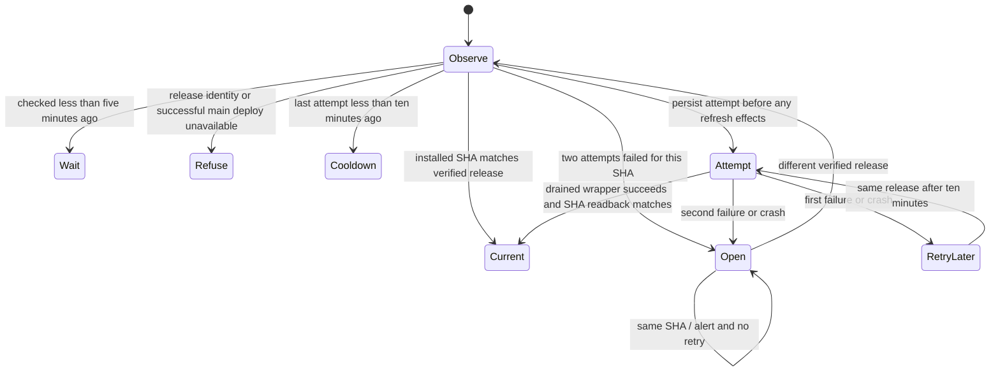

# Studio runtime auto refresh

Before-code statechart for WR634.S1.J80.

Never refresh an unverified release. Never attempt a SHA a third time after two
failures. Never attempt twice within ten minutes, even across release changes or
process crashes. Never interrupt a send. Same installed SHA is a no-op.
A persisted attempt counts as a failure until verified success. A crash after
installation is reconciled by installed SHA on the next observation.

## System design

One launchd calendar job wakes every five minutes. Python reads a dated local
ledger before each run, reads production `/release` (`git_sha.value`), and checks
for a successful `deploy.yml` run on main at that exact SHA through GitHub CLI. The workflow run name binds the actual deployed SHA,
which can differ from the workflow_run event’s own default-branch head SHA.
The existing drained wrapper owns send locks, runtime installation and recovery.
A temporary local source clone at the released commit supplies the installers;
shared main is never checked out or pulled by this job. It is deleted on exit.
The alternative of running from current main fails when main is ahead of release.
A T3 task adds an agent session where a bounded deterministic job suffices.

State is an atomic JSON file under `out/studio-runtime-auto-refresh`; append-only
UTC receipts record observations and attempts. A per-job flock serializes ledger
writes. The SHA is the operation key. Attempt reservations precede side effects.
Two failures for one SHA open its breaker permanently; a new release gets its own
budget. Network and Git commands have timeouts, with no internal retries. The outer
wrapper invocation has no kill timeout; the existing drain and subprocess bounds
own lifecycle failure handling, so this caller cannot kill it during restoration.
Release discovery failures refuse effects and are limited to one check per five
minutes. Refresh attempts have a global ten-minute cooldown. Existing watchdog
findings and orchestrator inbox carry an open-breaker alert; nonzero job exit also
lets the watchdog observe it. No email or external message is sent.

Capacity is one Studio and one runtime today and at 10x release frequency. Newer
releases supersede older targets. Slow builds/drains break the fifteen-minute
objective first. Calls run sequentially; a failed identity/deploy read keeps the
installed runtime. There is no database access, N+1 query, fan-out, or queue.
Caching is limited to the persisted cooldown and per-SHA failures; release truth
is fetched anew, and stale release data never authorizes a refresh. Local receipts
are durable; production proof remains separate from unit tests. No generic
scheduler, retry service, or dependency is added.

## Production proof

installed runtime SHA equals the production /release SHA within 15 minutes of the next main release, with a refresh receipt and no dropped send

The builder does not merge or invoke production. After merge, install only this
job through `./run.sh config install-launchd com.carr.studio-runtime-auto-refresh --apply`.
Watch its first run and the next main release. Do not run a full config install.
