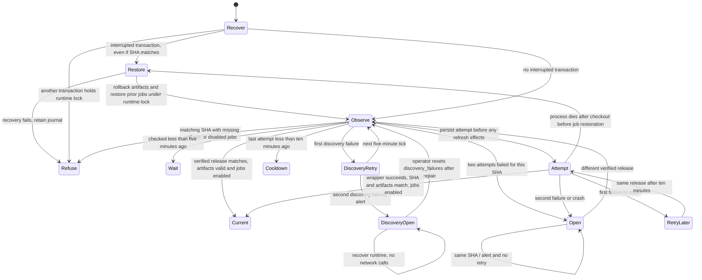
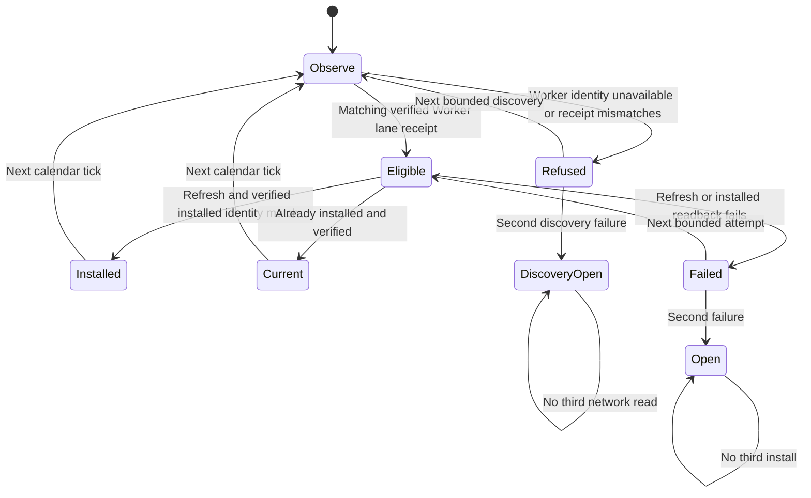

# Studio runtime auto refresh

Statechart for WR634.S1.J80, corrected before the WR634.S1.J87 fix.

Never refresh an unverified release. Never attempt a SHA a third time after two
failures. Never attempt twice within ten minutes, even across release changes or
process crashes. Never interrupt a send. Same installed SHA is a no-op only after recovery and artifact/job verification.
A persisted attempt counts as a failure until verified success. A crash after checkout can leave the released SHA installed while jobs remain
disabled and artifacts incomplete. Every tick first acquires the existing runtime
transaction lock and rolls back a pending journal through the existing wrapper.
Recovery runs before discovery throttling, network refusal, cooldown and breaker
checks and consumes no new attempt. Only verified artifacts and loaded, enabled
jobs allow a matching SHA to report current. Otherwise the tick refuses success.

## System design

One launchd calendar job wakes every five minutes. Python reads a dated local
ledger before each run, reads production `/release` (`git_sha.value`), and checks
for an immutable Worker lane artifact from the trusted main `deploy.yml` workflow.
The artifact binds the source SHA, Worker version, verb count, run and attempt.
The parent run may still be in progress. Display titles and aggregate run
conclusions have no role in installation eligibility.
The existing drained wrapper owns send locks, runtime installation and recovery.
A temporary local source clone at the released commit supplies the installers;
shared main is never checked out or pulled by this job. The fetched remote-main
SHA is copied into the clone before verification, independent of local main. It is deleted on exit.
The alternative of running from current main fails when main is ahead of release.
A T3 task adds an agent session where a bounded deterministic job suffices.

State is an atomic JSON file under `out/studio-runtime-auto-refresh`; append-only
UTC receipts record observations and attempts. A per-job flock serializes ledger
writes. The SHA is the operation key. Attempt reservations precede side effects.
Two failures for one SHA open its breaker permanently; a new release gets its own
budget. Network and Git commands have timeouts, with no internal retries. The outer
wrapper invocation has no kill timeout; the existing drain and subprocess bounds
own lifecycle failure handling, so this caller cannot kill it during restoration.
Release discovery failures refuse effects and are limited to one check per five
minutes. Refresh attempts have a global ten-minute cooldown. Existing watchdog
findings and orchestrator inbox carry an open-breaker alert; nonzero job exit also
lets the watchdog observe it. No email or external message is sent.

Capacity is one Studio and one runtime today and at 10x release frequency. Newer
releases supersede older targets. Slow builds/drains break the fifteen-minute
objective first. Calls run sequentially; a failed identity/deploy read keeps the
installed runtime. There is no database access, N+1 query, fan-out, or queue.
Caching is limited to the persisted cooldown and per-SHA failures; release truth
is fetched anew, and stale release data never authorizes a refresh. Local receipts
are durable; production proof remains separate from unit tests. No generic
scheduler, retry service, or dependency is added.

## Production proof

installed runtime SHA equals the production /release SHA within 15 minutes of the next main release, with a refresh receipt and no dropped send

The builder does not merge or invoke production. After merge, install only this
job through `./run.sh config install-launchd com.carr.studio-runtime-auto-refresh --apply`.
Watch its first run and the next main release. Do not run a full config install.

## Transition tests

`ops/studio-runtime-auto-refresh-selftest.py` keeps named executable transitions.

| Transition | Test |
| --- | --- |
| Recover / Restore before Current, Wait, Refuse, Cooldown and Open | `test_crash_recovery_precedes_every_short_circuit` |
| Attempt interrupted after checkout to Restore | `test_crash_recovery_precedes_every_short_circuit` |
| Restore failure to Refuse with journal retained | `test_recovery_failure_keeps_journal_and_never_reports_current` |
| Concurrent runtime transaction to Refuse | `test_recovery_respects_runtime_transaction_lock` |
| Matching SHA with incomplete artifacts or disabled/unloaded jobs to Refuse | `test_current_requires_installed_artifacts_and_enabled_jobs` |
| Observe / Attempt to Current | `test_success_then_same_sha_noop`, `test_success_requires_runtime_readback` |
| Observe to Wait / Refuse | `test_unknown_release_never_refreshes_and_discovery_is_bounded` |
| Observe to Cooldown | `test_rate_limit_survives_release_change`, `test_slow_discovery_does_not_shorten_attempt_cooldown` |
| Attempt to RetryLater / Open and Open to Open | `test_two_failures_open_breaker_no_third_attempt`, `test_attempt_reservation_survives_crash` |
| Open to Observe on a different release | `test_release_change_gets_new_budget_without_resetting_old_breaker` |

The combined recovery tests use the wrapper's filesystem snapshot, drain locks,
swap and restoration with synthetic launchctl/installer ports. They reproduce
process death by releasing only the fixture's held locks. No live mailbox or
launchd state is touched. No formal proof is claimed.

## Discovery repair design for WR634.S1.J96

The shared release reader owns GET headers, redirect refusal and HTTP replies.
Both smoke commands and automatic discovery use it. The existing ledger gains
`discovery_failures`, a consecutive failure count reserved before discovery.
Two failures open discovery permanently and alert through the existing watchdog
finding and inbox. Success clears the count before local runtime verification.
Open discovery still recovers interrupted runtime work but makes no HTTP or
GitHub call. After repair an operator resets only `discovery_failures` to zero
under the ledger lock. This builder changes no live ledger.

Loading the smoke CLI dynamically would couple runtime discovery to unrelated
smoke imports. The shared module keeps the actual HTTP implementation in one
place. The existing per-SHA refresh budget is unchanged. Discovery reservations
survive crashes. Capacity remains one sequential read per five minutes at
today's and 10x load. Discovery has a 20-second HTTP timeout. There is no fan-out,
queue, database or N+1 access. The only cache is the atomic local ledger,
cleared on success or explicit operator recovery after an open circuit.
Stale release truth never authorizes a refresh. Writes reuse the existing lock,
atomic replace and fsync. Alerts use the existing finding key for deduplication.

| Transition | Test |
| --- | --- |
| Discovery sends smoke headers | `test_released_sha_uses_shared_release_reader` |
| Two 403s open discovery, no third read, one alert | `test_discovery_403_opens_breaker_and_alerts_without_third_request` |
| Successful discovery resets first failure | `test_discovery_success_resets_failure_budget` |
| Discovery crash consumes reserved budget | `test_discovery_reservation_survives_crash` |
| Open discovery still recovers runtime | `test_discovery_open_still_recovers` |
| Counter reset permits fresh read | `test_discovery_operator_reset_allows_read` |

## Worker lane receipt cutover for WR823.S8.J1

The deploy job seals `worker-release.json` from its already verified `/release`
readback and uploads `worker-release-<full source SHA>` before downstream waits.
A rerun replaces its prior artifact, while each artifact ID remains immutable.
Discovery reads at most two exact-name artifacts and accepts only the current
attempt from the same repository's main deploy workflow. It compares production
source SHA, Worker UUID and verb count against a fresh `/release` read. No CARR
key or OIDC exchange is introduced. The live registry reconciliation found no
such reader contract. Canonical CARR installation evidence remains a separate
collector obligation. A local diagnostic report cannot satisfy that obligation.

`lib/worker_release_receipt.py` owns parsing and trust checks. The existing
reconciler still owns recovery, cooldowns and durable attempt reservations.
Every verified `current` or `refreshed` diagnostic row now includes installed
SHA and the Worker receipt with its run, attempt and artifact ID. A refreshed row also records the actual local install start
and completion times. A failed
readback never emits installed success. No generic delivery state store is added.

Receipts expire after 90 days. Expiry, unavailable identity, invalid archives,
wrong workflow, wrong attempt or mismatched release refuse installation. There
is no stale success fallback. Each discovery has at most five GitHub requests,
each with a 20-second timeout, and one public identity read. The existing drain
wrapper independently rechecks eligibility before applying effects. No inner
retry or fan-out is added. The existing discovery breaker opens after two failed
ticks, including a missing receipt during cutover, and needs operator recovery
after the cause is repaired. This builder never resets production state.

The statechart is the chart above plus this receipt admission region.

`worker-release-receipt-selftest.py` covers admission, identity and trust refusal,
missing and malformed artifacts, bounded reads, and sealer refusal. The automatic
refresh selftest runs real receipt discovery through a synthetic GitHub adapter
and the real tick while the parent remains in progress. It asserts the diagnostic
installed SHA and artifact/run association. Existing cooldown, recovery and
breaker tests cover the remaining transitions. No formal model proof is claimed.

Production readback is `python3 tools/studio-release-readback.py --source
/Users/booko/carr-system`. It reads fresh Worker identity, receipt and parent
metadata, verifies installed identity and existing helper/job checks, then checks
the latest 100 report rows for an actual refreshed diagnostic installation row for that exact artifact and
attempt, including its local installation interval. An already-current report
cannot substitute for that install event.
It refuses unless the parent is still in progress. It performs no refresh or
write. The unified parent's Studio waiting job belongs to the later graph slice;
WR823.S8.J3 must also verify that job is waiting when taking this readback.
Until those observations exist, production remains unproven.
