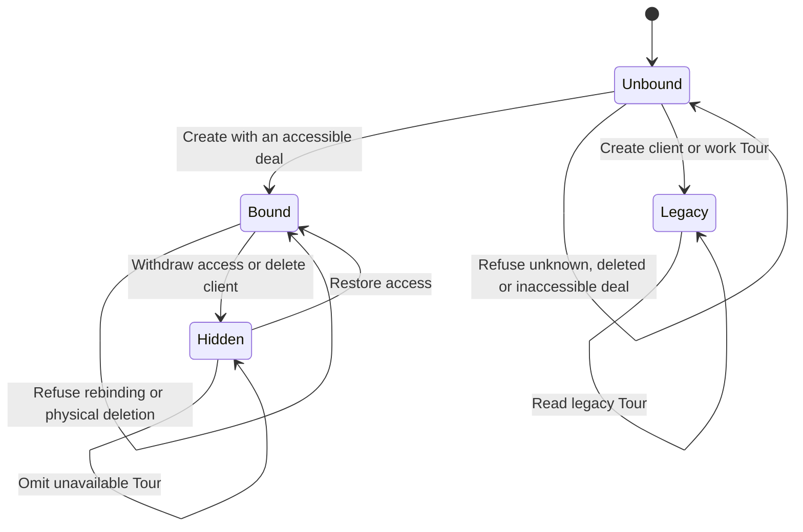

# Deal-bound Tour lifecycle

Migration `1139_tour_deal_binding.sql` introduces the binding;
`1142_tour_deal_access.sql` enforces current deal access.

The binding stays immutable while visibility follows current deal access.
Physical deal deletion is refused by the foreign key. Deleted or merged clients
and parties make their deals unavailable. Legacy Tours retain their behavior.

Named executable transition tests live in `tour-deal-access-postgres.sql`:
`create_accessible`, `create_unavailable`, `read_accessible`, `withdraw_restore`,
`read_unavailable`, `mixed_library`, `immutable_binding`, `legacy_unchanged`.

Run `./run.sh local-db-ci --class migration` to install the migrations and run
the SQL and HTTP proofs on disposable PostgreSQL. The canonical migration
runner includes the SQL file through `tour-domain-route-cheat-sheet-postgres.sql`
and runs `tour-deal-access.test.mjs` with its disposable database URL.

This statechart replaces the unreproducible 24-state TLC claim. No TLC result is
claimed. Routing, publication and public share access are outside this model.
