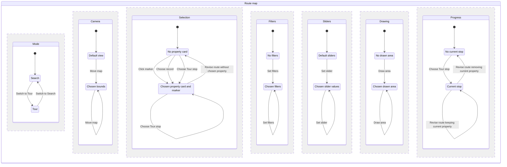
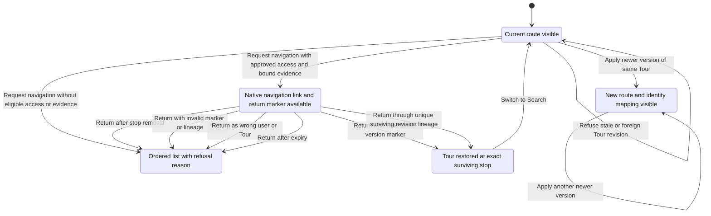

# Tour map route state

The route reducer keeps mode, camera, selection, filters, sliders, drawing and
progress independently. A selection does not move progress. A revision remaps
progress by property identity; native-navigation return follows recorded stop
lineage instead. This chart documents existing behavior, with no reducer change.

Each region is an abstraction of stored values, not a separate reducer or a
promise that every combination is reachable. Repeated actions replace values
inside the same abstract state. Choosing a Tour stop also selects its property.
Map edits work in both modes; choosing a stop requires Tour mode. Switching mode
preserves all other regions and returns effects that keep the map instance.
Refused events throw and leave every region unchanged.

Navigation requests produce a link or fallback without mutating route state.
Return success restores Tour mode, current stop and selected property together,
keeping camera, filters, sliders and drawing. Removal anywhere in lineage refuses
return even if the property is later re-added. Fallback is a result offered to
the caller; it does not overwrite route state.

## Transition verification

All names below are exact test names in
[the route-state suite](../../mcp-server/test/tour-map-route-state.test.ts).
Tests dispatch events through `reduceMapEvent`, apply revisions through
`applyRouteVersion`, and exercise handoff/return through their exported entry
points. Registration assertions are not transition evidence.

| Transition / guard | Behavioral test |
| --- | --- |
| Search to Tour and back | switching Search to Tour and back keeps map instance, camera and selection |
| Move map (`bounds_change`); click marker (`feature_click`); set filters (`filter_state`); set slider (`slider_state`); draw area (`draw_result`) | typed events never remount the map and keep camera and selection |
| Choose record (`selected_record`), empty or different selection, both modes; preserve progress | selected_record selects the card and marker without moving route progress |
| Reject unknown properties and stale selection events, both selection types and modes | selection events refuse unknown properties and stale versions without mutation |
| Replace bounds, feature selection, filters, slider and drawing independently in both modes; preserve all regions on mode switch | map regions replace values independently in Search and Tour |
| Copy accepted map payloads | accepted payloads are snapshots: mutating the event afterwards changes nothing |
| Reject invalid slider payloads; accept scalar replacements | slider values must be scalars; objects and missing values are refused |
| Reject malformed drawing; accept Polygon and MultiPolygon | draw_result accepts Polygon and MultiPolygon only, with valid closed rings and coordinates |
| Reject invalid bounds; accept antimeridian bounds | bounds must be ordered in latitude and finite; antimeridian longitudes are allowed |
| Choose Tour stop (`route_stop_change`), progress and selection together | route_stop_change moves progress and selection together in Tour mode |
| Reject progress in Search | route_stop_change is refused in Search mode |
| Reject stale events, unknown stop/event/mode | events for an old route version or unknown targets are rejected without changing state |
| Revise route, retaining selection by property and changing order/labels | route_sequence and label are presentation only: reorder keeps property identity |
| Revision mapping distinguishes removed, added, unchanged and resequenced | version mapping reports removed, added and unchanged stops explicitly |
| Revision removes selection | a removed selection clears selection instead of pointing at a stale stop |
| Revision carries camera, filters, sliders, drawing and current property; removal clears progress; stale/foreign revisions refuse | route revisions carry independent map state and progress by property or clear removed progress |
| Request eligible navigation on either platform | an approved entrance with a matching bound receipt yields a minimal-data link for each platform |
| Withhold navigation for approximate pin | native link is withheld for a downgraded stop and carries the reason and a fallback |
| Withhold navigation for absent/unbound/incomplete evidence | native link needs a receipt bound to this exact tour, projection and route version |
| Refuse invalid navigation platform, mode or stop | bad platform, travel mode or stop is refused |
| Restore same-version stop | return after native navigation lands on the exact stop that was handed off |
| Restore and then switch to Search | restored navigation state composes with projection and map events |
| Restore through multiple revisions | return follows the recorded version mapping across several revisions |
| Refuse removed then re-added stop | a stop removed and later re-added is not restored by property identity |
| Refuse invalid marker, future version, missing lineage or identity mismatch | return refuses future versions, unbound lineage and tampered markers |
| Refuse wrong/missing user | return fails closed unless the marker is bound to the same user |
| Refuse expired or wrong-Tour return | return degrades to the ordered list when expired or for another tour |
| Refuse ambiguous, foreign or non-advancing lineage | finding 3 supplement: return lineage binds projections and strictly advancing unique steps |

## Scope and reproduction

The source of truth is [the reducer](../../mcp-server/src/tour-map-route-state.ts),
particularly `reduceMapEvent`, `applyRouteVersion`, `buildNativeNavLink` and
`resolveReturn`. The charts abstract arbitrary coordinates, property identities,
filter contents, geometry, route versions and timestamps into visible outcomes.
They do not model tiles, UI rendering, server authentication, token signing,
receipt retrieval or the native navigation app. They are a transition review
artifact, not an exhaustive TLA+ proof.

Run `node --test mcp-server/test/tour-map-route-state.test.ts` from the repository
root. Deleting only `case "selected_record":` in an in-memory stripped module
must fail the selection and refusal tests. Restore the original import and the
suite must pass. No source mutation is needed for that check.
