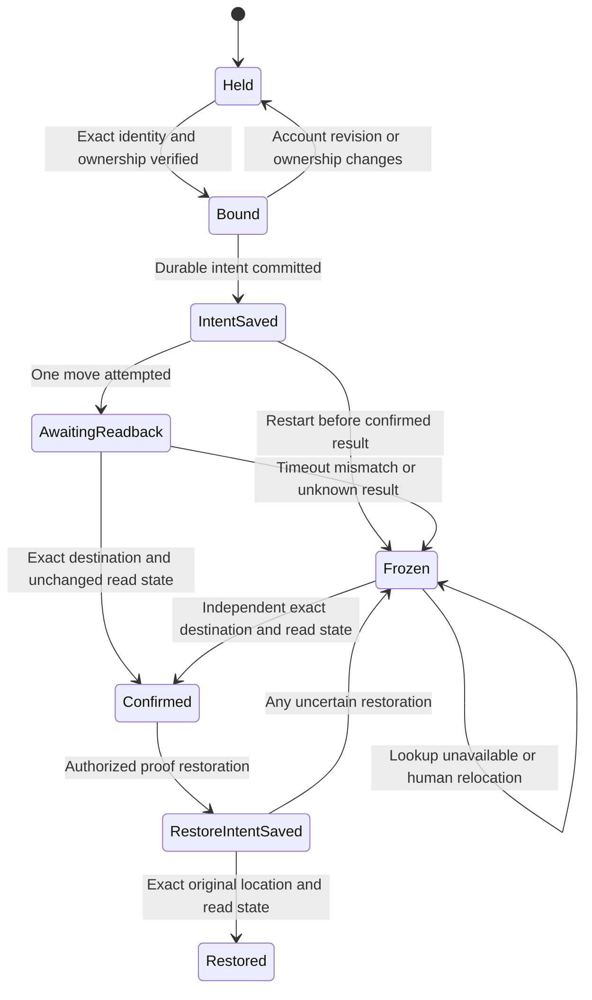

# Outlook local mover integration proposal

Card: WR634.S1.J111

Status: blocked implementation proposal. No mover, ledger, scheduled installation,
or executor qualification is delivered by this document.

## Executed local runtime boundary

Installed Cua Driver 0.28.2 exposes a standalone CLI at
`/Users/booko/.local/bin/cua-driver`. `lib/outlook_ui.py` already uses its
`call <tool> <json>` interface. A worker does not need an active T3 conversation
to call this interface. No new daemon or browser framework is necessary.

The J111 probe executed `get_accessibility_tree` and `get_window_state` against
the existing signed-in Chrome Outlook window. It then clicked the exact View
ribbon AX token, independently observed View selected, clicked the freshly
observed Home token, and independently observed Home selected. Both actions
returned `effect: unverifiable`; only the subsequent reads established success.
The desktop idle check exceeded 60 seconds before each action. These were
background accessibility actions. No message was selected, opened, or moved.

The following commands inspect the installed supported interface without
changing browser or mailbox state:

```sh
/Users/booko/.local/bin/cua-driver --help
/Users/booko/.local/bin/cua-driver list-tools
/Users/booko/.local/bin/cua-driver describe get_window_state
/Users/booko/.local/bin/cua-driver describe get_browser_state
/Users/booko/.local/bin/cua-driver describe browser_prepare
```

`get_browser_state` refused the exact Chrome window with
`browser_consent_required`, reason `consumer_profile_endpoint_requires_grant`.
The documented next operation, `browser_prepare` with strategy `existing_profile`,
also refused. Its response reported `permission_mode: standard` and
`authorization_host: null`. The daemon's status reported no startup capability
manifest or existing-profile grant. This is a runtime authorization requirement,
not a tenant denial, missing sign-in, or proof that native AX cannot act.
No daemon was stopped, replaced, granted broader permission, or reconfigured.

## Why a move cannot qualify yet

The parent proof in `/tmp/WR634-live-ui-move-proof.md` establishes one reversible
Archive and Inbox restore using a complete message header and read-state menu.
It explicitly leaves local-worker and provider-ID mapping unproven. J111
preserves that result and does not repeat the mailbox effect.

The current AX snapshot exposes per-snapshot `element_token` values. The driver
documents that another snapshot replaces them. These identify controls, not
mailbox objects. The current installed AX schema does not return a provider
message ID, provider folder ID, or mailbox revision. Header Message-ID alone
cannot establish the identity required by the existing executor contract.
The existing local copy has no independently verified mapping to those fields.
The old `Window.move` accepts a row label and leaf name and confirms source
disappearance. It cannot supply exact destination confirmation or that mapping.

The parent also observed dropdown choices absent from AX, although visible in
screenshots. J111 does not claim a new menu probe. Blind coordinates, subject
substrings, cache hashes, counts, and source disappearance cannot authorize a
production move. Reading DOM after a supported runtime grant may help inspect
controls, but does not itself prove stable provider identity or read semantics.

## System design for the supported integration

The intended interface consumes the existing planner's `MoveIntent`. It returns
held, reconciliation-required, or independently confirmed destination and read
state. It must never call the old label-based mover as a fallback. The existing
snapshot producer, planner, outbox, and intake retain their responsibilities.

Two designs were considered. An AX-only mover could reuse the local CLI today,
but lacks the identity and destination guarantees above. The selected proposal
keeps the CLI as the control interface and requires an observed mailbox-object
binding before implementing effects. A generic fake-port executor would leave
that same missing production interface hidden behind tests, so none is added.

The smallest next integration has these prerequisites and responsibilities:

1. Use the maintained runtime's startup grant or embedding authorization host
   to authorize exactly the existing browser profile. Do not alter a sibling
   runtime or expose its private transport. Recheck the exact browser window.
2. Establish an observed mailbox-scoped stable message identity across move,
   reload, and restart. Independently bind the intake observation to that object.
   Obtain the exact source and destination provider folder identities, their
   full paths, account ownership, revision, and current read state. Refuse
   duplicate or ambiguous bindings. URL IDs are candidates until tested.
3. Acquire exclusive desktop ownership shared with other UI workers. A private
   process lock alone does not exclude the human or other automation. Recheck
   idle state and the exact window before every action. Human input, changed
   account, missing ownership, or unsupported dropdown addressing stops effects.
4. Persist write-ahead intent atomically before the first possible mailbox
   effect. Bind the idempotency key to mailbox, stable message, source revision,
   destination identity, routing revision, and policy. Use private owned storage,
   fsync, atomic replacement, directory fsync, and an exclusive writer lock.
5. Execute at most one supported move for the intent, with bounded commands
   and a shared deadline. Independently locate that same identity at the exact
   destination and verify unchanged read state. A click acknowledgment is not
   confirmation. Do not open unread content if doing so changes its state.
6. On timeout, crash, lost ownership, or ambiguous readback, freeze that identity.
   Reload the durable intent and reconcile by independent identity lookup only.
   Do not repeat an uncertain effect. Human relocation stays held. A proof
   restore is a separate durable intent with the same verification obligations.

These are proposed guarantees, not advertised Cua Driver mailbox operations.
No `lookup_message` or `move_message` platform endpoint was discovered or invented.
The exact integration gap is a supported control plus independent readback that
binds those mailbox fields. Startup browser authorization is the first runtime
constraint, and its removal alone would not close the semantic gap.

Proposed capacity is one UI owner, one in-flight intent, at most 150 intents per
run, and no fan-out. At 10x input load, excess work stays held under the planner's
existing bounds. UI latency is the first expected limit. Each CLI invocation
needs a 30-second process cap and the run needs a shared monotonic deadline.
Two transport failures stop the run. Any uncertain mailbox effect immediately
stops further effects and requires reconciliation. Alerts contain fixed codes
and counts. No automatic transport retry follows a possible write.

The ledger serves no stale identity. Tokens never survive a fresh snapshot.
No DOM or AX observation cache, background consumer, or new queue is proposed.
Sequential observation and readback are necessary for each effect. There are no
CARR database queries in the mover; routing comes from the existing planner.
Ledger size is bounded by pending and retained proof records, with retention
defined before installation. Pending uncertainty must never expire into retry.

## Proposed lifecycle and acceptance



This chart is a design sketch. It has no implementation or formal verification.
Future fake-port tests must derive from every transition, including process death
after durable intent but before acknowledgment, unchanged unread state, duplicate
header identities, duplicate folder leaves, stale revisions, account mismatch,
ownership loss, human relocation, and concurrent worker refusal. A local runtime
test must independently prove supported menu control and exact identity readback.
Only then may the single authorized move-and-restore proof execute. Unrelated
messages remain held throughout. No success can qualify the contract until the
producer's local identity maps independently to the same observed provider item.

J111 changed no runtime source, dependencies, executor contract, producer, intake,
outbox, scheduler, or installed runtime. No synthetic mover test or mailbox proof
is claimed. This proposal is the brief's explicit fallback when the real runtime
cannot meet the required control and identity guarantees.
