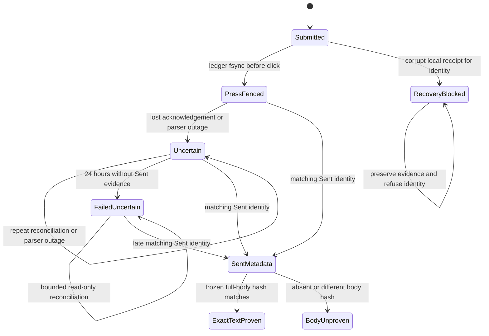

# Outlook finish-line repair

System design before code, WR441.S12.J19. This session fits the single-session rung.

The server owns frozen submissions and outcomes. The worker owns the durable press ledger and receipt replay. The decoder owns observed Sent identities and body hashes. Dispatch evidence and exact-body proof are independent facts. Data shapes stay SubmittedDraft, Result, SentRow and receipt dictionaries.

Never return from Uncertain, FailedUncertain, SentMetadata, BodyUnproven or RecoveryBlocked to Submitted or another press. Missing local ledger in the reconciliation path refuses. A successful metadata receipt is never exact-text proof.

Alternative A retained frozen submissions in a second local queue. Alternative B uses a separate bounded server reconciliation read of failed uncertain submissions, with a local cursor. B avoids duplicating frozen business records and attachment-file dependencies. It recovers even when the failed receipt was acknowledged and deleted. The write transition accepts only the original frozen identity and a matching Sent observation; it never reopens approval.

Capacity and storage: approved work retains its existing query. Reconciliation reads at most 100 rows per run using UUID keyset pagination, wrapping after the final page. At 10x load it takes more runs, not unbounded parser fan-out. No cache. Each failure stops that external operation until the next scheduled run. Parser calls remain bounded by transport confirmation deadlines; reconciliation performs one observation per identity, never a send. Receipt writes are fsynced and private. Server writes retain transaction, row lock and idempotency envelope. Read failures refuse; stale evidence cannot authorize dispatch. No new parallel work or external retries. Local receipts and ledger remain single-writer locked. A corrupt receipt is retained with mode 0600 and a content-free blocker; its filename fences its send key, while valid unrelated identities continue.

Regression mapping: proof tests cover both body-unproven edges and whitespace changes; worker tests cover timeout, missing ledger, parser outage, repeated late reconciliation and lost receipt acknowledgement; PostgreSQL tests cover correction and correspondence deduplication. Draft helper tests cover launch failure, ambiguous identity, account/field mismatch and persistence failure. All evidence is synthetic. Real Outlook persistence and existing-submission production proof remain parent obligations.

The draft helper uses a newly observed window ID and ComposeWindow's account and exact-field readback. It saves and closes that window, then requires exactly one new store key in the configured account's Drafts with full matching text and recipients. A launch failure, parser outage, preview-only body, account mismatch or absent store receipt refuses a persistence claim. `--leave-open` still requires the same durable store observation. The obsolete subject-prefix AppleScript has no remaining caller and is removed.

Design and debt pass: codebase-design keeps transport reconciliation in one shared implementation reached through a read-only interface; the worker cannot fall through into composition. zero-tech-debt removes the unused AppleScript and its title-prefix identification instead of adding a second success heuristic. The chosen shape remains appropriate after implementation. The statechart is a design artifact; no TLC model-checking result is claimed.

WR441.S12.J22 extends the RecoveryBlocked self-loop to payload rejection and repeated recovery. `test_corrupt_receipt_invalid_payload_stays_fenced_across_recovery` combines the exact corrupt key, an unavailable attachment, reconciliation and unrelated valid work. The identity fence runs before payload admission, so neither a success nor a failure receipt replaces its private bytes.

Draft observation keeps account admission in `_load`, then reads the full raw body by the admitted decoder row identity from the same immutable disposable snapshot. Intake presentation rewriting cannot establish persistence. Recipient comparisons parse complete canonical addresses separately for To and Cc; display names do not supply addresses, roles cannot swap, aliases remain distinct, and requested Bcc refuses because the decoder does not observe it. `DecodedDraftTests` executes the real SQLite projection and save orchestration for raw success, transformed mismatch, preview refusal and recipient semantics. Existing timeout, late correction, body-proof split, crash, missing-ledger and lock tests remain the transition checks. No model-checking claim is added.
