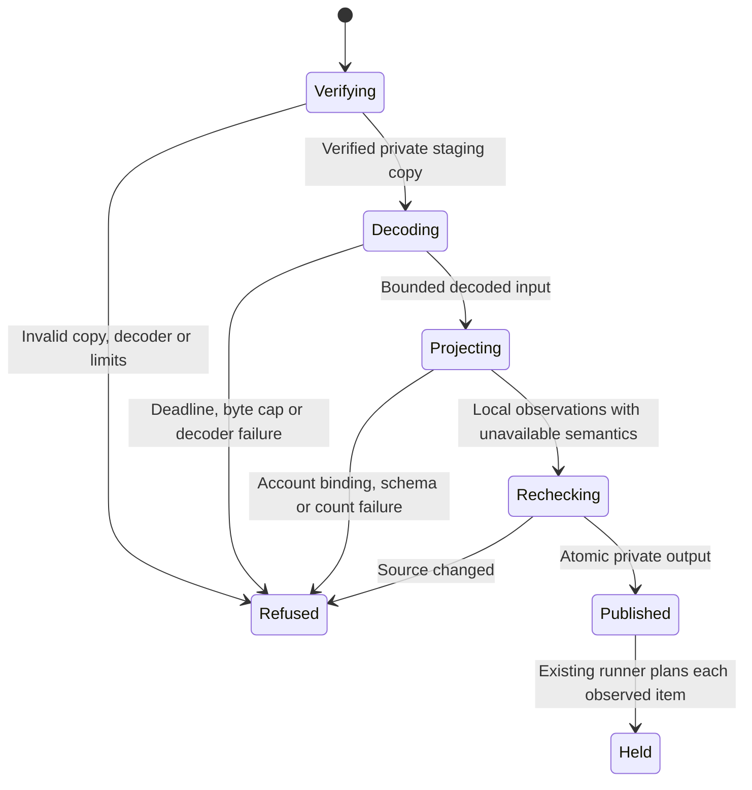

# Research-copy observation producer

Card: WR634.S1.J109

## System design

The intended end state is a bounded observation producer at the existing
`outlook-triage-snapshot/v1` seam. It never supplies mutation authority.
The selected design decodes a checksum-verified private staging copy with the
receipted installed decoder. Reading live HxStore or accepting arbitrary decoded
JSON was rejected. The decoder owns byte interpretation; the existing planner
owns eligibility and routing. No intake or outbox implementation changes.

Data shape is a private snapshot plus aggregate receipt. Local account, folder
and message keys are explicitly namespaced local observations. Provider binding,
message revision, authoritative read state, content completeness, uncached
coverage and canonical relationship lookup coverage remain unavailable.
Empty revision and unknown read state force per-item holds under the unchanged
planner contract. A copy hash is never used as a message revision. The projection
timestamp records decoding, not mailbox freshness. A dated copy cannot prove
current source placement or server coverage.

Capacity is bounded by source bytes, file count, decoded bytes, message count,
output bytes and a monotonic deadline. At 10x, limits refuse without replacing
prior output. Sequential local reads have no fan-out, N+1 transport, network,
queue, retries or external circuit breaker. Private staging is removed on every
exit. There is no cache. Manifest bytes, every listed source and the decoder are
checked before publication; source change refuses. Publication is atomic 0600
within an owned 0700 directory. Repeated publication replaces one projection.
No mailbox, production record or send writes occur. Counts and fixed codes alone
are printed; content and local identities stay in the private snapshot.

Throughput checkpoint. One worker owns the coupled producer and regression
fixture. Source and decoder validation precede decoding; consumer verification
follows publication. No independent work stream or child is needed.

Tests derive from each refusal and publication edge. This is an implementation
statechart, not a formal proof of decoder truth.

## Interface and proof

`python3 -m lib.outlook_triage_producer --copy <existing-research-directory>
--output <private-snapshot-path>` reads the configured decoder, account key and
folder guide. It does not copy the live mailbox or install a schedule. Output is
consumed by the unchanged `read_snapshot` interface. Routing uses the guide hash,
empty relationship results and `complete=false`; it is never a fabricated empty
canonical search. Catalog identities are local, never provider IDs.

PRODUCTION PROOF remains pending. After source delivery, observe an authorized
fresh-copy producer run and a natural scheduled runner receipt, with matching
hash provenance, actual per-item holds and zero moves. Holds are observation
progress only. Actual filing additionally requires the executor contract's
independent provider binding, revision/read-state and supported mover proofs.
