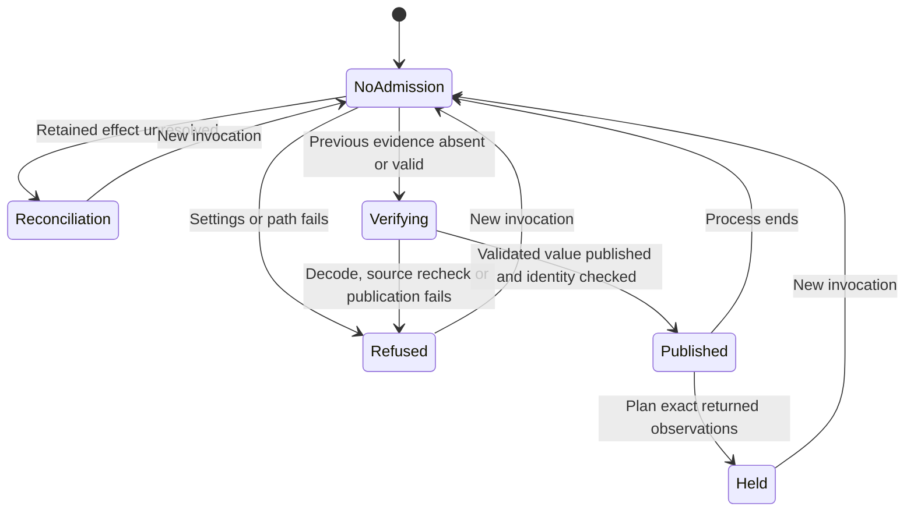

# Research-copy observation and planning

Card: WR634.S1.J124

## System design

The current invocation owns admission. Retained snapshot/v1 files are evidence,
never permission to plan. The producer verifies a supplied research copy, decodes
bounded private staging, rechecks sources, validates bytes once, and publishes
relative to an admitted directory descriptor. Only after successful publication
and directory identity checks does it return the exact parsed value to the
runner. The runner never reopens snapshot.json for planning. A later pathname
replacement cannot substitute a different planning value.

The snapshot module owns byte validation. The producer owns containment,
symlink refusal, private modes, decoder pins and evidence publication. The
runner owns current-attempt planning and aggregate reports. The planner retains
per-item eligibility and routing. No executor, mover, provider binding or
automatic filing is introduced.

This replaces the failed ambient-file authority model. In-band invalidation
cannot revoke authority when output is inside an immutable research copy or
behind an unsafe parent. A separate latest-attempt pointer would require a
freshness protocol when its first write fails. Invocation ownership needs no
durable admission ledger, and every new process begins without admission.

Retained uncertain or interrupted effects require reconciliation even when
observations are stale or publication_state is invalidated. Malformed or
unreadable evidence refuses replacement. Refusals preserve existing evidence
bytes. Source/output overlap and symlinks refuse without changing input copies
or symlink targets. Source nested beside output is permitted when output itself
is outside that copy. Staging lives outside the publication directory.

Bounds remain 256 MiB source and decoded bytes, 4096 files, 10000 observations,
8 MiB snapshot and 180 seconds. At 10x, the attempt refuses at these caps. The
flow is sequential and local. There is no database access, N+1 transport,
network, fan-out, queue, admission cache, eviction, retry or external circuit
breaker. Atomic replacement is repeatable, with observation time changing on
republication. No external send or write needs an idempotency token. Concurrent
movers and hostile same-UID ancestor replacement are outside this observation
contract. Effect execution requires separate synchronization and qualification.

This chart precedes the implementation and supplies the lifecycle tests. No
formal model proof is claimed. Tests cover both original unsafe-path defects,
settings failure, interruption, first-write failure, source changes,
republication, stale unresolved effects, malformed evidence, directory identity,
path replacement and independent retry. The prior 104 tests remain historical
evidence on a1036a679a2de82e920736f6db2da6157a0297a7. Assertions requiring
in-band invalidation or ambient planning were replaced for this contract.
Planner and executor suites remain unchanged.

## Invocation

`python3 -m lib.outlook_triage_producer --copy <research-directory> --output
<snapshot-path>` exports evidence only. Its exit 78 and observed_held JSON do
not admit a subsequent runner.

The scheduled runner's `main` accepts `--copy <research-directory>` for combined
observation and planning in its existing bounded evening window. Its public
Python operation is `observe_and_triage(repo, home, research_copy, waits,
limits, closed)`. No arbitrary parsed-result parameter is exposed. An independent
runner without a current producer attempt returns
`snapshot_producer_unavailable`, unless retained effects require reconciliation.
The existing launchd entry supplies no copy, so it truthfully holds. Runtime
wiring must supply an explicitly authorized directory; it never picks a newest
copy implicitly.

Provider identity, message revisions, authoritative read state, content
completeness, canonical relationship lookup coverage and server freshness
remain unavailable. Local keys and copy hashes cannot replace them. Projected
observations therefore remain held with zero planned moves and zero effects.

## Operational proof still required

After source, hosted CI, independent review, merge and installation, execute the
bounded canonical launchd triage route. It must show current-attempt planning
with matching provenance and per-item holds, or truthful held refusal. A skipped
receipt remains BLOCKED under the pinned observer. Verify the installed full
runtime SHA. Synthetic source tests and held observations never prove automatic
moves. Replay unsafe paths only against isolated synthetic copies, never by
altering a real research copy. This builder performs no production operation.
