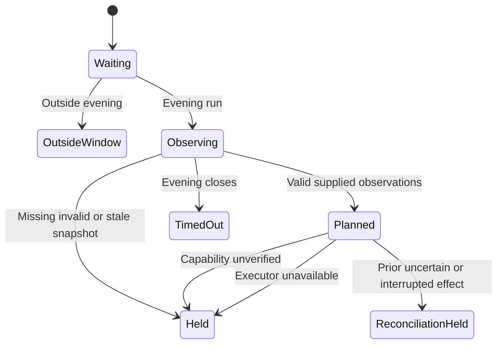

# Evening triage integration

Card: WR634.S1.J102

The launchd `fire` entrypoint reaches `main`, `run`, the pure planner and the
executor qualification contract. It never drives Outlook or moves messages.
Every evening slot reports a plan or a hold. Historical `.settled` files no
longer suppress later observations. A skipped plan is not successful filing.

The governing design is `/tmp/WR634.S1.J75-design.md`, amended by the unread
permission recorded in decision `fba2c07d-116d-4e07-8b7d-90dc6c85a26a` and
`spec/outlook/triage-executor-contract.v1.json`. Known unread messages may be
planned with their state preserved. Unknown read state remains a hold.

## System design

One local adapter reads a private supplied snapshot. The existing planner owns
eligibility, routing precedence and exact destination resolution. The existing
selector owns qualification. Qualification alone cannot install an executor.
Even sanctioned metadata returns `executor_unavailable` until a concrete,
verified executor exists. Unverified metadata returns `capability_not_verified`.

No production snapshot producer is supplied or claimed. The current decoder's
read flag and local-to-mover identity binding must be proved before publication.
Until then the scheduled runner reports `snapshot_unavailable`, calls the
planner with no observations and reports zero planned and moved messages.
The adapter validates supplied data; it does not independently attest its truth.

The local file limit is 8 MiB with at most 10,000 observations and folders.
The planner considers at most 1,000 observations and produces at most 150
intents. Larger accepted batches report overflow holds. Oversized files refuse.
These bounds apply at current load and 10x; no unbounded retry or fan-out exists.
Reads are sequential with no external calls, N+1 queries, queues or cache.
No external circuit breaker is needed because this path has no transport.
Snapshots older than 15 minutes, future timestamps and inconsistent provenance
refuse. TTL never establishes a read-state or mutation guarantee.

No mailbox writes occur. Repeated runs are idempotent by absence of effects.
Prior uncertain or interrupted effect metadata returns `reconciliation_required`.
This is a hold, not an implementation of effect reconciliation or a ledger.
A future executor must own durable intent, independent destination confirmation,
identity revalidation and read-state preservation before any effect is enabled.

## Supplied snapshot interface

The runner reads `out/outlook-triage/snapshot.json`, an owned regular 0600 file.
The output directory uses 0700. Symlink files, oversized input and malformed
data refuse. Snapshot JSON uses schema `outlook-triage-snapshot/v1` and contains:

- `account`, `inbox_folder_id`, `observed_at`, `snapshot_digest`, `decoder_pin`
  and `routing_version`. Account must equal the configured mailbox.
- `observations`, using the fields of `Observation`. Read state is `read`,
  `unread` or `unknown`. Recipients are an array. Each observation must bind the
  same digest, decoder pin and timestamp as the snapshot.
- `routing` with `version`, `guide`, `find_results` and boolean `complete`.
  Completeness requires certified lookup coverage, including capped find results.
- `catalog` with `version` and `folders`, each with account, folder ID and full path.
- `effect_state`, exactly `none`, `uncertain` or `interrupted`.

The synthetic runner tests construct the complete interface. This file is
private planning input, never execution authority or an operational log.
Reports retain counts and fixed codes only, without subjects, folders or IDs.

## Transitions and verification

`python3 ops/outlook-triage-runner-selftest.py` exercises those transitions,
the real main receipt, fire scheduling, duplicate identities, missing routing,
unresolved destinations, ambiguity, policy mismatch and cap overflow. It traps
UI moves and verifies unchanged snapshot bytes and repeated-run results.
Planner and executor qualification selftests retain their independent matrices.
Shared UI preflight and installer tests remain in `outlook-triage-selftest.py`.
Tests of the retired screen filing route were removed with that route.

## Production proof owned by the parent

After ordinary source delivery, compare the installed runtime and release to
the merged revision. Observe a natural evening firing. Require an exit-78 hold,
aggregate observed/planned/held/moved counts, zero moves and no desktop control.
Without a supplied snapshot require `snapshot_unavailable`; never claim mailbox
coverage from zero input. With verified observations require planner decisions
and `capability_not_verified` until the executor contract is satisfied.

The employer-permitted server-rule maintenance interface remains an unresolved
external fact. Graph remains prohibited. No filing completion is claimed here.
