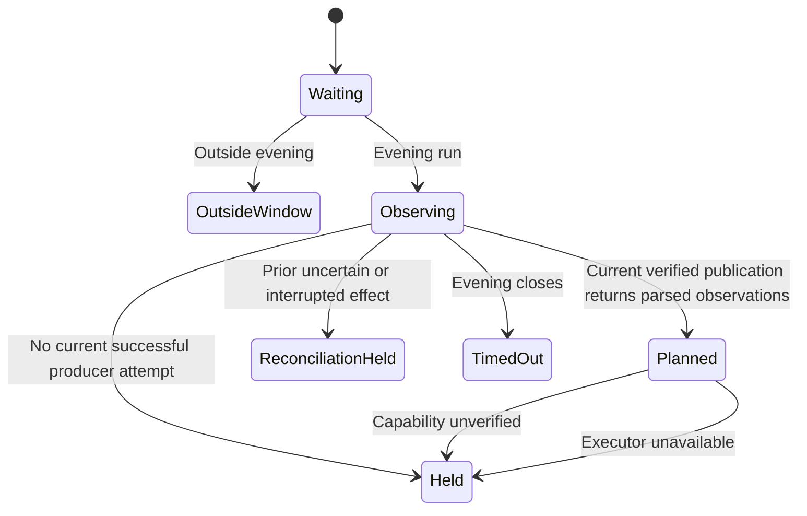

# Evening triage integration

Card: WR634.S1.J102

The launchd `fire` entrypoint reaches `main`, `run`, the pure planner and the
executor qualification contract. It never drives Outlook or moves messages.
Every evening slot reports a plan or a hold. Historical `.settled` files no
longer suppress later observations. A skipped plan is not successful filing.

The governing design is `/tmp/WR634.S1.J75-design.md`, amended by the unread
permission recorded in decision `fba2c07d-116d-4e07-8b7d-90dc6c85a26a` and
`spec/outlook/triage-executor-contract.v1.json`. Known unread messages may be
planned with their state preserved. Unknown read state remains a hold.

## System design

One current observation invocation owns admission. The producer verifies,
decodes, rechecks and publishes evidence, then returns its exact parsed value
to the planner. The runner never opens a retained pathname for planning. The
existing planner owns eligibility and destination resolution. Qualification
alone cannot install an executor. Even sanctioned metadata returns
`executor_unavailable` until a verified executor exists.

The bounded producer and lifecycle are documented in
[Research-copy observation and planning](outlook-triage-producer.md).
The combined runner main accepts an explicit `--copy` directory. An independent
runner, including the current launchd entry without a copy argument, truthfully
holds with `snapshot_producer_unavailable`. Standalone export, JSON flags, old
bytes and exit codes never grant admission. There is no ambient fallback.

The local file limit is 8 MiB with at most 10,000 observations and folders.
The planner considers at most 1,000 observations and produces at most 150
intents. Larger accepted batches report overflow holds. Oversized files refuse.
These bounds apply at current load and 10x; no unbounded retry or fan-out exists.
Reads are sequential with no external calls, N+1 queries, queues or cache.
No external circuit breaker is needed because this path has no transport.
Snapshots older than 15 minutes, future timestamps and inconsistent provenance
refuse. TTL never establishes a read-state or mutation guarantee.

No mailbox writes occur. Repeated runs are idempotent by absence of effects.
Prior uncertain or interrupted effect metadata returns `reconciliation_required`.
This is a hold, not an implementation of effect reconciliation or a ledger.
A future executor must own durable intent, independent destination confirmation,
identity revalidation and read-state preservation before any effect is enabled.

## Retained evidence interface

Evidence inspection reads `out/outlook-triage/snapshot.json`, an owned regular 0600 file.
The output directory uses 0700. Symlink files, oversized input and malformed
data refuse. Snapshot JSON uses schema `outlook-triage-snapshot/v1` and contains:

- `account`, `inbox_folder_id`, `observed_at`, `snapshot_digest`, `decoder_pin`
  and `routing_version`. Account must equal the configured mailbox.
- `observations`, using the fields of `Observation`. Read state is `read`,
  `unread` or `unknown`. Recipients are an array. Each observation must bind the
  same digest, decoder pin and timestamp as the snapshot.
- `routing` with `version`, `guide`, `find_results` and boolean `complete`.
  Completeness requires certified lookup coverage, including capped find results.
- `catalog` with `version` and `folders`, each with account, folder ID and full path.
- `effect_state`, exactly `none`, `uncertain` or `interrupted`.

The synthetic runner tests construct the complete interface. This file is
private observation evidence. Planning consumes only the current producer result.
Reports retain counts and fixed codes only, without subjects, folders or IDs.

## Transitions and verification

`python3 ops/outlook-triage-runner-selftest.py` checks independent admission
refusal, effect reconciliation, evidence parsing, caps, real receipts and fire
scheduling. `python3 ops/outlook-triage-producer-selftest.py` checks the actual
combined CLI and runner, unsafe paths, failure, republication and held
observations. Planner and executor suites retain their separate matrices.

## Production proof owned by the parent

After ordinary source delivery, compare the installed runtime and release to
the merged revision. Observe the bounded canonical launchd triage invocation. Require an exit-78 hold,
aggregate observed/planned/held/moved counts, zero moves and no desktop control.
Without a current producer attempt require `snapshot_producer_unavailable`; never claim mailbox
coverage from zero input. With verified observations require planner decisions
and `capability_not_verified` until the executor contract is satisfied.

The employer-permitted server-rule maintenance interface remains an unresolved
external fact. Graph remains prohibited. No filing completion is claimed here.

The machine-readable admission declaration is
`proofs/requirements/wr634-triage-runner.json`. It declares Studio observation
with the existing pinned `studio-run-receipt.v1` reader. This reader requires a
successful receipt with counts. The current triage receipt is skipped and has
no structured planning counts, so the reader must report BLOCKED. Admission
acceptance does not verify the natural-run hold above. Preserve that remaining
proof dependency alongside the missing operational proof and mover; never replace the
skipped state with success to satisfy the reader.
