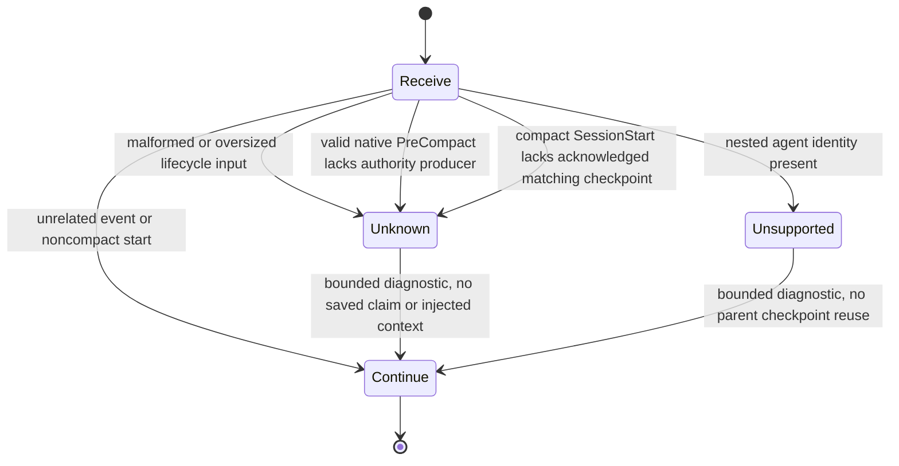

# Codex native continuity fallback, partial source

Card: WR826.S4.J1

## How and interface comparison

The native hook receives lifecycle JSON on stdin. Factory commit
`ae95b0b41a29750004fa347e79bba9b942eb7f42` owns policy and checkpoint shape.
CARR S3 commit `dfd9e1120a07fac7d402ff7852f7ebb39bfe6a8f` owns authority
transport, CAS, idempotency and readback. This slice owns only native admission
and output. It does not duplicate either engine.

Two designs were compared before tests and implementation.

| Interface | Consequence | Choice |
| --- | --- | --- |
| Hook infers state from cwd, environment and transcript | Confuses native session with task identity; transcript is unstable; invents epoch and checkpoint content | Rejected |
| Hook admits only established firsthand ownership and state | Current native contract lacks required facts, so no save or injection occurs | Selected partial fallback |

Data shape is a native lifecycle object plus a diagnostic result containing
status, reason, missing facts and supported output. Missing facts remain unknown.
No JSON field can grant authority. There is intentionally no producer plugin,
local sidecar spool, environment override, shell callback or fixture activation
switch in the installed entrypoint. Native nested agents remain unsupported
because their hook session_id may be the parent's identity. App-owned workers
also need an ownership receipt, not a role inferred from a path.

## Statechart and test derivation

Never stop compaction as a substitute for recovery. Never report saved without
exact durable authority readback. Never inject from session_id alone. Tests
exercise every edge, including caller-supplied fake receipts and envelope fields.
The fixture chart covers admission only. It does not model native execution,
T3 ordering or upstream authority internals, which retain their own tests.

## System design

Architecture and data ownership follow the three modules above. The hook owns
no durable state. It reads at most 65537 bytes and accepts at most 65536 bytes.
It emits one bounded diagnostic. Work is O(input bytes), with no transcript scan.
At today's load and 10x, independent short-lived processes have no shared lock;
process-start overhead breaks first. Load spread and scaling are per callback.
Caching, invalidation, eviction and storage N+1 are n/a because no store is read.
Consistency refuses missing or ambiguous identity instead of serving stale state.
Async queues are n/a; there is no dispatch, cancellation or background process.
External calls, rate limiting and circuit breakers are n/a in the native
entrypoint because it makes zero external calls. There are no loops or retries.
Writes and write idempotency are n/a. S3 retains its deterministic write key,
three-request budget, timeout and exact readback for its separate bridge tests.
No second receipt, threshold or retention engine is introduced.

## Executable contract gap

The official hook reference documents common session_id, transcript_path, cwd,
hook_event_name and model. PreCompact adds turn_id and trigger. SessionStart
adds source. It supplies no stable native epoch/cursor, model-window observation,
T3 thread/task/card/lease/parent binding, or authoritative handoff producer.
Unknown extras in stdin do not establish provenance. PostModelRequest usage is
per attempt and nullable, not occupancy. The transcript format is unstable.

Source: https://developers.openai.com/codex/hooks/#common-input-fields and
https://developers.openai.com/codex/hooks/#precompact . SessionStart(compact)
can deliver context before the immediate root continuation, but that says
nothing about whose checkpoint a hook should load. See
https://developers.openai.com/codex/hooks/#sessionstart .

The selftest can load the exact pinned S3 bridge and actual six-file factory
artifact with synthetic transport. It demonstrates that genuine native-shaped
PreCompact plus unknown epoch produces no write. It separately proves the
existing bridge's synthetic acknowledged payload preserves active operations,
exact jobs, report destinations, PR links and watches. That positive fixture is
bridge behavior, not native producer, installed hook or recovery proof.

## Wiring and installation

Repository declarations append only PreCompact(auto/manual) and
SessionStart(compact) diagnostics. Existing SessionStart safety and all Claude
role exclusions stay intact. Existing configuration preparation remains the
owner of rendering `{{REPO}}`; no new installer is needed for an inactive
partial adapter. Do not run installation for this source task. No hooks.state
trust entries are generated. Exact-definition trust and resolved interpreter
must be checked during a separately authorized installed verification.
Rollback removes only these two owned definitions. It does not delete
checkpoints or change unrelated hooks or trust. The current entrypoint never
reads or writes checkpoint storage.

## Remaining proof and delivery

A supported firsthand producer must bind native event, epoch, cursor, fresh
model/window and full T3 ownership to genuine bounded checkpoint content before
persistence can be enabled. Recovery then needs exact acknowledged generation,
full binding and freshness readback, plus native context delivery. Do not enable
a hypothetical producer with arbitrary JSON, infer identity from environment,
or present a fixed empty handoff as state. No universal threshold barrier is
established. Observed root window 475000 permits intended trigger at most
425000, but this hook implements no threshold and saved 600000 is not capacity.

Hold the PR while S3 is unmerged. This branch is based on main, not S3.
Separate coordinator verification must observe the actual trusted callback,
authority save/readback and matching recovery reaching the immediate next
request without redispatch, new thread or active-job interruption. Every
provider/harness/role needs its own receipt. This source is partial and is
neither installed protection nor review-ready until its required checks pass.

## Design and debt pass

Codebase-design keeps admission at the native interface and policy/authority at
their existing seams. Zero-tech-debt rejects a speculative producer framework,
local checkpoint engine and unused installer. Nothing live is retired without
replacement proof. Added code replaces no working path; it makes the contract
gap executable and keeps future wiring honest. Net lines are in the job report.
