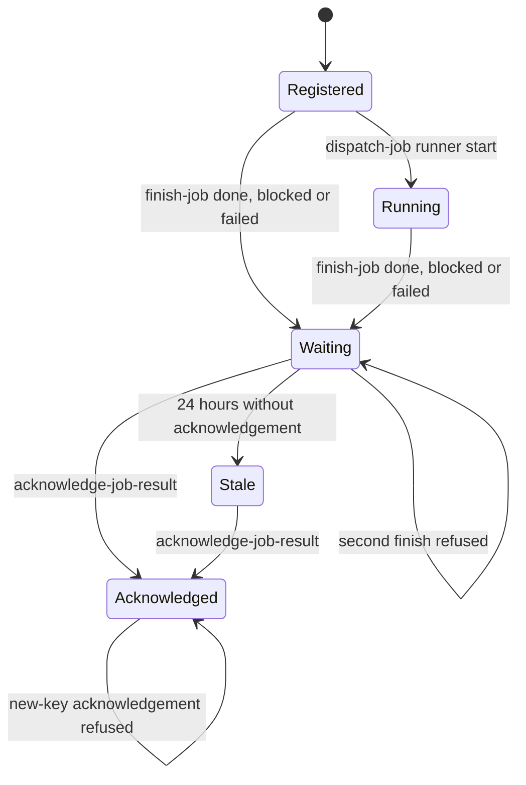

# Worker result lifecycle

A worker result belongs to an existing job Card. The existing `finished` JSON record owns immutable status, result, report reference, actor and timestamp. Its legacy `stage: closed` and `prs: []` satisfy the existing storage contract. Queue readers expose the worker fields as `finish`; live PR evidence continues to determine PR stages. No schema, table, service or local inbox is added.

Unknown Cards refuse both writes. Legacy PR finish records refuse worker replacement. Finished Cards refuse runner starts. A worker may finish a minted Card without a runner start because older dispatches did not consistently record their runner.

## System design

The work-queue module owns both commands and the projection. Existing transaction envelopes bind writes to principal and idempotency key; queue and row locks serialize competing finishes and acknowledgements. Replays return the original receipt. The event and result commit together. Reads never write or acknowledge. Acknowledgement records coordinator action, not proof of product delivery.

One indexed job lookup and update per command, plus the existing envelope and event writes. At current and 10x load, no new per-job external calls or N+1 query is introduced. The existing organization queue lock is the first write-throughput limit. Queue reads retain the existing bulk join and GitHub caching, paging, failure behavior and production enrichment. New result staleness is authoritative store data and remains available during GitHub failure. No new cache, async queue, external call, fan-out or retry loop is introduced. Transport retries reuse one UUID and payload. A transport failure leaves the report pending and must be surfaced, not retried indefinitely or reported as successful.

## Verification mapping

- Registered to Running uses existing runner adoption and concurrent-runner tests.
- Registered to Waiting, replay, second-finish refusal and acknowledgement transitions use `worker finish is durable, replayable exactly once, and acknowledged separately`.
- Running to Waiting and no start after finish use `a running worker finishes and a finished worker cannot restart`.
- Waiting to Stale, threshold and acknowledgement clearing use `worker finishes remain visible and become stale without GitHub until acknowledged`.
- Invalid outcome, unknown Card and unfinished acknowledgement use `worker finish refuses unknown cards, invalid outcomes and unfinished acknowledgements`.
- Competing finishes use `concurrent worker finishes preserve one immutable result`.

Production proof requires a real finished no-PR audit Card in `work-queue`, the preserved report reference and result, stale visibility after the threshold, and coordinator acknowledgement clearing it. Local tests use the registered tools and disposable PostgreSQL; no synthetic production records are written by this builder.
