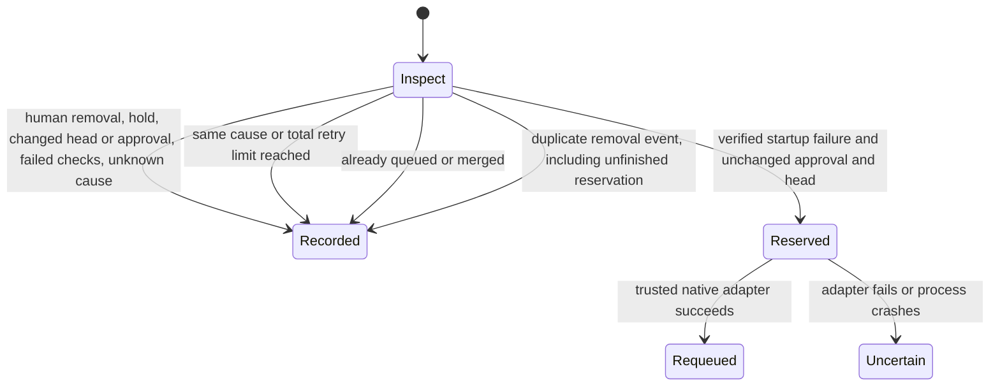

# Bounded merge queue recovery

Card: WR823.S16.J4

System design before code. This one-session slice owns recovery admission and a
local SQLite journal. GitHub owns dequeue events, CI execution, queue rebuilding
and merge execution. The S14 trusted adapter must own observation and the final
native match-head write. This module accepts callbacks at that seam and has no
credentials, GitHub client, worker scheduler or polling loop.

The data shape is an immutable Drop, an immutable current Observation, and a
journal keyed by repository, PR and native removal event ID. The journal also
counts attempts per source head and cause. Two retries per cause and two total
per source head are hard limits. Reapproval does not reset either budget.

Alternative designs were a workflow artifact ledger and SQLite. Artifact
retention and non-atomic read-modify-write cannot guarantee a retry cap. SQLite
transactions enforce reservation and deduplication in one coordinator-owned
journal. There is no distributed journal. Callers sharing authority must share
this journal; multiple hosts with separate journals are not supported.

A removal is transient only when GitHub reports failed_checks, the remover is
GitHub's queue actor, and a complete, nonempty collection of unsuccessful merge-group workflow
runs all concluded startup_failure. Cancellations, timeout, ordinary failure,
human removal and unknown reasons require coordinator diagnosis. Successful
checks do not change that classification. Each workflow run must be bound to the same
synthetic group SHA. The producer must bind the Drop head and approval ID to
its persisted enqueue observation; deriving those values after removal is unsafe.

The consumer must refresh the head, exact native approval ID, holds and queue
membership immediately before the callback writes. The callback must preserve
S14's independent current-head review, required-check and match-head checks.
No worker is authorized by this module to arm a PR. This slice deliberately has
no automatic event consumer until that trusted producer and adapter are installed.

At current load and 10x, each event has one observation and at most one native
write; an indexed transaction is constant work aside from the bounded check
collection. The first bottleneck is serialized SQLite write admission. No cache,
fan-out, queue or N+1 reads exist. Incomplete or unavailable evidence refuses.
SQLite errors stop before writes. An external write failure consumes its slot
and stops. A reserved event after a crash is uncertain and never replayed;
this favors bounded safety over automatic recovery after an ambiguous write.
Journal retention is coordinator-owned and must preserve active-head budgets.
Deleting the journal or losing its disk disables safe recovery.

## Transition tests

All tests are in the existing merge-queue-signal-selftest.py suite.

| Transition | Test |
| --- | --- |
| Inspect to Recorded, unsafe cause | test_unsafe_causes_never_arm |
| Inspect to Recorded, stale evidence or hold | test_changed_authority_never_arms |
| Inspect to Recorded, existing queue or merge | test_terminal_queue_state_never_arms |
| Inspect to Reserved to Requeued | test_transient_recovers_once |
| Inspect to Recorded, duplicate event | test_duplicate_delivery_does_not_repeat_write |
| Inspect to Recorded, retry limits | test_retry_budget_survives_restart_and_reapproval |
| Reserved to Uncertain | test_write_failure_is_not_retried |
| Reserved to Uncertain after crash | test_crash_reservation_is_not_replayed |
| Concurrent delivery to one reservation | test_concurrent_delivery_reserves_once |

Production proof remains blocked on the trusted S14 event integration. A proof
must observe a real dequeue's current-head and approval-bound recovery receipt,
then a third same-cause removal routed to diagnosis with no native write. Unit
fixtures prove policy only; they are not production evidence.

Additional refusal tests are test_adapter_refusal_is_not_success,
test_unavailable_evidence_never_writes and
test_invalid_identity_never_observes_or_writes. They cover callback refusal,
unavailable observations and invalid event identity before native writes.

Throughput checkpoint. Blocking first steps were the open-PR overlap check,
platform research and S14 interface inspection. Independent workstreams are n/a
because policy, journal and tests share one invariant. Shared mutable state is
one coordinator-owned SQLite database. The smallest safe decomposition is one
worker for this policy slice and a later trusted S14 integration after publication.

Codebase-design pass compared an artifact ledger with a transactional journal.
The chosen recover interface keeps reservation, caps and ambiguous-write handling
local. Zero-tech-debt pass found no existing recovery caller or legacy loop to
delete. This is an incomplete working slice, not installed automatic recovery.
