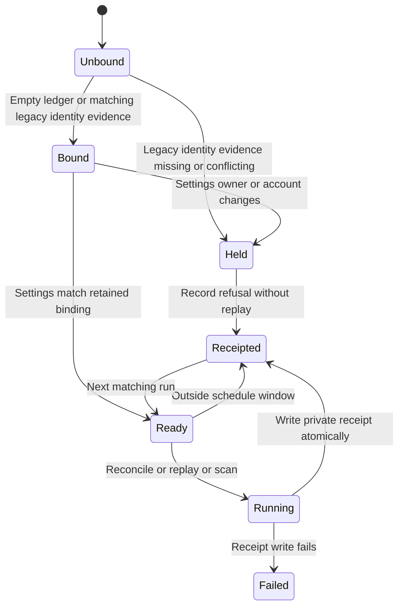

# Outlook ledger binding and normal receipts

The local lock covers binding, processing and receipt publication. An active-writer skip leaves its receipt untouched. Corrupt state or binding refuses processing. Folder keys can change while the canonical account stays fixed. The decoder re-verifies the new key.

Private binding.json retains schema outlook-ledger-binding/v1, mailbox_owner and mailbox_account. Existing state migrates only when both filing_account and account_binding match settings. Other legacy states require deployment reconciliation with original identity and retained request keys. Deleting state or binding is not recovery.

Private receipt-latest.json records runtime identity, timestamp, configured owner/account, folder key, binding digest, binding verification and decoder account verification. Local verification does not establish authenticated authority. Deployment preflight and server checks establish that separately. Monitoring retains only validated owner, digests, booleans, timestamp, runtime identity, counts and outcome.

Tests exercise admission and failure transitions through run and the collector CLI. This is a design chart, not a TLC proof. Transport and decoder internals are unchanged.
