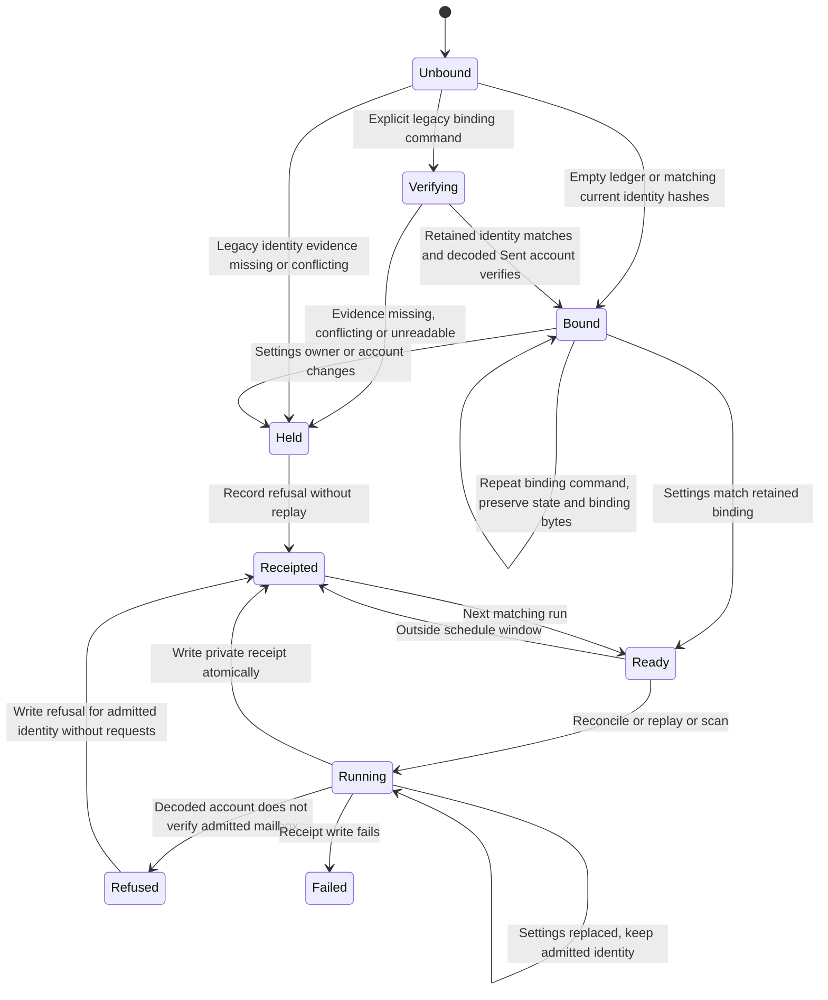

# Outlook ledger binding and normal receipts

The local lock covers binding, processing and receipt publication. An active-writer skip leaves its receipt untouched. Corrupt state or binding refuses processing. Folder keys can change while the canonical account stays fixed. The decoder re-verifies the new key.

Private binding.json retains schema outlook-ledger-binding/v1, mailbox_owner and mailbox_account. Existing state migrates only when both filing_account and account_binding match settings. Pre-binding states use the explicit `bin/reconcile-outlook-ledger-binding.py` deployment command. It requires retained request keys to equal payload idempotency keys, a retained owner witness matching settings, and a retained email account witness matching settings. Every retained email request must identify that account through email_identity or email_context sender/recipients. Explicit owner/account fields and any retained identity hashes must agree. It verifies the configured folder account against decoded Sent evidence under the intake lock before writing binding.json atomically. It never rewrites state or replays requests. Missing or conflicting evidence holds the ledger. Repeating the command on a matching bound ledger does not decode or rewrite either file. The installer does not invoke this command automatically. Deleting state or binding is not recovery.

Private receipt-latest.json records runtime identity, timestamp, configured owner/account, folder key, binding digest, binding verification and decoder account verification. Local verification does not establish authenticated authority. Deployment preflight and server checks establish that separately. Monitoring retains only validated owner, digests, booleans, timestamp, runtime identity, counts and outcome.

Tests exercise admission and failure transitions through run and the collector CLI. This is a design chart, not a TLC proof. The frozen OutlookSettings value admitted under the lock is the transaction context for source selection, schedule checks, copy helper, census, decoder, processing, requests and receipts. Production transport and decoder closures capture that same value before run. No step reloads identity during the transaction. A settings replacement takes effect on the next run, where a different owner or canonical account refuses before replay.

The settings-change tests replace the synthetic file immediately after successful binding, in both partner directions. Foreign Sent evidence refuses before requests are persisted or sent. An owner-only replacement retains the admitted identity in requests and receipts. The next run refuses the changed owner. A separate test exhausts the settings loader after the first read, including a census request, and exercises processing without another read. Transport and decoder tests verify the captured settings at invocation. This chart does not model filesystem tampering or authenticated server authority.

## Legacy reconciliation transition coverage

| Transition | Intake selftest |
| --- | --- |
| Unbound to Verifying to Bound, then normal reconciliation and retirement | test_prebinding_legacy_reconciliation_preserves_state_and_retires_actions |
| Verifying to Held on missing or conflicting retained evidence | test_prebinding_reconciliation_refuses_missing_or_conflicting_evidence |
| Verifying to Held on foreign decoded account | test_prebinding_reconciliation_refuses_foreign_decoded_account |
| Corrupt ledger or active writer refuses binding | test_prebinding_reconciliation_refuses_corrupt_state_and_active_writer |
| Failed binding publication retries without state loss | test_prebinding_reconciliation_binding_write_failure_retries_without_state_loss |
| Bound to Bound, or Held on changed settings or corrupt binding | test_prebinding_reconciliation_preserves_existing_binding_and_refuses_changes |

The command shares normal run's lock and receipt writer. It leaves `account_verified` false for pre-binding state until a later normal run saves the account hash and folder key.
