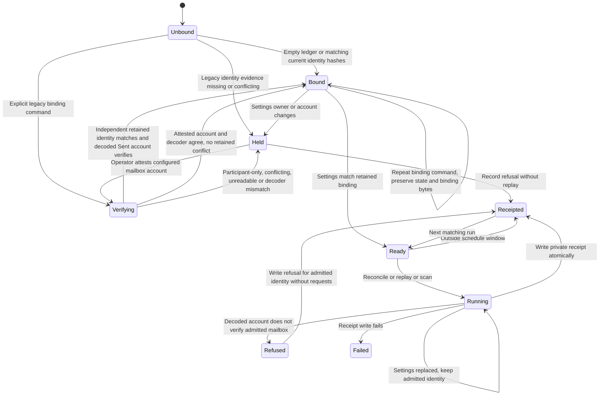

# Outlook ledger binding and normal receipts

The local lock covers binding, processing and receipt publication. An active-writer skip leaves its receipt untouched. Corrupt state or binding refuses processing. Folder keys can change while the canonical account stays fixed. The decoder re-verifies the new key.

Private binding.json retains schema outlook-ledger-binding/v1, mailbox_owner and mailbox_account. Existing state migrates only when both filing_account and account_binding match settings. Pre-binding states use the explicit `bin/reconcile-outlook-ledger-binding.py` deployment command. It requires retained request keys to equal payload idempotency keys and a retained owner witness matching settings. Independent account evidence consists of explicit account/mailbox_account fields in the request, email_source or email_identity, or retained account_binding/filing_account hashes matching settings. Message sender and recipients are participation evidence only. Folder numbers and message IDs alone do not prove a mailbox. Participant-only requests hold with ledger_binding_evidence_insufficient. Every explicit retained owner/account/hash must agree; attestation never overrides conflicts.

For a ledger without independent account evidence, the operator can supply the single `--attest-mailbox ACCOUNT` flag on the same command. ACCOUNT must exactly equal the configured mailbox account. Under the same intake lock, the current decoder must verify the configured folder account against decoded Sent evidence in the private snapshot. Only then does atomic binding publication record `provenance: operator_attested` alongside the identity. The operator asserts the historical ledger association; the decoder verifies the current snapshot, not the ledger's historical provenance. Attestation is never inferred from participants and the installer never supplies it automatically.

The command never replays requests. With a separate verification decoder, it decodes the same snapshot with the installed legacy decoder and saves its original Message-ID mapping before publishing binding.json. That update preserves all retained request keys and payloads. A retry resumes from the saved mapping if publication failed. Without a separate decoder, binding leaves state bytes unchanged. Repeating on a matching binding does not decode or rewrite either file. Normal runs accept the exact attested identity plus its known provenance; existing bindings without provenance retain their existing bytes and behavior. Deleting state or binding is not recovery.

| Recovery transition | Test in ops/outlook-intake-selftest.py |
| --- | --- |
| Participant-only verification to Held for both possible mailboxes | test_prebinding_participants_cannot_bind_two_mailboxes |
| Held to attested verification to Bound; Bound to Bound; normal admission | test_prebinding_attestation_binds_once_and_normal_run_preserves_binding |
| Attested verification to Held for retained conflict, wrong flag or decoder mismatch | test_prebinding_attestation_refuses_retained_and_decoder_conflicts |
| Independent retained evidence to Bound; following reconciliation and retirement | test_prebinding_legacy_reconciliation_preserves_state_and_retires_actions |
| CLI attested success and refusal; preserve original IDs | test_prebinding_cli_binds_or_refuses_without_replaying |
| Publication failure and retry without request loss | test_prebinding_original_id_decode_failure_and_binding_retry_keep_requests |
| Existing bound identity and bytes unchanged | test_prebinding_reconciliation_preserves_existing_binding_and_refuses_changes |

Private receipt-latest.json records runtime identity, timestamp, configured owner/account, folder key, binding digest, binding verification and decoder account verification. Local verification does not establish authenticated authority. Deployment preflight and server checks establish that separately. Monitoring retains only validated owner, digests, booleans, timestamp, runtime identity, counts and outcome.

Tests exercise admission and failure transitions through run and the collector CLI. This is a design chart, not a TLC proof. The frozen OutlookSettings value admitted under the lock is the transaction context for source selection, schedule checks, copy helper, census, decoder, processing, requests and receipts. Production transport and decoder closures capture that same value before run. No step reloads identity during the transaction. A settings replacement takes effect on the next run, where a different owner or canonical account refuses before replay.

The settings-change tests replace the synthetic file immediately after successful binding, in both partner directions. Foreign Sent evidence refuses before requests are persisted or sent. An owner-only replacement retains the admitted identity in requests and receipts. The next run refuses the changed owner. A separate test exhausts the settings loader after the first read, including a census request, and exercises processing without another read. Transport and decoder tests verify the captured settings at invocation. This chart does not model filesystem tampering or authenticated server authority.

## Legacy reconciliation transition coverage

| Transition | Intake selftest |
| --- | --- |
| Unbound to Verifying to Bound, then normal reconciliation and retirement | test_prebinding_legacy_reconciliation_preserves_state_and_retires_actions |
| Verifying to Held on missing or conflicting retained evidence | test_prebinding_reconciliation_refuses_missing_or_conflicting_evidence |
| Verifying to Held on foreign decoded account | test_prebinding_reconciliation_refuses_foreign_decoded_account |
| Corrupt ledger or active writer refuses binding | test_prebinding_reconciliation_refuses_corrupt_state_and_active_writer |
| Separate verification decoder saves original IDs from an old decoder without ownership columns | test_prebinding_separate_decoder_saves_original_ids_before_upgrade |
| Failed binding publication retries without state loss | test_prebinding_reconciliation_binding_write_failure_retries_without_state_loss |
| Bound to Bound, or Held on changed settings or corrupt binding | test_prebinding_reconciliation_preserves_existing_binding_and_refuses_changes |

The command shares normal run's lock and receipt writer. It leaves `account_verified` false for pre-binding state until a later normal run saves the account hash and folder key.
