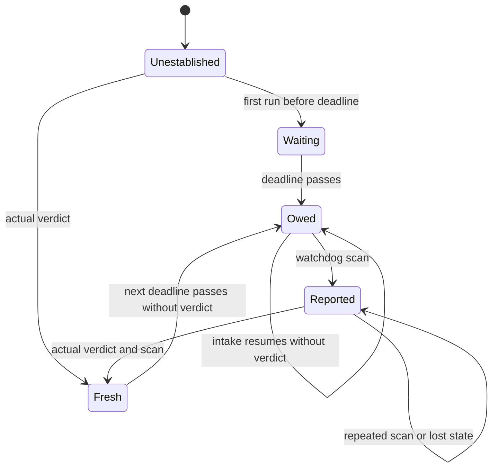

# Outlook verdict watchdog

The watchdog tracks a daily obligation and reconciles one finding. A resumed
intake run does not itself constitute a verdict.

Each edge is exercised by `tools/test_job_watchdog.py` in `WatchdogTests`.
The chart separates an owed verdict from its recorded finding; the detector
computes the former and reconciliation records the latter.

| Transition | Test |
| --- | --- |
| Initial, first run before deadline, first verdict | `test_verdict_legacy_first_install_and_invalid_days` |
| Waiting or fresh to owed at deadline | `test_verdict_deadline_and_calendar_days`, `test_verdict_legacy_first_install_and_invalid_days` |
| Owed after resumed run, scan to reported, repeated scan, actual verdict and scan | `test_resumed_intake_keeps_owed_verdict_until_actual_verdict` |
| Reported through lost state and later actual verdict | `test_local_missed_verdict_survives_transport_failure_and_recovers` |

The diagram abstracts invalid dates, timezone and deadline calculation, other
alarms, delivery, and simultaneous changes to the input files. Those behaviors
are covered separately in the watchdog suite. It is an explanatory chart, not
an exhaustively checked formal model.
