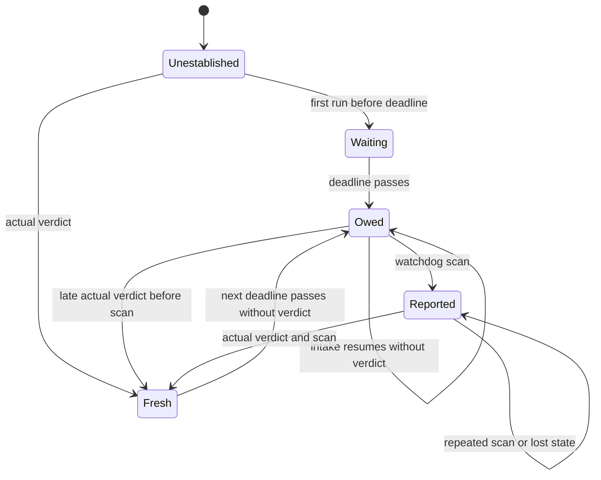

# Outlook verdict watchdog

The watchdog tracks a daily obligation and reconciles one finding. A resumed
intake run does not itself constitute a verdict.

Each edge is exercised by `tools/test_job_watchdog.py` in `WatchdogTests`.
The chart separates an owed verdict from its recorded finding; the detector
computes the former and reconciliation records the latter.

| Transition | Named test in `WatchdogTests` |
| --- | --- |
| Initial to unestablished | `test_first_run_waits_until_deadline_and_late_verdict_recovers_before_scan` |
| Unestablished to waiting | `test_first_run_waits_until_deadline_and_late_verdict_recovers_before_scan` |
| Unestablished to fresh | `test_first_actual_verdict_establishes_freshness_until_next_deadline` |
| Waiting to owed | `test_first_run_waits_until_deadline_and_late_verdict_recovers_before_scan` |
| Fresh to owed | `test_first_actual_verdict_establishes_freshness_until_next_deadline` |
| Owed to owed after resumed intake | `test_resumed_intake_keeps_owed_verdict_until_actual_verdict` |
| Owed to fresh before a scan | `test_first_run_waits_until_deadline_and_late_verdict_recovers_before_scan` |
| Owed to reported on scan | `test_resumed_intake_keeps_owed_verdict_until_actual_verdict` |
| Reported to reported on repeated scan | `test_resumed_intake_keeps_owed_verdict_until_actual_verdict` |
| Reported to reported through lost state | `test_local_missed_verdict_survives_transport_failure_and_recovers` |
| Reported to fresh after actual verdict and scan | `test_resumed_intake_keeps_owed_verdict_until_actual_verdict`, `test_local_missed_verdict_survives_transport_failure_and_recovers` |

The diagram abstracts invalid dates, timezone and deadline calculation, other
alarms, delivery, and simultaneous changes to the input files. Those behaviors
are covered separately in the watchdog suite. It is an explanatory chart, not
an exhaustively checked formal model.
