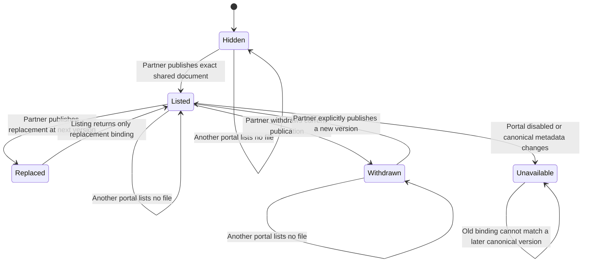

# Immutable portal file publication binding

This is a proposed design, not an implemented or deployed file contract.
WR227.S17.J7 is blocked on the S4 publication and deliverable producers landing on main.
The source candidate is `541e47ffce83bbd6cb591545417be0dd91a3ea0c`.
Its publication module and migrations `1145_deal_deliverables.sql` and
`1146_client_publications.sql` are absent from inspected main
`f26f8b19e86faa038d7fe64898131444f37b06ed`.
The candidate has no associated GitHub PR at this observation.
Do not copy its migrations or create a second publication decision here.

## System design

The data shape is one append-only binding per publication ID and publication version.
The binding stores the portal slug, canonical document ID and version, SHA-256,
byte count, MIME type, and filename. `material_id` denotes S4's UUID publication ID.
It does not denote the legacy bigint `ops.client_portal_material.id`.
`document_version` distinguishes the source version from `publication_version`.
The candidate's `ops.deal_deliverable` owns file metadata and storage identity.
Its integer version also changes with visibility. Integration must retain this
strict version check and must never silently rebind a publication after sharing changes.
The attachment metadata view on current main supplies no finalized/shared lifecycle
and cannot replace this producer.

The existing explicit publication command remains the only visibility decision.
Its transaction validates same-deal finalized/shared metadata and the expected
canonical version/hash before appending a binding. Caller-supplied metadata must
match the canonical row exactly. A wrong hash or version must write nothing.
The listing reads only a current published row joined to that exact binding and
current canonical metadata after live portal/session authorization.
No storage key, source URL, credential, release token, or download route belongs
in the public metadata contract.

At the candidate's limits, one portal exposes at most 100 publications and retains
at most 1,000 publication identities. These are source limits, not measured load.
At ten times that demand, refuse at the same limits rather than enlarge a response.
Version history is the first unbounded storage dimension. Measure it before adding
retention because deleting bindings would remove audit evidence.
Use an indexed publication/version key and one bounded joined listing query.
There is no per-file query loop and no N+1 storage read.
Spread load by portal and serialize writes for the same publication using the
existing publication transaction lock and optimistic base version.

Consistency is strict for session, portal, publication, binding, and canonical
metadata. No cache exists, so invalidation and eviction are not applicable.
Withdrawal, disablement, or a source version change removes the file immediately
from subsequent reads. Refuse on database failure, with no stale fallback.
The later byte-release owner must recheck authority after its bounded storage read.
This unit introduces no external HTTP calls, queue, producer retry, or fan-out.
External-call circuit breakers are therefore not applicable here. The database
adapter must use its existing bounded connection concurrency and finite timeout.
No retries occur inside the binding transaction. The existing command envelope's
idempotency key replays the original receipt. Reusing that key with changed input
must refuse. A replay never republishes a withdrawn or replaced version.

## Design alternatives

A separate file visibility table would let publication and file access disagree.
Reject it. Extend the existing publication transaction with an append-only exact
version binding instead. This keeps withdrawal and replacement in one authority.
A mutable file pointer on the publication row would lose the byte identity of
previous receipts. Reject it in favor of immutable history.

## Statechart

This chart specifies required behavior. It does not claim executed transitions.

Never release a binding without current publication and session authority.
Never mutate or delete an existing version binding.
Never make an earlier version current through withdrawal or replay.

## Verification checkpoint

Blocking first steps are landing the S4 producers and reconciling their migration
slots with the existing session projection. Current main already uses `1145` and
`1146` for other migrations. Allocate a fresh number above main and every open PR.
Independent work consists of this proposed contract and design, which do not
change runtime behavior. Shared publication files serialize with S19 and S20.
One worker owns the eventual transaction and its real PostgreSQL tests because
splitting that invariant across workers would hide races.

The first failing PostgreSQL tests must exercise the real publication command
with wrong canonical hash and version and assert no releaseable binding exists.
Then cover every chart transition, exact metadata mismatch, cross-deal documents,
nonfinalized/private documents, duplicate replay after withdrawal and replacement,
concurrent writers at one base version, immutable history, portal disablement,
canonical version change, cross-portal listing, metadata allowlisting, and caps.
Use synthetic fixtures and the existing disposable PostgreSQL helper.
Schema validation alone cannot prove these properties.

No transaction implementation or PostgreSQL acceptance is included in this partial
branch. The JSON contract is proposed for downstream owners, not live authority.
AI behavior evals do not apply because this design changes no AI output.

## Production proof

After integrated deployment, the coordinator runs a read-only proof for an already
shared material. Its listing must equal the canonical ID, version, hash, and size.
An already withdrawn material and a wrong-portal material must be absent and
inaccessible. No real material is shared or withdrawn to manufacture this proof.
The unit remains landed-unproven until the exact observation passes.
A release-identity smoke check alone cannot prove this predicate.
